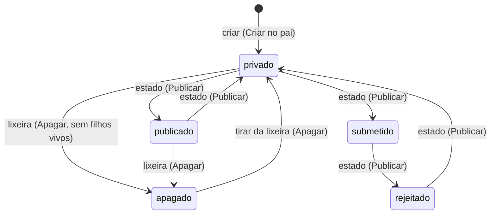

# ADR 0012 — Administração pelo navegador

Status: aceito e implementado em parte (2026-11-01, fase 5a: painel com os sites, navegação na árvore e edição de título e descrição; fase 5c: tipos de conteúdo, §6; fase 5b: criar, editar todas as propriedades, estado e datas, mover, lixeira, histórico com restaurar e lista com ordem e filtros, §7). fase 5d: contas e domínios, §8; fase 5e: redirecionamentos e peles, §9; fase 5g: integridade no repositório, HTML limpo, publicação agendada e mover pela árvore, §10 e §11). Ficam para as próximas fatias: mais do editor de peles (veja §9). Complementa o [ADR 0011](0011-autenticacao-sessao-permissoes.md) (sessão, CSRF e permissões) e detalha a parte de administração do [fluxo 5](../fluxos/05-conteudo-workflow.md).

## Contexto

Até a fase 4 o conteúdo só se gerencia pela linha de comando e por código. A administração precisa existir sem repetir os erros do PBL3: ação decidida por texto da requisição, ausência de CSRF e telas que só **escondiam** o botão de quem não podia agir. O produto roda em hospedagem comum, então a administração não pode depender de etapa de build, de JavaScript obrigatório nem de serviço extra.

## Decisão

### 1. Onde mora
- Todas as rotas ficam sob **`/_pbl/`**, o prefixo reservado do ADR 0011 (o `_` nunca é válido em URL de conteúdo).
- Rotas desta fatia:

| Método e rota | O que faz | Ação exigida |
|---|---|---|
| `GET /_pbl/` | painel inicial: sites e seções que a pessoa pode ver | sessão |
| `GET /_pbl/objeto/{id}` | um conteúdo, as ações que a pessoa pode fazer e a lista dos filhos (paginada, com ordem e filtros por classe e estado) | `Acao::Ver` no objeto |
| `GET`/`POST /_pbl/objeto/{id}/editar` | título, descrição, endereço, peso e as propriedades da classe (5a: só título e descrição) | `Acao::Editar` no objeto |
| `GET`/`POST /_pbl/objeto/{id}/novo` | escolher a classe (`?classe=`) e criar um filho | `Permissoes::podeCriarSob` (`Acao::Criar` no pai) |
| `GET`/`POST /_pbl/objeto/{id}/estado` | estado e datas de publicação e de validade | `Acao::Publicar` |
| `GET`/`POST /_pbl/objeto/{id}/mover` | mudar de pai, com a subárvore | `Acao::Apagar` no objeto + `Acao::Criar` no destino |
| `GET`/`POST /_pbl/objeto/{id}/apagar` | confirmação e envio para a lixeira | `Acao::Apagar` |
| `POST /_pbl/objeto/{id}/recuperar` | tirar da lixeira | `Acao::Apagar` |
| `GET /_pbl/objeto/{id}/versoes` | histórico de versões | `Acao::Ver` |
| `POST /_pbl/objeto/{id}/restaurar` | restaurar uma versão | `Acao::Editar` |
| `GET /_pbl/classes` | lista dos tipos de conteúdo (contagem de uso só para quem modela) | sessão |
| `GET`/`POST /_pbl/classes/nova` | criar tipo de conteúdo | `Permissoes::podeModelarClasses` (+ CSRF + origem no POST) |
| `GET`/`POST /_pbl/classe/{id}/editar` | descrição, filhos aceitos e campos | idem |
| `GET`/`POST /_pbl/classe/{id}/apagar` | confirmar e apagar tipo sem uso | idem |

- Todo POST exige CSRF + origem antes de qualquer outra coisa.
- O `{id}` é validado por expressão sem ambiguidade (`[1-9][0-9]{0,9}`, ancorada) antes de virar inteiro; em `/_pbl/objeto/{id}/…` a sub-rota precisa estar numa lista fixa para aquele método (`TelasDeObjetos::atende`), conferida **antes** da sessão: o resto é 404 para todos.

### 2. HTML no servidor, sem JavaScript
- Cada tela é HTML montado em PHP (`Pbl\Admin\Pagina`), com formulários comuns (`GET` para ler, `POST` para gravar) e o padrão **POST → 303 → GET** depois de salvar.
- **Toda saída é escapada** (`Pagina::h`, `htmlspecialchars` com `ENT_QUOTES | ENT_SUBSTITUTE`). Título, descrição, nome de classe, de site e de pessoa nunca vão crus para a página.
- Todas as respostas passam por `Pagina::protegida()`: `no-store`, CSP `default-src 'none'; style-src 'self'; img-src 'self' data:; form-action 'self'; base-uri 'none'; frame-ancestors 'none'`, `X-Frame-Options: DENY`, `nosniff`, `Referrer-Policy`, HSTS em HTTPS. **Nenhum estilo nem script inline**; sem JavaScript, a CSP não libera `script-src`. O `img-src data:` existe só porque o CSS do Bootstrap desenha alguns ícones de formulário como SVG embutido.
- HTML semântico: atalho "pular para o conteúdo", navegação em `<nav>` dentro de `<header>`, conteúdo em `<main>`, `<label for>` em todo campo, `<th scope>` nas tabelas, alertas com `role="alert"`/`role="status"`.

### 2.1. Visual: Bootstrap 5 local (decidido)
- **Bootstrap 5.3.8** (a última 5.3.x estável), **só o CSS**, servido do próprio site em `public/_pbl/assets/bootstrap-5.3.8/`. Sem CDN (a administração não depende de terceiros no ar nem vaza a visita), sem etapa de build e sem Node: o arquivo é copiado sem alteração da release oficial do npm.
- Procedência e integridade: versão, origem e SHA-256 em `public/_pbl/assets/PROVENIENCIA.md`, conferidos por teste (`tests/AssetsAdminTest.php`). Licença MIT do Bootstrap ao lado do arquivo e listada em [Licenças de terceiros](../tecnica/terceiros.md).
- O `bootstrap.bundle.js` **não** é usado: nenhuma tela desta fatia precisa de componente com JavaScript (a barra de navegação não recolhe). Se um dia for necessário, entra pelo mesmo caminho e a CSP ganha `script-src 'self'`, nunca `unsafe-inline`.
- Ajustes próprios num único arquivo, `public/_pbl/assets/pbl.css` (sem `@import` nem `url()` de fora).
- Os arquivos ficam **dentro** do prefixo reservado `/_pbl/`, mas são arquivos de verdade em `public/`: o Apache (`RewriteCond %{REQUEST_FILENAME} !-f`), o nginx de referência (`try_files $uri`) e o servidor embutido do PHP (em desenvolvimento) os entregam direto, sem passar pelo `index.php`. O que não existe cai no `Painel` e recebe 404, como qualquer rota desconhecida da administração. Trocar de versão é criar uma pasta nova (`bootstrap-5.3.9/`), o que também resolve cache de navegador.

### 3. Permissão em toda rota
- Cada rota escolhe a ação no código (`Acao::Ver`, `Acao::Editar`…) e chama **`Permissoes::pode`** antes de ler ou gravar. Esconder o botão é só conforto: a rota recusa sozinha.
- Sem sessão: `303` para `/_pbl/entrar` (também no POST, que não grava nada).
- Sem permissão **ou objeto inexistente**: a mesma resposta `403`, para não revelar quais ids existem a quem não pode vê-los.
- A lista de filhos não verifica permissão por filho: o perfil vale para a subárvore inteira (ADR 0011), então quem vê o pai vê os filhos. O caminho de navegação (migalhas) mostra só os ancestrais que a pessoa pode ver.
- O painel inicial mostra ao administrador global todos os sites (entrando pela raiz) e aos demais só as seções onde receberam um papel (e não as que já estão dentro de outra seção dele).

### 4. Gravação
- Todo POST confere, **antes de qualquer outra coisa**, a origem (`Rede::origemConfere`) e o token CSRF da sessão (`Csrf::conferirSessao`). Falhou: `403` e nada é gravado.
- Os campos chegam como texto (valor não textual é recusado), em UTF-8 válido, sem caracteres de controle (a descrição aceita quebra de linha), com teto de tamanho (título 300, descrição 2000) e título obrigatório. Erro de validação: `422` com o formulário de novo.
- A gravação usa **só** `ObjetoRepositorio::atualizar` (sem SQL novo), com a **versão esperada** que veio no formulário. Se outra pessoa salvou antes, `ConflitoDeVersao` vira `409` com o formulário mostrando o valor atual e o texto que a pessoa tentou salvar; salvar de novo é uma decisão consciente.
- Se nada mudou, nada é gravado (nenhuma versão nova).
- Depois de salvar, o `Publicador` regrava a página do objeto e a do pai (onde o título costuma aparecer em listas), se estiverem visíveis. Falha ao republicar não desfaz a edição: a tela avisa para publicar o site de novo. Outras páginas que citam o título (menus em outras seções) só mudam na próxima publicação do site.

### 5. Auditoria
- `ObjetoRepositorio::atualizar` já registra `objeto.atualizar` com **os nomes** dos campos alterados e a versão, nunca o conteúdo. A administração passa um motivo fixo (`administracao`), nunca texto digitado.
- Tentativa de editar sem permissão (com CSRF válido) registra `objeto.editar.negado` com o id do objeto, sem conteúdo.

### 6. Tipos de conteúdo (fase 5c)
- **Quem**: classes valem para a instalação inteira e mudam o que todas as seções podem guardar, por isso só o administrador global modela tipos (`Permissoes::podeModelarClasses`, novo, conferido em toda rota menos a lista). Os demais veem só a lista, sem a contagem de uso (que cruza sites). Para quem não modela, tipo inexistente e sem permissão dão o mesmo 403.
- **O que se guarda**: na classe, `descricao`, `aceita_filhos` e `filhas` (nomes; vazia = qualquer tipo) e `versao` (migração 9, só colunas novas com padrão que mantém o comportamento de hoje); em cada propriedade, além de `nome`, `tipo`, `indexavel` e `classe`, os opcionais `rotulo`, `obrigatorio` e `arquivada`, gravados só quando têm valor (o JSON das classes antigas não muda). A ordem dos campos é a ordem da lista. Não existe valor padrão no modelo, então a tela não oferece.
- **Nome técnico não muda** (nem da classe nem do campo): é o que moldes, referências e listas de filhas usam.
- **Nenhum dado se perde**: o uso de cada campo é contado em PHP sobre o JSON dos objetos e das versões (igual em qualquer banco). Campo com valor, hoje ou em versão antiga, não pode ser removido nem mudar de tipo, classe apontada ou indexação: a tela recusa (422) explicando e oferece **arquivar**. Arquivar um campo com valores hoje passa por uma tela de confirmação com a contagem; o valor continua no objeto, a validação continua aceitando, os moldes continuam lendo e restaurar versões antigas continua funcionando. O `ClasseRepositorio::atualizar` repete a regra, então nem um formulário forjado nem outro chamador conseguem destruir dados.
- **Apagar** só sem nenhum objeto (em qualquer estado, inclusive `apagado`) e sem outra classe que dependa dela (referência restrita a ela ou lista de filhas); o bloqueio é explicado na tela e repetido no repositório.
- **Edição simultânea**: `UPDATE ... WHERE versao = ?`; versão diferente dá 409 sem gravar e mostra o que está salvo (o que a pessoa digitou não é reaproveitado, porque pode não caber mais na classe atual).
- **Auditoria**: `classe.criar`, `classe.atualizar` (nomes do que mudou, como `propriedade.resumo.rotulo`, `ordem`, `descricao`), `classe.apagar` e `classe.negado`; nunca o texto de rótulos ou descrições.
- **Fora desta fatia**: exigir `obrigatorio` e `filhas` ao salvar ou mover um objeto (feito nas telas de objetos, fase 5b, §7, e no `ObjetoRepositorio`, fase 5g, §10); mudar a indexação de um campo com valores (precisa reindexar).

### 7. Conteúdo (fase 5b)
- **Arquivo próprio**: as telas de um conteúdo ficam em `TelasDeObjetos`; `TelasDeConteudo` ficou só com o painel inicial. O `Painel` só registra as rotas.
- **Lista de filhos**: ordens fixas (peso e título; título; alterados por último; data de publicação), filtro por classe (só ids de classes existentes) e por estado; sem filtro, a lixeira fica de fora. Valor desconhecido na URL é ignorado. Nada da URL chega ao SQL: as ordens e filtros vão como `Consulta` para o `MotorDeConsulta`, que passou a aceitar `status` como coluna.
- **Criar**: a pessoa escolhe a classe entre as que o tipo do pai aceita (`aceita_filhos` e `filhas` da fase 5c, §6; conferido também no POST, 422 se forjado) e preenche título, descrição, endereço (vazio = gerado do título, com `-2`, `-3`… se já usado), peso e as propriedades. O conteúdo **nasce sempre `privado`**, com `criado_por` = a pessoa; ir ao ar é a tela de estado, com outra permissão.
- **Campos por tipo** (os de `ClasseRepositorio::TIPOS`, nenhum inventado): `texto` (área de texto, até 10 000), `html` (área de texto, até 200 000, guardado como veio e mostrado **como texto** na administração), `numero` (inteiro ou decimal, aceita vírgula), `data` (`aaaa-mm-dd`, com hora opcional), `booleano` (Sim / Não / sem valor) e `ref` (número de outro conteúdo **do mesmo site que a pessoa pode ver**, da classe exigida, se houver; a mesma mensagem para "não existe", "outro site" e "sem permissão"; uma referência já gravada continua valendo ao salvar outros campos). Campo vazio = sem valor (a propriedade sai dos dados), a não ser que seja **obrigatório** (422). O rótulo vem da classe (`Classe::rotuloDe`). Campo **arquivado** não aparece no formulário e não é tocado na gravação, mesmo que um formulário forjado o envie: o valor guardado continua. Na edição, campo que nem veio no pedido mantém o valor atual. Toda validação acontece no servidor, com a mensagem ao lado do campo (`aria-invalid`, `aria-describedby`); o repositório valida de novo.
- **Endereço**: só letras minúsculas, números, hífen e `/`; recusado se já é de outro conteúdo ou se hoje redireciona para outro (`urlDisponivel`, sem "liberar de propósito" pela tela). A página inicial do site não troca de endereço. Ao trocar, a página no endereço antigo sai do cache na hora e o antigo passa a responder 301.
- **Estado e datas** (`Acao::Publicar`): `privado`, `submetido`, `rejeitado` ou `publicado` (o fluxo de submeter e revisar, com fila e avisos, fica para a fase 6), mais publicação e validade digitadas em **horário de Brasília** e gravadas em UTC (ISO 8601). Publicar regrava a página; tirar do ar (ou validade vencida) tira a página do cache. Publicação com data futura avisa que a página só entra no ar na próxima publicação do site depois da data.
- **Mover** (`Acao::Apagar` no objeto e `Acao::Criar` no destino): destino escolhido navegando pela árvore (§11; antes era o número digitado), no mesmo site, fora da lixeira, fora da própria subárvore e de um tipo que aceite o tipo do objeto; a página inicial não se move; versão esperada também aqui. O endereço não muda; o objeto, o pai antigo e o novo são regravados.
- **Lixeira** (`Acao::Apagar`): o repositório não tem apagar definitivo, então "apagar" é o estado `apagado`, com tela de confirmação. A página sai do cache na hora. Não vai para a lixeira a página inicial nem quem tem filhos fora da lixeira (é preciso mover ou mandar antes). Na lixeira, o conteúdo não se edita, não muda de estado, não se move e não recebe filhos; **tirar da lixeira** o devolve como `privado` (e exige que o pai não esteja na lixeira). A auditoria registra a troca de estado (`objeto.estado`, de/para).
- **Corrida com a lixeira**: a regra "nada fora da lixeira dentro de algo na lixeira" é conferida **dentro da transação** que grava (`ObjetoRepositorio::criarDentro`, `mandarParaLixeira`, `tirarDaLixeira` e `mover(..., destinoForaDaLixeira: true)`), com a linha do pai travada por um `UPDATE` que não muda nada (bloqueio de linha no MySQL/PostgreSQL, de escrita no SQLite), então criar, mover, tirar da lixeira e mandar o pai para a lixeira ficam um depois do outro (`ConflitoDeArvore` → 409). Como defesa em profundidade, a tela reconfere depois de gravar e, se a regra quebrou mesmo assim, desfaz (o filho criado vai para a lixeira, o objeto movido volta, o estado anterior volta) e responde 409.
- **Histórico**: lista as versões (até as 200 mais novas) com quando (Brasília), quem, título, estado e motivo; restaurar (`Acao::Editar`) usa `ObjetoRepositorio::restaurar` com versão esperada e **sem mexer no estado nem nas datas** (restaurar o texto não pode publicar nem tirar do ar: isso é `Acao::Publicar`). Se o endereço daquela versão já é de outro conteúdo, ou os campos da classe mudaram, a tela explica e nada muda.
- **Edição simultânea**: `ConflitoDeVersao` vira 409 em editar (com o que a pessoa digitou e o que está salvo), estado, mover, lixeira e restaurar; nada é sobrescrito.
- **Auditoria**: tentativas sem permissão com CSRF válido registram `objeto.criar.negado`, `objeto.editar.negado`, `objeto.estado.negado`, `objeto.mover.negado`, `objeto.apagar.negado`, `objeto.recuperar.negado` e `objeto.restaurar.negado`, só com ids. O que é gravado continua registrado pelo repositório só com nomes de campo e motivo fixo.

(Qualquer estado da lista vai para qualquer outro pela tela de estado; o diagrama mostra os caminhos usuais.)

### 8. Contas e domínios (fase 5d)
- **Rotas** (arquivos `TelasDeContas` e `TelasDeDominios`; o `Painel` só as registra; peças comuns no trait `AuxiliaresDeTela`):

| Método e rota | O que faz | Quem |
|---|---|---|
| `GET /_pbl/contas` | lista de contas | `Permissoes::podeAdministrarContas` |
| `GET`/`POST /_pbl/contas/nova` | criar conta (login, nome, e-mail, senha duas vezes, marca de administrador) | idem |
| `GET /_pbl/conta/{id}` | a conta: dados, senha, situação e papéis | idem |
| `POST /_pbl/conta/{id}/editar` | nome, e-mail e marca de administrador | idem |
| `POST /_pbl/conta/{id}/senha` | redefinir senha | idem |
| `POST /_pbl/conta/{id}/desativar` e `/reativar` | situação | idem |
| `POST /_pbl/conta/{id}/conceder` e `/revogar` | papel (leitor, autor, editor) numa seção, pelo número | idem |
| `GET /_pbl/site/{id}/dominios` | domínios do site | `Permissoes::podeAdministrarSite` |
| `POST /_pbl/site/{id}/dominios/adicionar`, `/principal`, `/modo`, `/remover` | alias ou redirecionador novo; trocar o principal; alias ⇄ redirecionador; remover | idem |

- **Permissão**: contas valem para a instalação inteira, então só o administrador global (`podeAdministrarContas`, novo). Domínios exigem `Acao::Administrar` na página inicial do site (`podeAdministrarSite`, novo; nenhum perfil por seção a inclui, então hoje é o administrador global; site sem página inicial: idem). Sem permissão e inexistente dão a mesma 403; o POST tem origem + CSRF antes de tudo e registra `conta.negado` ou `dominio.negado` só com ids.
- **Sem lógica duplicada**: tudo passa pelos repositórios que a linha de comando usa. Novos nesta fatia: `UsuarioRepositorio::atualizar` (nome e e-mail, audita só os nomes dos campos), `definirAdministrador`, `ehUltimoAdministradorAtivo` e `DominioRepositorio::definirModo`.
- **Regras**: ninguém desativa nem tira a marca de administrador de si mesmo (na própria conta a caixa nem aparece e o servidor ignora o campo); a última conta de administrador ativa não é desativada nem rebaixada (repetido no `UsuarioRepositorio::definirAdministrador`; `definirAtivo` continua sem a trava para não mudar o comportamento da linha de comando, a tela confere antes). Redefinir a senha usa `definirSenha` (política de 10 a 1024, custo fixo do hash) e encerra as sessões da conta; na própria conta, a pessoa vai ao login. A senha é digitada duas vezes, não volta ao formulário e não entra na auditoria.
- **Papéis**: a seção é escolhida pelo número do conteúdo (como em mover); conceder substitui o papel que a conta já tinha naquela seção; seção inexistente é 422. Administradores já podem tudo, e a tela avisa que os papéis deles só valem se a marca sair.
- **Domínios**: o site sempre tem um principal. Adicionar só como alias (`servir`) ou redirecionador (`redirecionar`); trocar o principal escolhe o que o anterior passa a ser; o principal não se remove nem muda de modo; domínio de outro site não se mexe por esta tela; o endereço pelo qual a pessoa está acessando agora não se remove (um domínio `redirecionar` nunca abre a administração, pois a `Aplicacao` redireciona antes). DNS e certificado do domínio são feitos fora do PBL4.
- **Auditoria**: `usuario.criar`, `usuario.atualizar` (nomes dos campos), `usuario.admin.dar`/`tirar`, `usuario.ativar`/`desativar`, `senha.trocar`, `acesso.conceder`/`revogar` (pelo repositório, com o ator `usuario:ID`) e `dominio.adicionar`/`principal`/`modo`/`remover` (site, host e modo; host é configuração pública, não dado pessoal).
- **Fora desta fatia**: apagar conta (só desativar), lista paginada e busca de contas, alterar o login, pedir a senha de novo antes de ações sensíveis, atribuir papel escolhendo a seção numa árvore (hoje pelo número) e verificar se o DNS do domínio aponta para cá.

### 9. Redirecionamentos e peles (fase 5e)
- **Quem**: `Acao::Administrar` na seção raiz do site (`Permissoes::pode`), que hoje só o administrador global tem; sem raiz, o administrador global. Conferido em toda rota, também no POST; site inexistente dá 403 a quem não administra (e 404 ao administrador). Arquivo próprio: `TelasDeSite`; o `Painel` só registra a rota.

| Método e rota | O que faz |
|---|---|
| `GET`/`POST /_pbl/site/{id}/redirecionamentos` | listar e criar regra |
| `GET`/`POST /_pbl/site/{id}/redirecionamentos/{regra}/editar` | editar regra |
| `POST /_pbl/site/{id}/redirecionamentos/{regra}/remover` | remover regra |
| `GET /_pbl/site/{id}/peles` | peles disponíveis, qual está ativa |
| `POST /_pbl/site/{id}/peles/ativar` | definir a pele ativa (precisa existir e ter o molde `padrao`) |
| `GET /_pbl/site/{id}/peles/{pele}` | moldes da pele |
| `GET`/`POST /_pbl/site/{id}/peles/{pele}/molde` | editar o texto de um molde (`?nome=`) |
| `GET`/`POST /_pbl/site/{id}/peles/{pele}/novo` | criar molde |
| `GET`/`POST /_pbl/site/{id}/peles/{pele}/apagar` | confirmar e apagar molde (`?nome=`) |

- **Redirecionamentos**: reutiliza o `RedirecionamentoRepositorio` (validação de origem/destino com regex possessiva, limites, duplicata), que ganhou `atualizar` e `porId`. Antes de gravar, a tela segue as regras do site a partir da origem: **laço** (volta a um caminho já visitado, ou mais de 10 saltos) é recusado com 422; **encadeamento** (mais de um salto) e **endereço que já é de um conteúdo** (a página publicada vem antes e a regra nunca valeria) são gravados com aviso. Regra de outro site responde 404. Auditoria `redirecionamento.criar`/`atualizar`/`remover` só com ids.
- **Peles**: `GerenciadorDePeles` é a **única porta de escrita em disco** da administração. Nome da pele `[a-z0-9_-]{1,50}`, nome do molde `[a-z0-9_]+` com `/` só entre partes (até 3 níveis, 100 caracteres), ambos por expressão ancorada e possessiva; a extensão `.pbl` é sempre acrescentada pelo código (nunca digitada, então nunca `.php`); pasta e arquivo não podem ser link simbólico e o `realpath` precisa ficar dentro da pasta da pele; até 200 000 bytes, UTF-8 válido, sem NUL; no máximo 300 moldes por pele. Gravação por arquivo temporário na mesma pasta + `rename`.
- **Validação antes de salvar**: o texto passa por `Compilador::compilar` com o `ResolvedorDePele` (parser, herança de layout, PHP cru recusado). Erro volta 422 com a mensagem, a **linha** e o trecho da linha (o parser só informa a linha, não a coluna) e o texto digitado preservado. Nada é executado ao validar. Moldes não são PHP: o `Gerador` só emite literais e chamadas ao `Runtime`; o sandbox da linguagem é o mesmo da publicação.
- **Edição simultânea**: o formulário leva o SHA-256 do texto aberto; se o arquivo mudou, 409 sem gravar.
- **Apagar**: `padrao` nunca; molde citado entre aspas por outro molde da pele (`estende`, `incluir`) também não. Confirmação em tela própria.
- **Depois de salvar, criar, apagar ou ativar**: os sites que usam a pele são republicados por `Publicador::publicarSite` (toda a árvore, pois um molde pode ser usado por qualquer página). Falha ao republicar não desfaz a gravação: a tela avisa para publicar de novo. Uma pele pode ser compartilhada por vários sites; a tela avisa que editar vale para todos.
- **Auditoria**: `pele.molde.salvar`/`criar`/`apagar` (site, pele e nome do molde, nunca o conteúdo), `pele.ativar`, e `site.negado` nas tentativas sem permissão.
- **Fora desta fatia**: criar, duplicar, importar ou apagar peles inteiras; arquivos que não sejam `.pbl` (CSS, imagens); pré-visualização; histórico e reverter de moldes; coluna do erro; pele por seção.

### 10. Integridade e HTML (fase 5g)
- **Regras no repositório, não só nas telas.** `ObjetoRepositorio::criar`/`criarDentro`/`mover` recusam um conteúdo cujo tipo o pai não aceita (`aceita_filhos` e `filhas`, via `Classe::aceita`), e `criar` exige todo campo obrigatório não arquivado com valor (vazio ou só espaços não conta; `0` e "não" contam). O erro é `ViolacaoDeRegra` (subclasse de `InvalidArgumentException`, para não quebrar quem já tratava "valor não aceito"), com `codigo` (`tipo_nao_aceito`, `campo_obrigatorio`, `data_invalida`, `html_invalido`), `campo` e uma mensagem em português sem conteúdo digitado. As telas de criar, editar e mover mostram a mensagem; as verificações das telas continuam, só dão a mensagem mais perto do campo.
- **O que já existe não quebra.** Na **atualização**, só os campos obrigatórios **tocados** pela mudança são conferidos (apagar ou esvaziar um obrigatório é recusado; editar outro campo de um conteúdo que nunca teve o obrigatório novo, não) e mover para o **mesmo** pai é aceito mesmo que o tipo dele já não aceite este. Ler, listar, publicar e restaurar (quando a versão antiga tem o obrigatório) seguem iguais.
- **HTML limpo na gravação.** Toda propriedade `html` passa por `HtmlSeguro::limpar` em `validar` (criar, atualizar e restaurar, qualquer origem). Lista de permissões, reescrevendo a saída a partir da árvore do `DOMDocument` (não é filtro por regex): elementos de texto, título, lista, tabela, citação, `a` (`href`) e `img` (`src`, `alt`, `width`, `height`); atributos globais só `title`, `lang`, `dir`; **nenhum** `style`, `class`, `id`, `target` ou `on*`; elementos perigosos (`script`, `style`, `iframe`, `object`, `embed`, `svg`, `math`, `form`, `template`…) somem com o conteúdo, os desconhecidos viram só o texto; comentários, CDATA e instruções somem. Endereços: espaços e controles são tirados antes de olhar o esquema (como o navegador faz); links aceitam `http`, `https`, `mailto`, `tel` ou relativo, imagens `http`, `https` ou relativo; `javascript:`, `vbscript:`, `data:` e `file:` nunca passam. Todo link ganha `rel="noopener noreferrer"`. É idempotente. Conteúdo antigo é limpo na próxima gravação do campo (ou ao restaurar uma versão); a leitura nunca altera nada. Limite de 1 MB de entrada no repositório (a tela limita a 200 000 caracteres). Consequência: quem precisa de `class`/`style` não os tem em campos `html`; o visual vem da pele.
- **Datas de vigência** (`data_publicacao`, `data_validade`) são normalizadas para UTC ISO 8601 em `criar` e `atualizar` (a comparação "já chegou/já passou" é por texto, então o formato tem de ser único); data que não se entende é `ViolacaoDeRegra`.

### 11. Publicação agendada e mover pela árvore (fase 5g)
- **Modelo.** O conteúdo já tinha `data_publicacao` e `data_validade`. Consultas públicas e moldes (`MotorDeConsulta::visivel`, `Objeto::visivel`) já respeitavam as datas; o que faltava era **aplicar a passagem do tempo no cache**, porque a página só existe em `dados/cache` depois de publicada. A saída do ar por validade já era coberta pelo arquivo `.expira`.
- **`Publicador::pendentes($site)`** lista (sem gravar) o que a data mudou e o cache ainda não reflete: visível sem página (`entram`) e fora do ar com página (`saem`). **`aplicarAgendados`** republica o site (`publicarSite`: grava o que está visível, remove o resto e regrava as listas dos pais) só se há pendência, então é **idempotente** e barato quando não há nada. **`bin/pbl agendados`** faz isso para todos os sites (`--simular` só mostra), silencioso quando não há nada, pensado para o cron (por exemplo a cada 5 minutos). `bin/pbl publicar` continua publicando tudo e também aplica as datas.
- **Tela.** Publicado com data futura aparece como "publicado, agendado para dd/mm/aaaa hh:mm (Brasília) (fora do ar até lá)", na tela do conteúdo, na tela de estado e na lista de filhos; com validade vencida, "publicado, vencido em…". O aviso depois de salvar explica que a entrada depende do agendamento do servidor. Sem cron, o conteúdo agendado só entra quando alguém rodar `publicar` ou `agendados`.
- **Mover pela árvore.** `GET /_pbl/objeto/{id}/mover?em={lugar}` mostra o lugar onde a pessoa está na navegação (começa no pai atual), o caminho até ele (links), os filhos dele (links para entrar, paginados) e, em cada um, o botão "Mover para cá" (um `POST` comum com `destino`, CSRF, versão esperada). Só aparecem lugares do mesmo site, fora da lixeira, fora da subárvore do que se move e que a pessoa pode ver; `em` inválido ou fora disso cai no pai atual, sem revelar nada. Onde o botão não se aplica (já é o pai, sem permissão de criar, tipo não aceito) a tela diz o motivo. O `POST` repete todas as verificações (§7) e o repositório as repete de novo (§9). Não há digitação de número.

### 12. Atualização (fase 4c)
- **Quem**: só o administrador geral (`podeAdministrarContas`), conferido em toda rota, também no POST; sem permissão é 403 (e, no POST, auditoria `atualizacao.negado`). Arquivo próprio: `TelasDeAtualizacao`; o `Painel` só registra a rota e a barra ganha o link "Atualização" para administradores.

| Método e rota | O que faz |
|---|---|
| `GET /_pbl/atualizacao` | versão instalada, canal, endereço de consulta, versão disponível (mudanças, segurança), andamento ou resultado da última atualização, formulário de aplicar |
| `POST /_pbl/atualizacao/verificar` | "verificar agora": ignora o cache e consulta de novo |
| `POST /_pbl/atualizacao/aplicar` | reautentica, reconfere o manifesto e inicia `bin/pbl atualizar` em segundo plano |

- **Consulta**: o mesmo `Atualizador::verificar` da linha de comando, com cache de 24 h em `dados/atualizacao-painel/verificacao.json` (falha: 1 h; vale só para a mesma URL, canal e versão instalada). O endereço vem de `dados/config/atualizacao.json`; **não há endereço padrão**, e sem ele a tela explica como configurar. Com `verificar: false` nada é consultado. Com `Chaves::PUBLICAS` vazia (a chave de produção virá depois) a tela diz "Nenhuma chave de assinatura instalada; atualizações recusadas." e não consulta nem aplica.
- **Aplicar**: campos `senha`, `confirmar` e `versao`. Ordem: origem e CSRF; permissão; campos; confirmação marcada (422); configuração e chave (409); trava (409); **senha da própria conta** com o `LimiteDeTentativas` do login (401, 429 com `Retry-After`); manifesto reconsultado ao vivo e **mesma versão** que a pessoa viu (409 se mudou); a pasta do PBL4 gravável e a extensão `zip` (409 com orientação para o terminal); trava e disparo. Resposta: 303 de volta à tela.
- **Processo separado**: `LancadorDeProcesso` roda `sh -c` com `nohup … &` e `php bin/pbl atualizar`, sem argumento vindo da requisição; a saída e o código de saída vão para `saida.txt` e `codigo` (este só aparece ao terminar). O PHP é o de linha de comando (`PHP_BINARY` só serve se for `php`; sob FPM ou Apache procura ao lado, ou usa a chave `php` de `atualizacao.json`; sem ele a tela diz o que fazer). O Atualizador é o mesmo da CLI: nada foi reimplementado.
- **Estado e trava**: `EstadoDoPainel` guarda tudo em `dados/atualizacao-painel/` (a requisição web só escreve em `dados/`). A trava é o `estado.json` sem `codigo`, decidida sob `flock` curto; passada 1 hora sem `codigo` ela é considerada solta. Os estados da tela: ociosa, em andamento, concluída, falhou e sem resposta.
- **Auditoria**: `atualizacao.iniciar` (de e para, versões validadas como SemVer pelo manifesto assinado), `atualizacao.concluida`/`falhou`/`sem_resposta` (registrada uma vez, na primeira vez que a tela vê o fim), `atualizacao.verificar`, `atualizacao.senha_errada`, `atualizacao.bloqueado`, `atualizacao.negado`. Nunca senha nem texto das mudanças.
- **Fora desta fatia**: verificação periódica sem abrir o painel (cron), aviso de versão nova na página inicial, botão para voltar atrás depois de uma atualização concluída (hoje é manual, descrito na tela), pacote por envio de arquivo, atualizar sem PHP gravável pelo servidor web.

## Consequências

- Cada nova tela segue a mesma receita: rota fixa, sessão, ação do enum, `Permissoes::pode`, CSRF e origem no POST, escape, auditoria sem conteúdo, classes do Bootstrap sem estilo inline, teste de acesso sem login, sem permissão, CSRF e XSS.
- Atualizar o Bootstrap é tarefa de manutenção: baixar a nova versão, conferir o `integrity` do npm, registrar o SHA-256 e trocar `Pagina::BOOTSTRAP`.
- Sem JavaScript, a interface é simples e segue o visual padrão do Bootstrap; melhorias de conforto (pré-visualização, arrastar para mover) poderão vir depois como camada opcional, sem tirar as checagens do servidor.
- A API de conteúdo (ADR 0009) poderá reutilizar as mesmas decisões de permissão; esta administração não depende dela.
