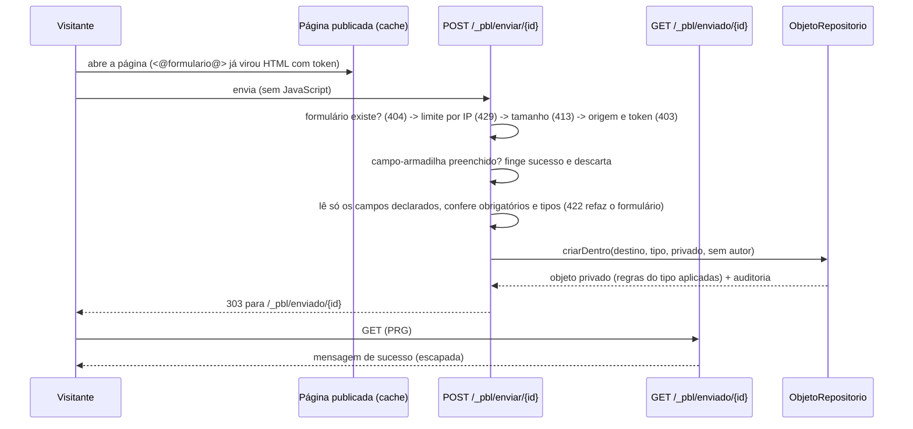

# ADR 0013 — Formulários públicos declarativos (fatia mínima da fase 6)

Status: aceito e implementado na fatia **6a** (novembro de 2026). Detalha a parte "formulário" do [fluxo 10](../fluxos/10-formularios-fluxos-participacao.md) e se apoia no [ADR 0003](0003-plataforma-low-code.md) (tudo é dado), no [ADR 0011](0011-autenticacao-sessao-permissoes.md) (CSRF, origem, limite, auditoria) e no [ADR 0012](0012-administracao-web.md) (telas de objetos). **Não** faz parte desta fatia: estados e transições, notificações por e-mail, captcha, anexos e identidade do participante ([ADR 0004](0004-identidade-publica.md)); veja "Próximos passos".

## Contexto

No PBL3 cada formulário público era um script PHP avulso: validação repetida, sem CSRF, moderação feita à mão. A promessa do PBL4 é que um sistema pequeno (inscrição, cadastro com aprovação, consulta) seja **configuração**. Esta fatia entrega o menor pedaço dessa promessa: receber, de visitantes anônimos, dados validados pelas regras de um tipo de conteúdo, guardando-os como conteúdo **privado** para a equipe revisar.

## Decisão

### 1. O formulário é um conteúdo do tipo `formulario`
Um tipo de conteúdo comum, criado pela migração 11 (se já existir um tipo com esse nome, nada é tocado). Suas propriedades são a definição:

| Propriedade | Tipo | Função |
|---|---|---|
| `destino` | `ref` (obrigatório) | a seção onde cada envio nasce, como filho |
| `classe_envio` | `texto` (obrigatório) | nome do tipo de conteúdo de cada envio |
| `campos` | `texto` (obrigatório) | nomes das propriedades do tipo de envio que o formulário mostra, separados por vírgula; a ordem é a da tela |
| `mensagem`, `botao` | `texto` | texto depois de enviar (padrão "Recebemos o seu envio. Obrigado!") e do botão (padrão "Enviar") |
| `fechado` | `booleano` | 1 = não recebe envios |
| `corpo` | `html` | texto de apresentação (usado pelo molde `formulario` da pele básica) |

Escolha mais simples: **sem tabela nova e sem editor de campos**. Rótulo, tipo e obrigatório de cada campo vêm do próprio tipo de envio (as regras que a administração de tipos já edita), então há uma única fonte de verdade. O formulário só escolhe quais campos expor.

**Falha fechada.** `FormularioRepositorio::porId` devolve o formulário só se: o conteúdo é do tipo `formulario`, é do site do domínio, está **publicado e vigente**, não está `fechado`; o destino existe no mesmo site e fora da lixeira; o tipo do destino **aceita** o tipo de envio (`filhas`); todo nome em `campos` existe, não está arquivado e é de tipo `texto`, `numero`, `html`, `data` ou `booleano`; e **todo campo obrigatório do tipo de envio está exposto** (senão todo envio seria recusado). Qualquer falha é "o formulário não existe": 404 igual para todos os motivos, sem enumeração.

### 2. Tipos aceitos e o que ficou de fora
- `ref` fica **proibido** em formulário público: o erro "esse número não existe" deixaria um visitante testar quais conteúdos existem.
- `html` é aceito e **sanitizado** pelo `HtmlSeguro` que o repositório já aplica a toda propriedade `html` (caixa de texto no formulário).
- Nada num envio vira código: moldes escapam por padrão, `texto` nunca é interpretado, e o envio nasce **privado**.

### 3. Rotas públicas reservadas
Sob o prefixo `/_pbl/` (nada publicado colide com ele), tratadas em `Aplicacao` antes do painel, **sem sessão**, só no domínio do site dono do formulário:

### 4. Defesas
| Defesa | Como |
|---|---|
| **CSRF** | campo `_csrf` = HMAC fixo do formulário (`Csrf::paraFormulario`). As páginas são **arquivos publicados**, então o token não pode girar a cada visita; ele prova que o POST veio de uma página gerada por este site. A defesa real contra requisição forjada é a conferência de **origem** (`Rede::origemConfere`), que também é exigida. O formulário é anônimo (não há sessão ou cookie para "pegar carona"), então o CSRF clássico não se aplica; o token existe para amarrar o POST a um formulário e atrapalhar envio avulso |
| **Origem** | `Origin`/`Referer` de outro site: 403 |
| **Limite** | `LimiteDeEnvios`: 10 POSTs por IP **e por formulário** em 15 minutos, contando acertos e erros; 429 com `Retry-After`. Reaproveita `tentativa_login` com chave HMAC `envio\|…`; IP nunca em claro. IP real atrás de proxy: `dados/config/rede.json` ([Rede](../tecnica/seguranca.md)) |
| **Armadilha (honeypot)** | campo `_mel`, escondido pelo atributo `hidden` (vale em site com CSP rígida). Preenchido: resposta idêntica à de sucesso, nada gravado, sem registro (para não encher a auditoria) |
| **Tamanho** | 64 KiB no corpo (cabeçalho `Content-Length` e tamanho real): 413. Por campo: `texto` 2.000 caracteres, `html` 20.000 |
| **Campos desconhecidos** | ignorados: só os campos declarados são lidos. `titulo`, `status`, `pai`, `peso`, `url_amigavel`, `criado_por`… enviados por fora nunca chegam ao objeto. Valor que não é texto simples (lista) conta como vazio |
| **Entrada** | UTF-8 inválido é recusado; caracteres de controle (exceto quebra de linha e tabulação) são removidos; número só `-?dígitos[.decimais]` (`1e9` e `0x1A` não passam; vírgula vira ponto) |
| **Autoria e auditoria** | envio sem autor (`criado_por` nulo = anônimo); auditoria `formulario.envio` com ator `anonimo`, id do formulário, tipo, id do objeto e HMAC do IP: **nunca valores**. A criação também registra `objeto.criar` como qualquer objeto |
| **Sem enumeração** | formulário inexistente, de outro site, fora do ar, fechado ou mal configurado respondem o mesmo 404; `/_pbl/enviado/{id}` idem |
| **Cabeçalhos** | páginas do formulário: `nosniff`, `X-Frame-Options: DENY`, `Referrer-Policy: same-origin`, `no-store`, CSP `default-src 'none'; style-src 'unsafe-inline'; form-action 'self'` (o estilo mínimo da página de erro é inline) |

### 5. Moldes
Novo comando **`<@formulario [id=n]@>`** (sem corpo): imprime o HTML do formulário (rótulos e atributos escapados; sem estilo nem script embutido; `required`, `maxlength`, `type=date`, caixa de seleção para booleano, `textarea` para `html`). Sem `id`, usa o conteúdo corrente (por isso a pele básica ganha `formulario.pbl`, que mostra `corpo` e o formulário). Formulário inexistente ou fechado imprime nada. O HTML é gerado na **publicação**: mudou o formulário (campos, fechar), republique as páginas que o mostram. O servidor sempre usa a definição **atual**, então um formulário publicado com campos antigos não grava campo removido nem deixa passar obrigatório novo.

### 6. Administração
`GET /_pbl/objeto/{id}/envios` (em um conteúdo do tipo `formulario`; botão "Envios recebidos" na tela dele): lista os conteúdos do tipo de envio dentro do destino, do mais novo ao mais antigo, fora da lixeira. Exige `Acao::Ver` no formulário **e** no destino. **Aprovar = publicar** pela tela de estado que já existe (`Acao::Publicar`), ou mover/apagar pelas telas de sempre. A lista não despeja os valores: cada envio abre na tela de conteúdo (que escapa tudo e mostra HTML como texto). Publicar um envio expõe ao público todos os campos dele; a tela avisa.

## Consequências
- Cada envio é um objeto com versão, histórico, índice e busca como qualquer outro (e conta nos limites de tamanho do banco). Spam que passe pelas defesas fica privado e vai para a lixeira.
- O limite por IP é por formulário e por IP; atrás de NAT grande ele pode bloquear usuários legítimos que compartilham o IP (10 envios em 15 minutos).
- Token fixo: trocar o segredo do site invalida os formulários já publicados até republicar.
- Sem anexos: upload exige a política do [fluxo 7](../fluxos/07-upload-blobs.md).

## Próximos passos (não implementados)
Estados e transições como dado (`pendente → aprovado`), com quem pode mover e ação ao entrar; notificações por e-mail (e depois WhatsApp/webhook) ao receber e ao mudar de estado; captcha plugável; prazo de abertura e fechamento; limite de vagas e agregações (enquete); anexos; participante identificado e modo "identificado" ([ADR 0004](0004-identidade-publica.md)); editor de formulários pela administração (hoje o formulário é um conteúdo editado como qualquer outro); exportação CSV; pagamento ([ADR 0005](0005-pagamentos-conectores.md)).
