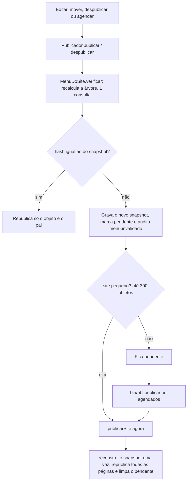

# ADR 0016 — Menu por snapshot, busca e páginas dinâmicas da pele básica

Status: aceito e implementado (2026-11-02, fase 5l). Parte do pacote mínimo do [ADR 0015](0015-classes-fixas-e-pacote-minimo.md).

## Contexto

As páginas são **arquivos estáticos** gerados ao publicar ([ADR 0003](0003-plataforma-low-code.md) §8; fluxo 1). Um menu que
consulta o banco em cada página (ou, pior, uma consulta por item) custaria uma ida ao banco por página publicada e
transformaria "republicar o site" em N × M consultas. Além disso, a pele básica não tinha menu, busca, listagens paginadas
nem uma página 404 própria.

## Decisão

### 1. Propriedades de menu em todo objeto
`objeto.no_menu` (0/1) e `objeto.rotulo_menu` (texto curto, até 60; vazio = usa o título), editáveis na tela de criar/editar
(não na raiz). A **ordem** é o `peso` que já existe. São colunas, não propriedades de classe, porque valem para todo objeto
e entram no `ORDER BY` do menu. Entram no histórico de versões: a versão guarda `no_menu` e `rotulo_menu` no próprio JSON sob a chave `_menu` (sem migração); restaurar uma versão os devolve, e versões antigas sem `_menu` deixam o menu atual como está.

### 2. Uma consulta por site: `MenuDoSite`
A árvore sai de **uma** consulta (`objeto JOIN classe`, mais um `LEFT JOIN` que resolve o destino interno dos itens `link`):
objetos do site com `no_menu = 1`, publicados e vigentes, ordenados por `peso, titulo`. A árvore é montada em PHP pelo
`pai_id`, a partir da página inicial. Sem N+1, sem `LIKE` por caminho.

- **Profundidade** configurável (padrão **3**, máximo 5; variável de ambiente `PBL_MENU_PROFUNDIDADE`) e no máximo **50 itens
  por nível**. O que passa disso é cortado e contado em `cortes`.
- Item de `link` sem destino utilizável (externo inválido, interno fora do ar) não entra.
- O resultado vive em memória durante a execução e em um **snapshot** `dados/cache/menu/<site>.json`
  (`hash`, `profundidade`, `cortes`, `arvore`), gravado de forma atômica. O `hash` é o SHA-256 da árvore.

### 3. Páginas só leem o snapshot
O comando `<@menu [profundidade=N] [inicio="Início"]@>` pede o HTML a `FonteDeDados::menu`, que lê o snapshot (memória, depois
arquivo) e monta `<nav><ul>` aninhado, **sem JavaScript**, marcando o item da página corrente (`class="ativo"`,
`aria-current="page"`) e os ancestrais (`class="ancestral"`, pelo `caminho` do objeto). Nenhuma consulta ao banco por página.
Rótulos e URLs saem escapados; externos e nova aba levam `rel="noopener noreferrer"`. Submenus abrem por CSS (`:hover` e
`:focus-within`).

### 4. Invalidação por hash

- Editar o **corpo** (ou qualquer coisa que não entre no menu) não muda o hash: nada além do objeto é republicado.
- Mudar rótulo, ordem, `no_menu`, título de item sem rótulo, endereço, estado, datas ou mover **muda** o hash.
- `bin/pbl agendados` também chama `verificar` (a passagem do tempo faz itens entrarem e saírem) e republica se houver pendente.
- Site grande: a requisição só marca o pendente; quem republica é o cron (`bin/pbl agendados` / `bin/pbl publicar`) ou a administração, por `/_pbl/site/{id}/publicacao` ("Republicar agora"), que republica em lotes de até 100 objetos ou 10 s por requisição, com continuação (`Publicador::republicarLote`). Isso mantém a requisição curta.
  era para a entrada e a saída por data. Isso mantém a requisição curta.
- Auditoria: `menu.invalidado` (site e prefixo do hash), sem conteúdo.

### 5. Limites e alternativa
Menu com muitos níveis ou itens não é bom para o visitante nem para o custo de republicação. Alternativa documentada: menu
até N níveis (padrão 3) mais uma página de **mapa do site** feita com `<@localizar@>`/`<@filhos@>` e a paginação do §6.

### 6. Busca, listagens e 404
Como o resto é estático, três páginas são **dinâmicas** (`PaginasDinamicas`), renderizadas com o mesmo motor de moldes:

- `/busca?q=termo&pagina=N`: só se **não existir** uma página publicada em `busca` e a pele tiver o molde `busca`. Usa
  `<@localizar busca=$q@>` (o motor de busca existente, `BuscaInterface`), mostra 10 por página e, com zero resultados,
  `%SUGESTAO`. O termo (até 200 caracteres, UTF-8 válido) entra como variável do molde e sai escapado; o link da próxima
  página usa `$q_url` (URL-encoded).
- `?pagina=N` (N ≥ 2, até 1000) sobre uma página publicada: o mesmo molde da página, com `$pagina`. A página 1 continua
  estática. Paginação sem contagem total: pede `limite=11`, mostra 10 e o 11º indica "próximos".
- 404: se a pele tiver o molde `erro404`, ele é renderizado sobre a página inicial com status 404; senão, o texto simples de
  antes. Molde quebrado cai no texto simples.

Moldes novos da pele básica: `topo` (cabeçalho, busca, menu), `estilo`, `item`, `paginacao`, `pasta` (filhos com título,
resumo e imagem, paginados), `noticia` (data, imagem de destaque, resumo), `busca` e `erro404`.

## Consequências

- Custo do menu: 1 consulta ao reconstruir (publicar o site, ou conferir o hash numa edição) e 0 por página.
- Uma edição que mexe no menu de um site pequeno republica o site na própria requisição (até 300 objetos); acima disso, o
  efeito vem com o próximo `bin/pbl agendados`.
- O host do site vem do domínio principal (`EnderecoDoSite`, `https` salvo `PBL_ESQUEMA=http`), nunca da requisição, e chega ao molde como `#base_url`: `canonical`, `og:url` e `og:image` saem absolutos, e `/sitemap.xml` e `/robots.txt` são gerados por site (`SitemapERobots`); acima de 50.000 URLs `sitemap.xml` vira índice de `sitemap-N.xml`. Trocar o domínio principal republica o site. Site sem domínio principal volta aos endereços relativos e sem sitemap.
- `/busca` e `?pagina=` não são cacheados (renderizam a cada pedido). Para tráfego alto, ponha uma CDN na frente.
