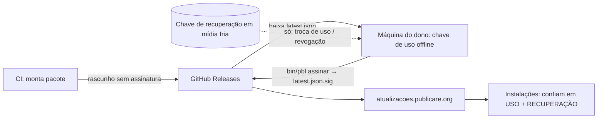

# ADR 0019 — Custódia da chave de assinatura e origem de distribuição

Status: aceito (2026-11-02); **emendado em 2026-11-16** (a chave de uso passa a assinar no CI protegido; veja a [Emenda](#emenda-2026-11-16-release-automática-assinada-no-ci)). Os itens 1 e 4 e o diagrama abaixo mostram a decisão original e estão marcados onde foram superados. Detalha o item 3 do [ADR 0006](0006-atualizador-automatico.md) (assinatura obrigatória e rotação) e fecha a parte de custódia da questão 12 do [plano](../plano.md). Para peles do catálogo, ver [ADR 0007](0007-galeria-pacotes-peles.md).

## Contexto

Toda instalação confia na chave pública embutida no produto: quem controla a chave privada controla o código que milhares de sites vão executar. A chave não pode ficar em lugar atacável (CI, nuvem, servidor de build), mas o dono também não pode perdê-la nem ter um incidente sem saída. O fluxo de publicação precisa continuar simples.

## Decisão (opção C, híbrida)

1. **A chave de produção fica offline**, na máquina do dono: nunca no rock64 ou em nuvem. *(Emenda de 2026-11-16: a chave de **uso** passou a existir também como segredo de um Environment protegido do CI; a de **recuperação** continua só offline.)* Arquivo protegido por senha (volume cifrado), com **2 backups** em mídias separadas.
2. **Duas chaves públicas de produção embutidas desde a primeira versão** (`Pbl\Atualizacao\Chaves`):
   - **uso diário** (`USO`): assina cada release;
   - **recuperação** (`RECUPERACAO`): guardada em **mídia fria** (pen drive/papel num cofre), usada só em emergência.
3. **Só a chave de recuperação troca a de uso e revoga chaves.** O manifesto pode trazer `"chaves": {"uso": "<hex>", "revogadas": ["<hex>", …]}`. O `Atualizador` honra esse bloco **apenas** se o manifesto foi assinado por uma chave de recuperação; vindo da chave de uso, é recusado com erro (não ignorado). A chave de recuperação em si **não** é trocada nem revogada por manifesto (exige uma versão nova do produto com outra constante). O resultado fica em `dados/config/chaves-confiaveis.json` (chave de uso vigente e revogadas); a chave de uso anterior é revogada junto com a troca. Uma lista `REVOGADAS` embutida cobre as chaves já conhecidas como comprometidas quando o produto nasce.
4. **Fluxo de release original (superado pela Emenda de 2026-11-16, que automatiza a assinatura no CI; este fluxo manual virou a contingência).** O CI (GitHub Actions) monta o pacote reproduzível e publica um **rascunho** no GitHub Releases **sem assinar** (`bin/pbl empacotar … --sem-assinar`). O dono baixa o `latest.json` do rascunho, **assina localmente** (`bin/pbl assinar latest.json --chave-privada=ARQUIVO`, que só lê a chave, não a imprime nem grava) e publica o manifesto + `.sig`. O manifesto carrega o SHA-256 e o tamanho do pacote, então assinar o manifesto já autentica o pacote.
5. **Canal de teste com chave própria.** Demos e versões de teste usam o canal `teste` (`latest-teste.json`), assinado por uma chave **separada, que pode ficar no CI** (`Chaves::TESTE`). Essa chave só vale para o canal `teste`; o `Atualizador` de uma instalação de produção (canais `estavel`/`beta`) não confia nela, e as chaves de produção também não valem no canal `teste`. Um manifesto de teste não pode trazer troca de chaves.
6. **Origem de distribuição.** Os artefatos ficam no GitHub Releases, mas as instalações **não conhecem a URL do GitHub**: consultam um endpoint nosso, `https://atualizacoes.publicare.org/` (um proxy/redirecionamento estático na frente do GitHub Releases), configurável por instalação em `dados/config/atualizacao.json` (`url`). Assim dá para trocar de hospedagem sem lançar versão, e forks operam o próprio endpoint. Cache: o **manifesto tem TTL curto** (minutos, para uma revogação ou correção de segurança chegar logo) e os **pacotes são imutáveis** (nome com versão, cache longo). O cliente já consulta no máximo 1 vez por dia (ADR 0006 §4).

## Incidente: o que fazer

| Situação | Ação |
|---|---|
| Chave de uso vazada ou perdida | Gerar nova chave de uso; criar manifesto com `--nova-chave-de-uso=<pública> --revogar=<antiga>`, assinar com a **recuperação**, publicar. Instalações adotam a nova na próxima verificação e passam a recusar a antiga. |
| Chave de recuperação perdida | Sem ela não há troca por manifesto: lançar versão nova do produto (assinada pela chave de uso) com outra `RECUPERACAO`. Por isso o backup duplicado e o cofre. |
| Chave de recuperação vazada | Mesmo caminho: versão nova com outra `RECUPERACAO` e a antiga em `REVOGADAS`. |
| Chave de teste vazada | Trocar `TESTE` numa versão; não afeta produção. |

## Consequências

- O dono é gargalo de publicação (assina à mão); aceitável para o ritmo atual. Automatizar a assinatura exigia colocar a chave onde o CI alcança; isso foi rejeitado na decisão original e aceito, com condições, na Emenda de 2026-11-16.
- A segurança da recuperação depende de guardar uma mídia fria com disciplina; a simplicidade da chave única foi trocada por poder se recuperar sem quebrar as instalações existentes.
- Estas decisões se aplicam ao produto; o catálogo de peles e módulos terá chave própria (custódia a decidir no ADR 0007/0008).
- Rotação de chave e revogação têm testes (`tests/ChavesDeConfiancaTest.php`).

## Adendo (2026-11-16): chaves públicas embutidas

O dono gerou os dois pares e as **públicas** de uso e de recuperação foram embutidas em `app/src/Atualizacao/Chaves.php` (`REVOGADAS` e `TESTE` seguem vazias). A privada nunca entra no repositório nem em logs. Falta a primeira release assinada; o endpoint de canal tem Worker pronto em `infra/atualizacoes/` (falta o deploy e o DNS).

## Emenda (2026-11-16): release automática assinada no CI

**Decisão do dono.** A release passa a ser **automática a partir da tag `v*`**, assinada no CI, sem etapa local. Em troca, o dono aceitou colocar a chave de **uso** no CI, protegida por um GitHub **Environment** chamado `release` com **aprovação manual obrigatória**.

**O que muda**
- O workflow `release.yml` empacota, **assina** o `latest*.json` com a chave de uso (segredo `PBL4_CHAVE_USO` do Environment `release`), **confere** a assinatura com `bin/pbl verificar-assinatura` (contra `Chaves::USO`) e só então **publica** zip, manifesto e `.sig`. Se a conferência falha, nada é publicado. Tag estável vai ao canal `estavel`; `-rc`/`-beta` vai ao canal `beta`, marcada como pré-lançamento.
- O job de assinatura roda só em tag `v*` e só depois de o dono aprovar no GitHub. A chave vai a um arquivo temporário 0600 apenas no passo de assinatura e é apagada em seguida (`if: always()`); não é impressa, não vai a artefato nem a variável de ambiente exportada. `contents: write` existe só no job de publicar.
- Sem o segredo (ensaio ou fork), o comportamento anterior continua: empacota e cria só um rascunho, com aviso no resumo do job.
- A chave de **recuperação nunca entra no CI**: segue offline em mídia fria e é o que permite girar a chave de uso se ela vazar (itens 2, 3 e a tabela de incidentes valem como estão).
- `bin/assinar-release.sh` fica como **contingência manual** (assinar localmente um rascunho); ver [releases](../releases.md).

**Riscos e mitigações**

| Risco | Mitigação |
|---|---|
| Quem escreve no repositório empurra uma tag `v*` e o CI assina código malicioso | Aprovação manual obrigatória no Environment (o aprovador confere commit e tag); **proteção das tags `v*`** (ruleset); Environment restrito às tags `v*` |
| Workflow alterado numa branch lê o segredo | O segredo só existe no Environment, que só libera para tags `v*` protegidas; o job exige aprovação |
| Vazamento do segredo em log ou artefato | Segredo em um único passo, via arquivo 0600 apagado com `if: always()`; sem `echo`, sem `GITHUB_ENV`/`GITHUB_OUTPUT`; artefato só com zip, manifesto e `.sig`; testes de estrutura do workflow (`ReleaseWorkflowTest`) |
| Action de terceiros comprometida | Actions fixadas por versão e poucas no job de assinatura (checkout, setup-php, artefatos); evolução recomendada: fixar por SHA |
| Chave de uso vazada | A chave de **recuperação** (offline) assina um manifesto com `--nova-chave-de-uso` e `--revogar`; trocar o segredo `PBL4_CHAVE_USO`; o fluxo manual serve enquanto isso |
| Proxy ou GitHub servem manifesto trocado | Assinatura Ed25519 e SHA-256 do pacote no manifesto assinado: o endpoint não precisa ser confiável |

**Origem de distribuição (item 6).** Os artefatos ficam nos GitHub Releases; as instalações consultam o endpoint configurável. O repositório traz um Cloudflare Worker mínimo (`infra/atualizacoes/`) que serve `/latest.json`, `/latest-beta.json`, as `.sig` e `/pacotes/<arquivo>` sob o **mesmo host** (o cliente recusa redirecionamento para outro host). O manifesto aponta o pacote por caminho absoluto (`empacotar --url-base-pacote=/pacotes/`).
