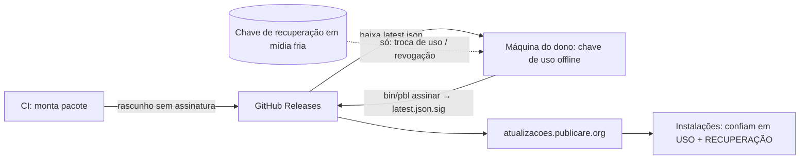

# ADR 0019 — Custódia da chave de assinatura e origem de distribuição

Status: aceito (2026-11-02). Detalha o item 3 do [ADR 0006](0006-atualizador-automatico.md) (assinatura obrigatória e rotação) e fecha a parte de custódia da questão 12 do [plano](../plano.md). Para peles do catálogo, ver [ADR 0007](0007-galeria-pacotes-peles.md).

## Contexto

Toda instalação confia na chave pública embutida no produto: quem controla a chave privada controla o código que milhares de sites vão executar. A chave não pode ficar em lugar atacável (CI, nuvem, servidor de build), mas o dono também não pode perdê-la nem ter um incidente sem saída. O fluxo de publicação precisa continuar simples.

## Decisão (opção C, híbrida)

1. **A chave de produção fica offline**, na máquina do dono: nunca no rock64, no CI ou em nuvem. Arquivo protegido por senha (volume cifrado), com **2 backups** em mídias separadas.
2. **Duas chaves públicas de produção embutidas desde a primeira versão** (`Pbl\Atualizacao\Chaves`):
   - **uso diário** (`USO`): assina cada release;
   - **recuperação** (`RECUPERACAO`): guardada em **mídia fria** (pen drive/papel num cofre), usada só em emergência.
3. **Só a chave de recuperação troca a de uso e revoga chaves.** O manifesto pode trazer `"chaves": {"uso": "<hex>", "revogadas": ["<hex>", …]}`. O `Atualizador` honra esse bloco **apenas** se o manifesto foi assinado por uma chave de recuperação; vindo da chave de uso, é recusado com erro (não ignorado). A chave de recuperação em si **não** é trocada nem revogada por manifesto (exige uma versão nova do produto com outra constante). O resultado fica em `dados/config/chaves-confiaveis.json` (chave de uso vigente e revogadas); a chave de uso anterior é revogada junto com a troca. Uma lista `REVOGADAS` embutida cobre as chaves já conhecidas como comprometidas quando o produto nasce.
4. **Fluxo de release.** O CI (GitHub Actions) monta o pacote reproduzível e publica um **rascunho** no GitHub Releases **sem assinar** (`bin/pbl empacotar … --sem-assinar`). O dono baixa o `latest.json` do rascunho, **assina localmente** (`bin/pbl assinar latest.json --chave-privada=ARQUIVO`, que só lê a chave, não a imprime nem grava) e publica o manifesto + `.sig`. O manifesto carrega o SHA-256 e o tamanho do pacote, então assinar o manifesto já autentica o pacote.
5. **Canal de teste com chave própria.** Demos e versões de teste usam o canal `teste` (`latest-teste.json`), assinado por uma chave **separada, que pode ficar no CI** (`Chaves::TESTE`). Essa chave só vale para o canal `teste`; o `Atualizador` de uma instalação de produção (canais `estavel`/`beta`) não confia nela, e as chaves de produção também não valem no canal `teste`. Um manifesto de teste não pode trazer troca de chaves.
6. **Origem de distribuição.** Os artefatos ficam no GitHub Releases, mas as instalações **não conhecem a URL do GitHub**: consultam um endpoint nosso, `https://atualizacoes.publicare.org/` (um proxy/redirecionamento estático na frente do GitHub Releases), configurável por instalação em `dados/config/atualizacao.json` (`url`). Assim dá para trocar de hospedagem sem lançar versão, e forks operam o próprio endpoint. Cache: o **manifesto tem TTL curto** (minutos, para uma revogação ou correção de segurança chegar logo) e os **pacotes são imutáveis** (nome com versão, cache longo). O cliente já consulta no máximo 1 vez por dia (ADR 0006 §4).

## Incidente: o que fazer

| Situação | Ação |
|---|---|
| Chave de uso vazada ou perdida | Gerar nova chave de uso; criar manifesto com `--nova-chave-de-uso=<pública> --revogar=<antiga>`, assinar com a **recuperação**, publicar. Instalações adotam a nova na próxima verificação e passam a recusar a antiga. |
| Chave de recuperação perdida | Sem ela não há troca por manifesto: lançar versão nova do produto (assinada pela chave de uso) com outra `RECUPERACAO`. Por isso o backup duplicado e o cofre. |
| Chave de recuperação vazada | Mesmo caminho: versão nova com outra `RECUPERACAO` e a antiga em `REVOGADAS`. |
| Chave de teste vazada | Trocar `TESTE` numa versão; não afeta produção. |

## Consequências

- O dono é gargalo de publicação (assina à mão); aceitável para o ritmo atual. Automatizar a assinatura exigiria colocar a chave onde o CI alcança, e isso foi rejeitado.
- A segurança da recuperação depende de guardar uma mídia fria com disciplina; a simplicidade da chave única foi trocada por poder se recuperar sem quebrar as instalações existentes.
- Estas decisões se aplicam ao produto; o catálogo de peles e módulos terá chave própria (custódia a decidir no ADR 0007/0008).
- Rotação de chave e revogação têm testes (`tests/ChavesDeConfiancaTest.php`).
