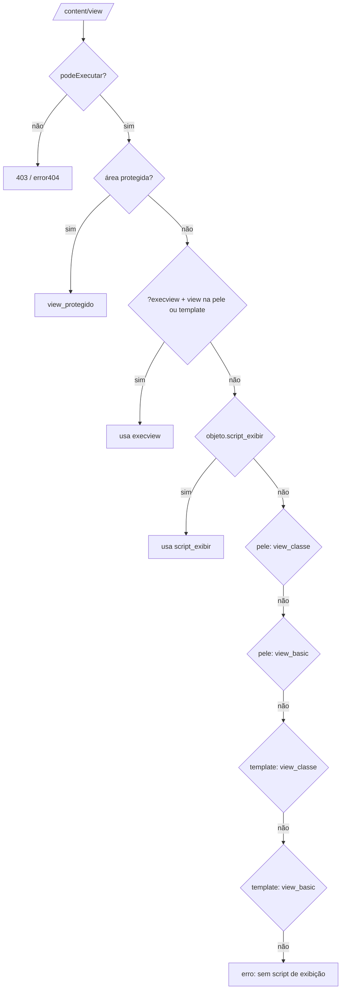
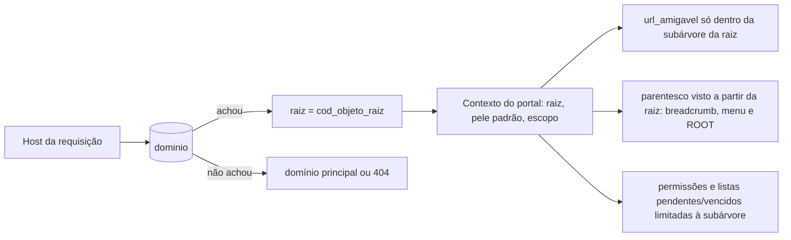
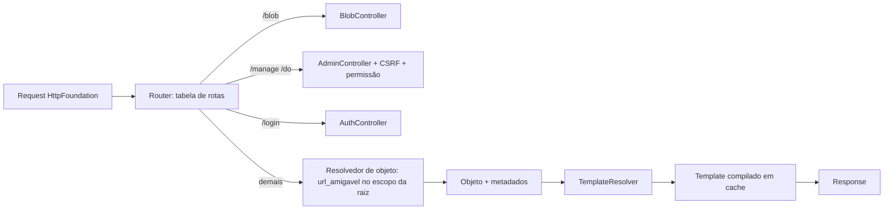

# Fluxo 1 — Requisição pública

## Hoje (p3)

`Start::iniciar()` (`publicare3/src/Start.php:46`) roteia por `switch` no 1º segmento da URL:

| Segmento | Efeito |
|---|---|
| `blob` | serve arquivo (`/blob/ver`, `baixar`, `iconeclasse`…) |
| `include` | `include('includes/<seg>.php')` e `exit` |
| `login` | view do portal ou `includes/login.php` |
| `html/objects` | `include` direto de arquivo sob `html/objects` |
| `content/view` | objeto por código |
| `manage`, `do` | ações do admin |
| *(outro)* | trata como **URL amigável**: `SELECT cod_objeto … WHERE url_amigavel = ?` |

`Pagina::executar()` (`Core/Pagina.php:156`) escolhe header/view/footer. Ordem de resolução da **view** em `/content/view`:

Header e footer: da pele (`html/skin/<prefixo>/header.php|footer.php`) se `cod_pele>0` e o arquivo existir; senão `html/template/basic_*.php`. Tudo passa por `Parse::start()` (fluxo 2).

### Problemas
- Roteamento e resolução espalhados; `DOCUMENT_ROOT.'/html/skin/'` repetido ~15x.
- `str_replace("\.\.\/", …)` é inócuo; `include` direto de caminho derivado da URL (LFI/traversal).
- `url_amigavel` é buscada globalmente (sem escopo do portal/raiz).
- `action` pode vir de GET/POST e substituir a rota.
- Erros fazem `var_dump` da exceção para o visitante.

## Raiz do domínio (multi-subsite)

No 2.9.2 o host da requisição era procurado em `$_dominios` (host → `cod_objeto`), e o objeto achado virava o ponto de partida do subsite. No p3 só resta um `portal.objroot` global, usado em ~25 pontos (`ROOT` do PBL, permissões, pendentes, vencidos, novo objeto, login...).

Exemplo de uso real: 8 hosts (com e sem `www`, domínios alternativos) apontando para **2 raízes** (o portal em dois idiomas), ou seja, **N hosts → 1 raiz**. Nas cópias p3 consultadas o consumo de `$_dominios` no inicializador está comentado ou ausente: só o 2.9.2 o aplicava.

PBL4: o **host é resolvido para uma raiz** antes de qualquer outra coisa.

Regras (ADR 0003, fluxo 9):
- O ajuste de `parentesco` tinha duas funções: **exibir a árvore a partir da raiz** do domínio e **reduzir a população de registros nas buscas**. No PBL4 ambas vêm do `caminho` materializado: a raiz do domínio corta a trilha em breadcrumb, menu e `ROOT`, e toda consulta fica restrita à subárvore. Objeto fora da subárvore dá 404 no domínio.
- O mesmo objeto pode ser alcançado por mais de um domínio, mas tem **uma URL canônica** (a do site dono); os demais domínios emitem `rel=canonical`.
- Subdomínio curinga e domínios de desenvolvimento: configuráveis na tabela `dominio` (padrão, apelido, desenvolvimento).

### URLs legadas e domínios antigos (de-para)

> **Implementado (fase 1b):** o **histórico de URLs** (`url_historico`) e o **301** do endereço antigo para o atual, com a query string mantida, só para caminho do site e só se o destino está publicado e vigente; tomar um endereço que redireciona para outro conteúdo (ao criar ou ao alterar) exige liberação explícita; a publicação remove do cache as páginas de endereços que mudaram. **Também implementado (1b, parte 2):** domínios com papel (`principal`, `servir` com canônico no cabeçalho `Link`, `redirecionar` com 301 para o principal) e regras manuais de redirecionamento (exatas e por prefixo, 301/302, destino no site ou `https://`), geridos por `bin/pbl dominio` e `bin/pbl redirecionamento`. A ordem de resolução é a descrita abaixo.

URL e domínio divulgados, impressos ou citados em outros sites são **contrato permanente**: trocar de domínio, renomear ou mover um objeto não pode quebrar endereços já distribuídos (material impresso não se reimprime). O PBL3 já teve uma camada de de-para de domínios com esse papel; o PBL4 a torna parte do núcleo:

- **Domínios antigos e apelidos** (tabela `dominio`): cada host aponta para um site, com política `servir` (mesmo conteúdo, com `rel=canonical`) ou `redirecionar` (301 para o domínio canônico), preservando caminho e consulta.
- **Histórico de URLs** (`url_historico`): ao alterar `url_amigavel` ou mover um objeto, a URL anterior é registrada e passa a responder **301 para a atual**. Nunca é descartada em silêncio; só o admin pode liberá-la.
- **Regras manuais de redirecionamento** por site (origem → destino, 301/302, prefixo ou exata), para endereços legados que não correspondem a nenhum objeto atual (URLs de sistemas antigos, por exemplo). Aplicadas antes do 404.
- **Importador do PBL3** (fase 9): carrega os domínios e as URLs amigáveis existentes e gera as regras necessárias para que nenhum link **mapeado** quebre na migração. O relatório lista o que não pôde ser mapeado e o **cutover (virada do domínio) fica bloqueado** enquanto houver URL sem destino: cada uma precisa ser resolvida (regra, redirecionamento) ou aceita explicitamente por quem migra. A garantia de "nenhum link quebra" vale para as URLs mapeadas e as aceitas, não para as ignoradas.
- **Ordem de resolução**: domínio → site; redirecionamento de domínio; página publicada no cache; histórico de URLs; regras manuais; 404.
- **Cache**: redirecionamentos são resolvidos no mesmo caminho rápido do cache de páginas (tabela pequena em memória/arquivo), sem passar pelo banco a cada requisição.

Todo `portal.objroot` do p3 deixa de ser global e passa a ser lido do **contexto do portal** da requisição.

## PBL4

Regras:
- **Router único** com whitelist de rotas; sem `include` de caminho vindo da URL.
- **`TemplateResolver`** é a única classe que conhece a ordem de resolução (a do diagrama acima), lendo `pele_arquivo` (fluxo 4) e usando cache compilado (fluxo 2).
- `url_amigavel` resolvida dentro do escopo do site (ADR 0003, §5).
- A pele de saída é escolhida por prefixo/extensão (`/api/v1/…`, `.json`) ou `Accept`: HTML, JSON, RSS etc. (ADR 0009).
- Rotas de **formulários públicos** e de **webhooks** (pagamento) são registradas no mesmo router, com CSRF e limites próprios (fluxo 10).
- Erros: página 404/403/500 do tema; detalhes só em log, nunca ao visitante.
- Front controller único `public/index.php`, que na ausência de configuração entra no instalador (fluxo 3).
