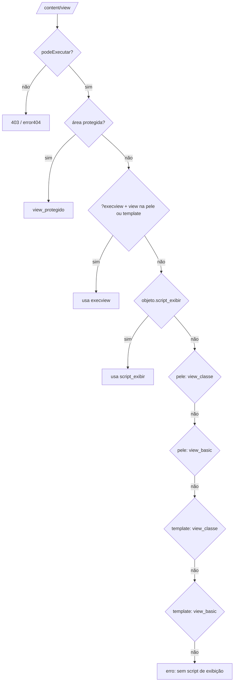
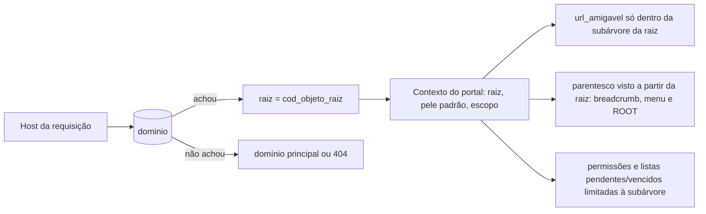
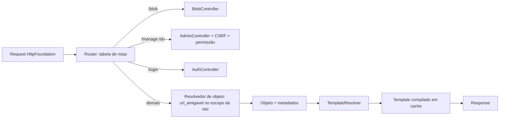

# Fluxo 1 — Requisição pública

## Hoje (p3)

`Start::iniciar()` (`publicare3/src/Start.php:46`) roteia por `switch` no 1º segmento da URL:

| Segmento | Efeito |
|---|---|
| `blob` | serve arquivo (`/blob/ver`, `baixar`, `iconeclasse`…) |
| `include` | `include('includes/<seg>.php')` e `exit` |
| `login` | view do portal ou `includes/login.php` |
| `html/objects` | `include` direto de arquivo sob `html/objects` |
| `content/view` | objeto por código |
| `manage`, `do` | ações do admin |
| *(outro)* | trata como **URL amigável**: `SELECT cod_objeto … WHERE url_amigavel = ?` |

`Pagina::executar()` (`Core/Pagina.php:156`) escolhe header/view/footer. Ordem de resolução da **view** em `/content/view`:

Header e footer: da pele (`html/skin/<prefixo>/header.php|footer.php`) se `cod_pele>0` e o arquivo existir; senão `html/template/basic_*.php`. Tudo passa por `Parse::start()` (fluxo 2).

### Problemas
- Roteamento e resolução espalhados; `DOCUMENT_ROOT.'/html/skin/'` repetido ~15x.
- `str_replace("\.\.\/", …)` é inócuo; `include` direto de caminho derivado da URL (LFI/traversal).
- `url_amigavel` é buscada globalmente (sem escopo do portal/raiz).
- `action` pode vir de GET/POST e substituir a rota.
- Erros fazem `var_dump` da exceção para o visitante.

## Raiz do domínio (multi-subsite)

No 2.9.2 o host da requisição era procurado em `$_dominios` (host → `cod_objeto`), e o objeto achado virava o ponto de partida do subsite. No p3 só resta um `portal.objroot` global, usado em ~25 pontos (`ROOT` do PBL, permissões, pendentes, vencidos, novo objeto, login...).

Exemplo de uso real: 8 hosts (com e sem `www`, domínios alternativos) apontando para **2 raízes** (o portal em dois idiomas), ou seja, **N hosts → 1 raiz**. Nas cópias p3 consultadas o consumo de `$_dominios` no inicializador está comentado ou ausente: só o 2.9.2 o aplicava.

PBL4: o **host é resolvido para uma raiz** antes de qualquer outra coisa.

Regras a especificar com exatidão (ver questões em aberto):
- Como o `parentesco` é "ajustado" a partir da raiz (corte da trilha acima da raiz no breadcrumb/menu/`ROOT`; objetos fora da subárvore dão 404 no domínio).
- Se o mesmo objeto pode ser servido por mais de um domínio e qual é o canônico (SEO, links absolutos).
- Subdomínio curinga e domínios de desenvolvimento.

Todo `portal.objroot` do p3 deixa de ser global e passa a ser lido do **contexto do portal** da requisição.

## PBL4

Regras:
- **Router único** com whitelist de rotas; sem `include` de caminho vindo da URL.
- **`TemplateResolver`** é a única classe que conhece a ordem de resolução (a do diagrama acima), lendo `pele_arquivo` (fluxo 4) e usando cache compilado (fluxo 2).
- `url_amigavel` resolvida dentro do escopo do portal (ver questão de multi-subsite no ADR 0002).
- Erros: página 404/403/500 do tema; detalhes só em log, nunca ao visitante.
- Front controller único `public/index.php`, que na ausência de configuração entra no instalador (fluxo 3).
