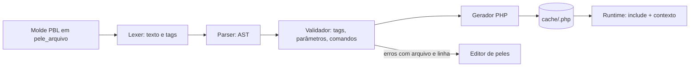

# Fluxo 2 — Compilação do PBL

## Hoje (p3)

`Core/Parse.php` (1194 linhas) é um **transpilador PBL → PHP por regex**:

- Tabela `$cmdArray` (`initialize()`, ~700 linhas) com `regex`, `output` (PHP com marcadores `<#1#>`/`<#P:param#>`), `opentag/closetag`, `paramitens`.
- `start()` lê o arquivo **linha a linha** e casa `<@cmd …@>`; `evaluate()` converte `#campo` → `$_OBJ_->valor("campo")`, `$var` → `$GLOBALS["var"]`, `%macro`.
- O PHP gerado é executado com `eval("?>" . $out)` **a cada request, sem cache**; `incluir` recursa e refaz tudo.

Comandos: `ECO`, `ECOE`, `ECO_LIMITE`, `FILHOS`, `SEMFILHOS`, `INCLUIR`, `INCLUIRMENU`, `LOCALIZAR`, `NAOLOCALIZADO`, `REPETIR`, `SE`, `SENAO`, `USAROBJETO`, `VAR`, `ALEATORIO` + macros.

### Problemas
- `eval` por request; qualquer `<?php` literal no molde roda.
- `eco` não escapa; `ecoe` usa `htmlentities` sem charset.
- `exit` em erro de sintaxe; `ParseError` do `eval` não é capturado.
- Bug em `checkTags` (`$key` indefinido); `$_GET` e globais expostos ao template.
- Sem gramática, sem testes, comandos só alteráveis editando o array gigante.

## PBL4

Princípios:
1. **Três estágios separados** (Lexer, Parser, Gerador) e uma **gramática EBNF** documentada (comandos, tipos de parâmetro `s|v|n|m|d`, operadores).
2. **Registro de comandos**: cada comando é uma classe (nome, parâmetros, nó de AST, geração). Sem editar array gigante.
3. **Compilar uma vez**: PHP gerado em `cache/<hash do conteúdo>.php`; request faz `include` (opcache). Invalida ao salvar a pele.
4. **Erros como exceção** (`PblSyntaxError` com arquivo e linha); nunca `exit`. O editor usa o mesmo validador em modo "compilar sem executar".
5. **Escape por padrão**: `ECO` escapa (`htmlspecialchars` com `ENT_QUOTES|ENT_SUBSTITUTE`, UTF-8); `ECOCRU` é explícito para HTML confiável. É quebra de compatibilidade: acompanha uma **ferramenta de migração** que varre moldes antigos e propõe a troca.
6. **Sem PHP cru** no molde (rejeitado no lexer); contexto de execução explícito (`objeto`, `pilha`, `loop`), sem `$GLOBALS`.
7. **Herança de layout**: `<@estende "base"@>` e `<@bloco nome@>…<@/bloco@>` (Fase 2).
8. **Compatibilidade por conversão**: não há modo de execução legado (ADR 0003). Um **conversor** traduz moldes PBL3 para PBL4 (inclusive a troca `ECO` → `ECOCRU` onde o conteúdo era HTML confiável); golden files verificam que a saída renderizada permanece equivalente.
9. **Extensão**: módulos registram comandos e tipos de campo novos pelo registro do item 2.

### Corpus de testes
Branch `2.9.2` do repo `publicare` (≈8 moldes: `basic_header/footer`, `view_basic`, `view_mapasite`, `view_rss`…). Existe um corpus muito maior de moldes reais em repositórios privados do mantenedor; ele não é commitado aqui (ver `plano.md`, nota sobre corpus).
