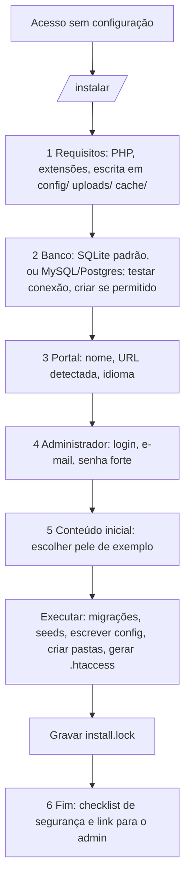

# Fluxo 3 — Instalação

## Hoje (p3): na prática não instalável sem ler o código

- `verifica_instalacao.php` só checa PHP ≥ 5.5 e algumas extensões (o código usa `public const`, que exige PHP 7.1+).
- Não existem `index.php`, `.htaccess` nem exemplo de `config/global.php` (formato só deduzível do código: `bd`, `portal`, `email`, `login`).
- `Schema::verifica()` tenta criar o banco mas está quebrado (`xd()` dá `die`); `Schema/Mysql.php` e `Pgsql.php` são stubs.
- `db/dados_iniciais.sql` não cria admin (objeto raiz referencia `cod_usuario=1` inexistente), nem `infoperfil`, pele ou templates.
- Passos manuais do leigo: composer, vhost + rewrite, escrever `config`, criar banco, importar SQL, inserir admin com `md5()`, criar `html/template/*`.

## PBL4: assistente web em 6 passos (e `bin/pbl instalar` equivalente em CLI)

Requisitos:
- **Nenhum conhecimento de PBL**: o passo 5 entrega um portal funcionando com uma pele pronta, editável depois pelo editor (fluxo 4).
- **Roda em hospedagem compartilhada**: distribuição em zip com `vendor/` incluso; sem terminal. Requisitos mostrados em linguagem clara, com o que fazer em cada falha.
- **Banco**: SQLite sem nenhuma configuração é o caminho de leigo; MySQL/Postgres para portais grandes. O usuário de banco da aplicação só precisa de `SELECT/INSERT/UPDATE/DELETE` (sem DDL em runtime, ADR 0003); as migrações usam credencial própria só durante instalação/atualização.
- **Migrações** (ADR 0003) executam dentro de transação quando o driver permite; falha não deixa meio-instalado.
- **Seeds completos**: tipos de dado, perfis, status, `infoperfil`, classes base, usuário admin (hash seguro), site e domínio, objeto raiz, pele padrão e templates.
- **Modelos prontos** escolhidos no passo 5: portal institucional, consulta pública, evento com inscrição, biblioteca, cadastro com aprovação (fluxo 10).
- **Layout de pastas** `app/` (substituível) e `dados/` (config, uploads, peles, cache, SQLite), requisito do atualizador (ADR 0006, fluxo 11); a chave pública de assinatura de releases já vem embutida.
- **Config**: gerada a partir de modelo; segredos fora do docroot quando possível.
- **Trava**: `install.lock` + 403/remoção de `/instalar`; a verificação de schema em runtime **nunca** reinstala sozinha.
- **Pós-instalação**: checklist (`display_errors` off, permissões, remover pasta de instalação, HTTPS) e exportação do relatório.
- **Atualização**: o mesmo mecanismo roda migrações pendentes (`schema_versao`) após trocar os arquivos.

Fora do escopo inicial: instalador de Nginx automático (documentar o rewrite), Oracle.
