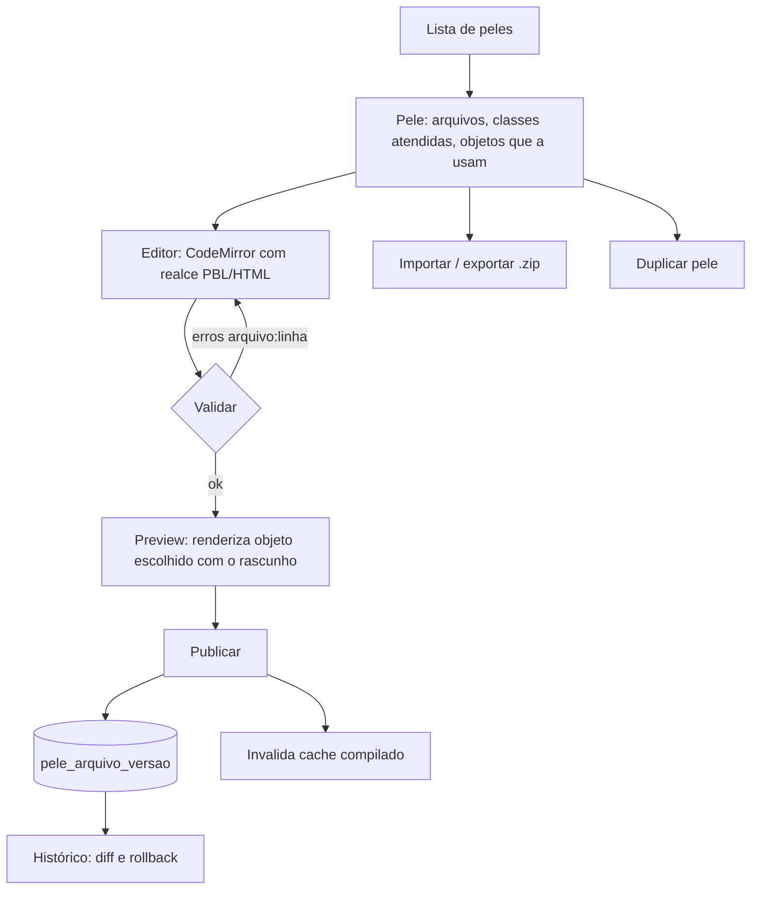
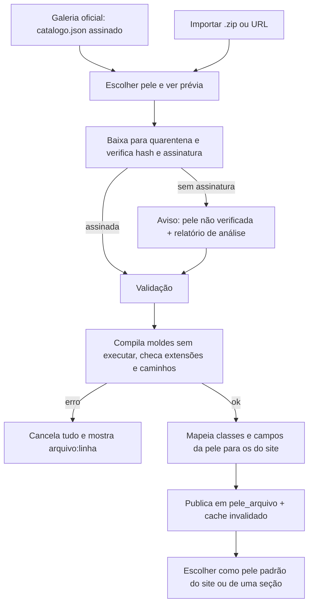

# Fluxo 4 — Edição de peles, templates e layouts

> **Nota (fase 5j):** o editor de um molde (texto, validação, histórico com diferença e voltar atrás, rascunho com
> pré-visualização e realce **só leitura**) já está implementado, pelo navegador e **sem JavaScript** — veja o
> [ADR 0012](../adr/0012-administracao-web.md) §9 e §14 e o [fluxo 12](12-administracao-web.md). Isto já cumpre os itens
> 3, 4 e 5 da lista abaixo, de um jeito diferente do desenhado aqui (sem CodeMirror nem realce ao digitar, por decisão
> do ADR 0012: nenhuma tela da administração depende de JavaScript). O resto deste fluxo (navegador de arquivos restrito
> à pele, import/export `.zip`, galeria, assistente "criar pele", duplicar/apagar pele inteira) continua só planejado
> ([ADR 0007](../adr/0007-galeria-pacotes-peles.md)).

## Hoje (p3)

- `manage/peles.php` e `peles_post.php` fazem CRUD de **nome/prefixo/pública** na tabela `pele`. Nada além.
- O conteúdo real vive no disco: `html/skin/<prefixo>/{header,footer,view_<classe>,view_basic}.php` e `html/template/*`. O admin não vê nem edita esses arquivos; edição é por FTP.
- Apagar pele não remove arquivos nem confirma no servidor. Sem versionamento, preview ou validação; um erro de PBL derruba a página pública.
- Salvar um molde equivale a executar código (`eval`), então o recurso é sensível.

## PBL4

### Instalar pele (galeria ou arquivo)

Peles instaladas ficam intactas; a personalização vai numa **pele filha** (sobrescritas), então a atualização da original não apaga o trabalho do usuário (ADR 0007).

Funcionalidades (ordem de entrega):
1. **Navegador de arquivos** restrito à pele (caminho canônico, extensões permitidas).
2. **Editor** com realce de PBL, autocompletar de comandos e de propriedades da classe (a partir de `propriedade`).
3. **Validação ao salvar** com o validador do fluxo 2: mesma mensagem, mesmo arquivo e linha.
4. **Rascunho x publicado**: editar não afeta o site até publicar; preview via sessão do editor.
5. **Versionamento**: toda publicação grava versão (usuário, data, hash); diff e rollback de um clique.
6. **Import/export `.zip`** com manifesto `pele.json` (identificador, versão, autor, licença, versão mínima do PBL4, classes e campos esperados, hashes). Importação valida caminhos (zip-slip), extensões e rejeita PHP cru (ADR 0007).
7. **Galeria de peles** (CDN, catálogo assinado) com prévia, instalação com um clique e aviso de nova versão; as peles iniciais do instalador (fluxo 3) vêm da mesma galeria. Ver fluxo abaixo.
8. **Assistente "criar pele"**: o leigo escolhe base, cores, logo e menu; o sistema gera header/footer/views. PBL só aparece no modo avançado.
9. **Apagar pele**: mostra quais objetos a usam e exige substituta.

Segurança:
- Somente perfil Administrador; CSRF; registro em `auditoria` (quem, o quê, quando).
- Conteúdo de usuário **nunca** passa pelo compilador; só moldes de pele.
- Preferência: moldes não executam PHP cru (fluxo 2, item 6).

Peles são globais, com sobrescrita por site (ADR 0003, §5). Fonte de verdade: `pele_arquivo` no banco; o disco é cache compilado. Questão em aberto: política para quem ainda edita por FTP (reimportar do disco ou ignorar).
