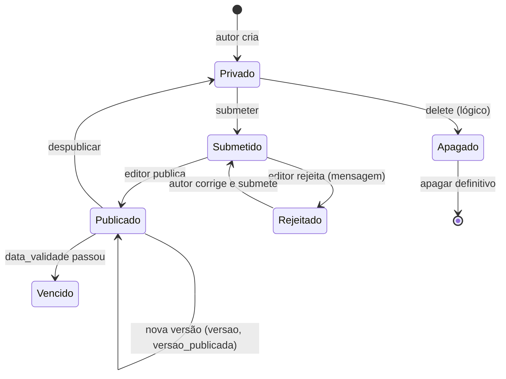
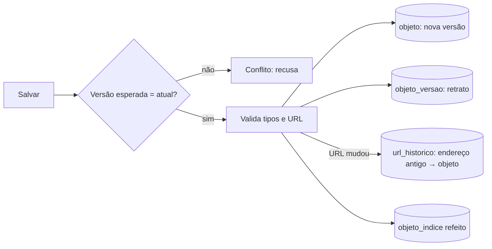

# Fluxo 5 — Conteúdo e workflow

## Hoje (p3)

Modelo: objeto de uma `classe`, valores nas tabelas `tbl_*` conforme `propriedade.cod_tipodado`; hierarquia em `objeto.cod_pai` + `parentesco` (closure com ordem); `classexfilhos` define quais classes podem ser filhas de quais.

Status (`status`): 1 Privado, 2 Publicado, 3 Rejeitado, 4 Submetido. Telas: `new`, `edit`, `submeter`, `publicar`, `rejeitar`, `delete`, `apagar_definitivo`, `pendentes`, `rejeitados`, `vencidos`, `pilha` (copiar, mover, colar), `workflow`, `log`.

Versões em `versaoobjeto`; ações registradas em `logobjeto` e `logworkflow`. `pendencia` guarda a fila do editor.

### Problemas
- CRUD em páginas procedurais (`manage/*.php`) com HTML misturado; `Administracao` e `AdminObjeto` com ~2k linhas cada.
- SQL por concatenação; `insertId` com `SELECT MAX()` (corrida).
- Conteúdo `tbl_text` salvo e exibido sem saneamento (XSS armazenado de Autor contra Admin).

## PBL4

> **Implementado (fase 1b):** histórico de versões (`objeto_versao`, uma linha por estado salvo, a atual inclusive), `atualizar` com mesclagem de dados e reindexação, `restaurar` (como nova versão), `mover` com a subárvore, proteção contra conflito (`versaoEsperada`) e os estados `privado`, `submetido`, `rejeitado`, `publicado`, `apagado`. **Fase 5a:** título e descrição já se editam pelo navegador, com a mesma proteção contra conflito ([fluxo 12](12-administracao-web.md)). **Fase 5b:** pelo navegador também se cria conteúdo (sempre `privado`), se editam todas as propriedades, se muda o estado e as datas (perfil editor), se move, se manda para a lixeira (estado `apagado`; não há apagar definitivo) e se restaura uma versão sem mexer no estado. As transições são livres entre `privado`, `submetido`, `rejeitado` e `publicado` para quem pode publicar. Ainda falta: as **transições com permissão por perfil**, o quem-mudou (depende do login, fase 3), a fila de pendentes e as notificações (fase 6).

- **Dados em `objeto` (JSON)** validados pela definição da classe, com `caminho` materializado no lugar de `cod_pai`+`parentesco` e `objeto_indice` para filtros (fluxo 9); versões em tabela própria.
- **Workflow como configuração**: os estados acima são o padrão; classes e pastas podem definir estados, transições, prazos e notificações próprios (fluxo 10).
- **Serviços de domínio** (`ObjetoRepository`, `WorkflowService`, `VersaoService`) com testes; controllers finos.
- **Máquina de estados explícita**: transições permitidas por perfil, validadas no serviço, não na tela.
- **Sanitização por tipo** (HTML permitido via lista de tags para `Texto Avanc.`).
- **Escopo por subárvore** (perfil por objeto, já existente em `usuarioxobjetoxperfil`) preservado.
- Mesmos estados e telas, para o editor antigo reconhecer o produto; UX do formulário gerado por `propriedade` é melhorada depois.
