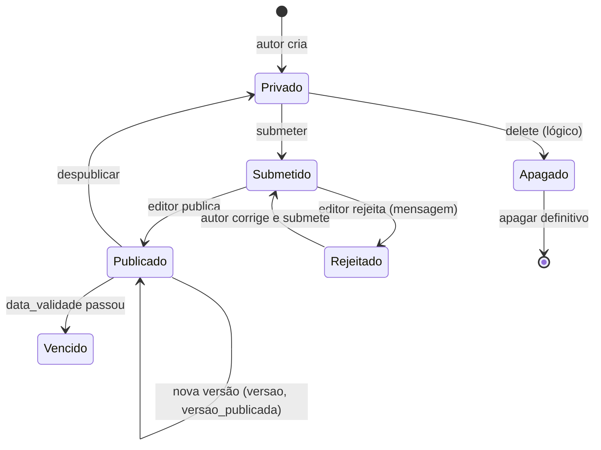

# Fluxo 5 — Conteúdo e workflow

## Hoje (p3)

Modelo: objeto de uma `classe`, valores nas tabelas `tbl_*` conforme `propriedade.cod_tipodado`; hierarquia em `objeto.cod_pai` + `parentesco` (closure com ordem); `classexfilhos` define quais classes podem ser filhas de quais.

Status (`status`): 1 Privado, 2 Publicado, 3 Rejeitado, 4 Submetido. Telas: `new`, `edit`, `submeter`, `publicar`, `rejeitar`, `delete`, `apagar_definitivo`, `pendentes`, `rejeitados`, `vencidos`, `pilha` (copiar, mover, colar), `workflow`, `log`.

Versões em `versaoobjeto`; ações registradas em `logobjeto` e `logworkflow`. `pendencia` guarda a fila do editor.

### Problemas
- CRUD em páginas procedurais (`manage/*.php`) com HTML misturado; `Administracao` e `AdminObjeto` com ~2k linhas cada.
- SQL por concatenação; `insertId` com `SELECT MAX()` (corrida).
- Conteúdo `tbl_text` salvo e exibido sem saneamento (XSS armazenado de Autor contra Admin).

## PBL4

- **Serviços de domínio** (`ObjetoRepository`, `WorkflowService`, `VersaoService`) com testes; controllers finos.
- **Máquina de estados explícita**: transições permitidas por perfil, validadas no serviço, não na tela.
- **Sanitização por tipo** (HTML permitido via lista de tags para `Texto Avanc.`).
- **Escopo por subárvore** (perfil por objeto, já existente em `usuarioxobjetoxperfil`) preservado.
- Mesmos estados e telas, para o editor antigo reconhecer o produto; UX do formulário gerado por `propriedade` é melhorada depois.
