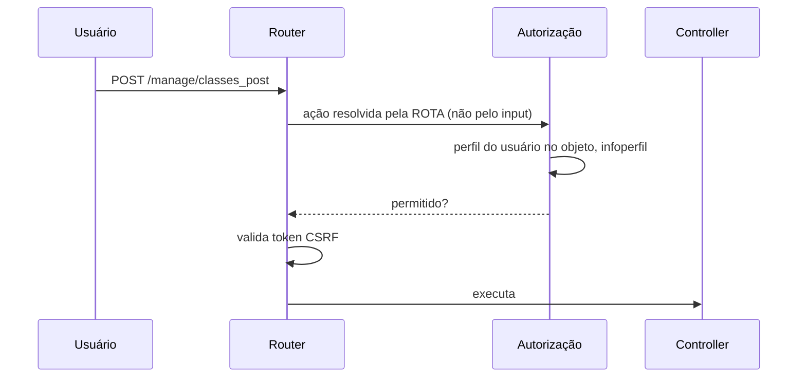

# Fluxo 6 — Autenticação e permissões

## Hoje (p3)

- Login em `manage/login_post.php` → `Usuario::login()` (`Core/Usuario.php:185`): `md5($senha)` (coluna `varchar(32)`), com `prepare` do ADOdb. LDAP opcional. `htmlspecialchars` aplicado à senha antes do hash (corrompe senhas com `&`, `<`, aspas).
- Rate limit: `$maximotentativas * 100`, **só na sessão** (contornável descartando o cookie). Sem `session_regenerate_id` após login.
- Sessão: `use_strict_mode`, `only_cookies`, `httponly`; sem `SameSite`/`secure`.
- Permissões: `perfil` (Administrador, Editor, Autor, Restrito, Militarizado, `_Default`) por usuário **e por objeto** (`usuarioxobjetoxperfil`, herdado pela árvore); ações permitidas em `infoperfil` (`acao`, `script`, flags `sodono`, `sopublicado`, `donooupublicado`).
- `Usuario::podeExecutar($acao)` (`Usuario.php:453`) usa `preg_match("%".$script."%is", $acao)` **sem âncora**, sobre a `action` completa; o arquivo executado vem só do último segmento. Resultado: quem tem permissão em `edit` pede `action=/do/edit/gerusuario` e executa `manage/gerusuario.php`.
- Nenhum token CSRF.



## PBL4

> **Decisões detalhadas:** [ADR 0011](../adr/0011-autenticacao-sessao-permissoes.md).
> **Implementado (fase 3a):** contas e senhas (argon2id), perfis por subárvore com herança pelo `caminho`, `Permissoes::pode` (ação por enum, nunca texto da requisição), autoria nas versões, auditoria que só acrescenta e `bin/pbl usuario`. **Falta (3b):** sessão própria com cookie `__Host-pbl4`, tela/rota de entrar e sair, CSRF, limite de tentativas no servidor, cabeçalhos de segurança, segredo do site, recuperação de senha.

```mermaid
flowchart LR
    R[Rota /_pbl/...<br/>(ação fixa no código)] --> S[Sessão → Usuário]
    S --> P{Permissoes::pode<br/>usuário, ação, objeto}
    P -->|admin global| OK[permitido]
    P -->|perfil mais forte nos ancestrais do objeto| M{ação ∈ perfil?}
    M -->|autor + editar| D{criado_por = usuário?}
    M -->|sim| OK
    M -->|não| NO[recusado]
    D -->|sim| OK
    D -->|não| NO
```

1. **Ação = rota registrada.** A permissão é checada contra o identificador da rota resolvida, por comparação exata, nunca por regex sobre texto de entrada.
2. **`password_hash`** (argon2id/bcrypt) com `password_needs_rehash` no login; migração transparente de md5 no primeiro acesso do usuário; senha nunca passa por `htmlspecialchars`.
3. **Sessão**: `session_regenerate_id(true)` no login, cookie `HttpOnly; SameSite=Lax; Secure` (quando HTTPS), expiração por inatividade.
4. **CSRF**: token por sessão em todos os POST/ações destrutivas.
5. **Rate limit no servidor** por login e por IP (`tentativa_login`), com bloqueio temporário e aviso ao admin.
6. **Recuperação de senha** por e-mail com token de uso único e prazo.
7. **Auditoria** das ações sensíveis (`auditoria`).
8. LDAP preservado como opção; fluxo idêntico depois da autenticação.
9. Estrutura de perfis por subárvore mantida; `infoperfil` evolui para permissões por **rota e por campo** (o importador converte as existentes).
10. **Visitantes cadastrados não são usuários do admin**: população separada (`participante`), com cadastro por token, LGPD e modos anônimo/identificado (ADR 0004).
