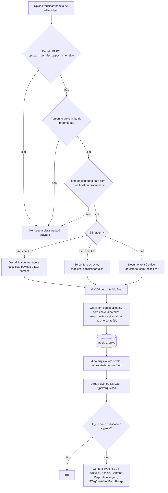

# Fluxo 7 — Upload e blobs

## Hoje (p3)

- Propriedade do tipo Blob (`tbl_blob`: `arquivo`, `tamanho`); classes `Imagem` e `Arquivo`.
- Upload (`Administracao.php` ~590–640, `Blob::gravarBlob` `Blob.php:510`) grava `<cod_blob>.<extensão do nome enviado>` em `uploadpath` **sem whitelist e sem checar MIME**. Um `.php`/`.phtml`/`.phar` vira webshell se `uploadpath` estiver no docroot.
- SVG é servido inline (`tipos_ver`, `Blob.php:66`): XSS armazenado.
- `shell_exec` com `gs` (miniaturas de PDF) sem `escapeshellarg`; a extensão vem do cliente.
- Nome do arquivo entra em SQL sem escape em um ramo (`Administracao.php` ~605).
- Entrega via `/blob/ver|baixar|verinterno` (`Pagina::executar`).

## PBL4 (fase 7a, feita; ADR 0014)

Propriedades de classe dos tipos **`arquivo`** (documentos: pdf, txt, csv e, com a ressalva abaixo, docx/xlsx/pptx/odt/ods/odp)
e **`imagem`** (jpg, png, gif, webp). O valor guardado no JSON do objeto é o **id de uma linha de `arquivo`** (como uma `ref`,
mas apontando para `arquivo`, não para `objeto`): `Pbl\Arquivos`.

- **Upload só na tela de editar** um objeto que já existe (`TelasDeObjetos`, `multipart/form-data`): o arquivo precisa de um
  dono (`objeto_id`) desde a criação, então criar um conteúdo com arquivo é salvar primeiro (sem arquivo) e depois editar. Essa
  restrição é documentada no próprio formulário.
- **Nunca o nome do cliente como caminho**: o arquivo em disco leva uma **chave aleatória** (16 bytes); a extensão vem sempre
  da whitelist, nunca do nome enviado. O nome original só é guardado como metadado saneado, para mostrar na tela e no
  `Content-Disposition`.
- **Tipo real por conteúdo**, nunca pela extensão do nome: `finfo` lê os bytes; para os formatos que são contêineres ZIP
  (`docx`, `xlsx`, `pptx`, `odt`, `ods`, `odp`) o `finfo` às vezes só diz "zip", então confere também a assinatura `PK\x03\x04` —
  mais fraco que os outros tipos, é uma limitação conhecida (não valida a estrutura interna do documento, só que é um ZIP).
- **Imagem**: com GD, `imagecreatefromstring` decodifica de verdade (um `.jpg` que não é imagem de verdade é recusado) e o
  resultado é **recodificado** — recria os pixels, então qualquer payload escondido e o EXIF somem (`sanitizada = true`). Sem
  GD, só confere os bytes mágicos do formato (mais fraco; `sanitizada = false`), registrado na tela de requisitos do instalador.
- **Whitelist por propriedade**: a classe pode restringir `tipos` (subconjunto das extensões da categoria) e `tamanho_max_mb`
  (até `TiposDeArquivo::TETO_MB`, hoje a tela de tipos de conteúdo ainda não oferece editar isso — só o `ClasseRepositorio`
  direto); sem configurar, vale a lista inteira da categoria e `TiposDeArquivo::PADRAO_MB`.
- **Deduplicação**: o mesmo conteúdo (mesmo sha256 e extensão) reaproveita o arquivo em disco; cada upload ainda cria sua
  própria linha em `arquivo` (dono e nome podem ser diferentes).
- **Entrega sempre por `ArquivoController`** (rota pública sob `/_pbl/arquivo/{id}`, tratada pela `Aplicacao` antes do
  `Painel`, como `EnvioDeFormulario`): só entrega se o **objeto dono** (fixado no upload) está `publicado` e vigente agora;
  qualquer outro caso (privado, fora do ar, de outro site, inexistente) dá 404, sem distinguir o motivo. `Content-Type` vem
  sempre da tabela fechada de `TiposDeArquivo` (nunca do que foi detectado), com `X-Content-Type-Options: nosniff`,
  `Content-Disposition` (`inline` para o que é feito para abrir no navegador — imagem e pdf —, `attachment` para o resto, nome
  saneado e em ASCII + `filename*` RFC 5987), `ETag`/`Cache-Control: immutable` e suporte a `Range` de um trecho (via
  `BinaryFileResponse::prepare`, embutido no Symfony).
- **Miniaturas** (`GET /_pbl/arquivo/{id}/miniatura/{tamanho}`, tamanho só de `ServicoDeMiniaturas::TAMANHOS`): só de imagem e
  só com GD; geradas sob demanda e cacheadas em `dados/cache/miniaturas/`. Sem GD, a tela mostra o arquivo original.
- **Versionamento**: o valor gravado é o id do arquivo, então uma versão antiga do objeto (`objeto_versao`) continua
  apontando para o arquivo de quando foi salva; restaurar uma versão antiga traz o arquivo de volta.
- **Arquivo órfão nunca é apagado na requisição**: trocar ou remover o valor de uma propriedade só deixa de referenciar o
  arquivo antigo (o arquivo e a linha continuam existindo, para não arriscar apagar algo que uma corrida ainda está
  gravando). `bin/pbl limpar-uploads [--simular]` varre `objeto` e `objeto_versao` (todas as versões) à procura de ids ainda
  referenciados e apaga o resto, com uma carência de 1 hora (nunca apaga algo enviado há menos tempo que isso).
- **Fora desta fatia**: anexar arquivo já na criação do conteúdo (fica para depois de salvar); comando de molde para montar o
  link num template (`#propriedade` dá o id; o link é `/_pbl/arquivo/<id>`, montado por quem lê o id); editor de `tipos`/
  `tamanho_max_mb` por propriedade na tela de tipos de conteúdo; anexos de formulário público (fluxo 6); S3/B2 (armazenamento
  é só `dados/uploads/` em disco local por agora, mas já isolado em `ArmazenamentoDeArquivos`); remoção opcional de EXIF
  quando o GD não está disponível (sem GD, o conteúdo original é mantido como veio, só com o cabeçalho conferido).
- Limites de `upload_max_filesize`/`post_max_size` do PHP não são verificados pelo instalador nesta fatia (ficam só na
  mensagem de erro do upload); confira-os no `php.ini` do servidor para o maior arquivo que a instalação vai aceitar.
