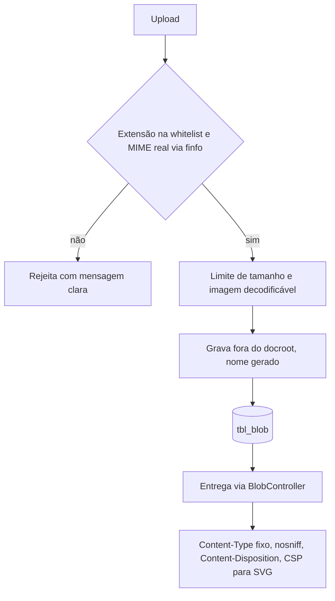

# Fluxo 7 — Upload e blobs

## Hoje (p3)

- Propriedade do tipo Blob (`tbl_blob`: `arquivo`, `tamanho`); classes `Imagem` e `Arquivo`.
- Upload (`Administracao.php` ~590–640, `Blob::gravarBlob` `Blob.php:510`) grava `<cod_blob>.<extensão do nome enviado>` em `uploadpath` **sem whitelist e sem checar MIME**. Um `.php`/`.phtml`/`.phar` vira webshell se `uploadpath` estiver no docroot.
- SVG é servido inline (`tipos_ver`, `Blob.php:66`): XSS armazenado.
- `shell_exec` com `gs` (miniaturas de PDF) sem `escapeshellarg`; a extensão vem do cliente.
- Nome do arquivo entra em SQL sem escape em um ramo (`Administracao.php` ~605).
- Entrega via `/blob/ver|baixar|verinterno` (`Pagina::executar`).

## PBL4

- **Armazenamento fora do docroot** (ou diretório com execução de PHP desligada) e **nome interno gerado**; o nome original é só metadado escapado.
- Anexos de objeto guardam o **id do blob** no JSON do objeto; o blob mantém dono, tamanho e hash. Anexos de formulário público seguem a mesma política e entram em quarentena até moderação.
- **Whitelist** configurável de tipos por classe; SVG sanitizado ou servido como download.
- **Entrega sempre por controller**, com cabeçalhos seguros e checagem de permissão do objeto dono.
- **Miniaturas** com `escapeshellarg` ou biblioteca (GD/Imagick), cache em disco.
- Abstração de armazenamento (disco local agora; S3/B2 depois), pensando em hospedagens sem disco persistente.
- Limites (`upload_max_filesize`, `post_max_size`) verificados e explicados pelo instalador (fluxo 3).
