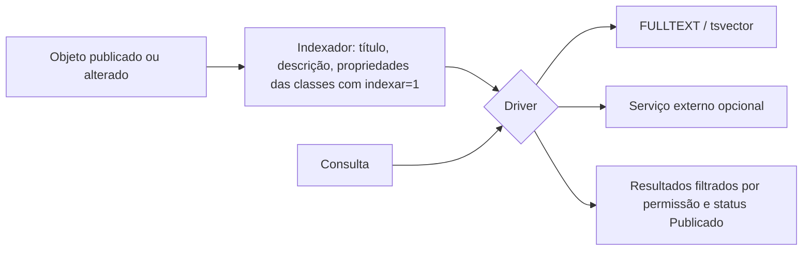

# Fluxo 8 — Busca e indexação

## Hoje

- Classes têm flag `indexar`. A busca textual dependia do **indexador Lucene** (repo `publicare/indexador-lucene`, Java, privado) criando índices a partir do banco; o portal consultava esse índice (`manage/indexportal.php`, `html/objects/search_result.php`).
- Exige Java e processo externo: inviável para o público do instalador (fluxo 3).
- Postgres no schema usa a extensão `unaccent`, o que indica buscas sem acento.

> **Atualização:** o desenho em três níveis (normalizar, relevância, grafias parecidas) está no [ADR 0010](../adr/0010-busca.md). Os **níveis A, B e C estão implementados**: a busca ignora maiúsculas e acentos, procura por várias palavras, começo de palavra e plural, com relevância, numa tabela do próprio banco (`objeto_termo`), e pode sugerir "você quis dizer…" quando não acha nada (opcional por site, `%SUGESTAO` no molde); a visibilidade (estado e datas) é aplicada na consulta — tanto na busca quanto na sugestão —, no mesmo motor de consulta do fluxo 9. A tabela de opções abaixo continua valendo para o driver de portais grandes.

## PBL4 (a decidir; não bloqueia as Fases 0–4)

Meta: busca que funcione **sem serviço externo** na instalação padrão.

| Opção | Prós | Contras |
|---|---|---|
| A. Tabela de índice invertido própria (`indice_busca`) populada ao publicar | portátil (MySQL e Postgres), sem dependência | qualidade de ranking limitada |
| B. FULLTEXT do MySQL / `tsvector` do Postgres atrás de uma interface | ranking e performance melhores | dois dialetos para manter |
| C. Lucene/Meilisearch opcional | melhor para portais grandes (100k+ objetos) | exige serviço externo |

Recomendação inicial: interface `BuscaInterface` com **B como padrão** (um driver por banco: FTS5 no SQLite, FULLTEXT no MySQL, `tsvector` no Postgres) e C como driver opcional para portais grandes.

A busca textual devolve ids que seguem o mesmo caminho do motor de consulta (fluxo 9): o escopo da subárvore do site e as facetas (tema, autor, ano) vêm de `objeto_indice`, e o texto vem do driver. A biblioteca virtual usa exatamente essa combinação.

Pontos a cuidar:
- Resultado só mostra objetos que o usuário pode ver (publicado, não vencido, não apagado, não protegido).
- Reindexação completa disponível no admin; indexação incremental ao publicar/despublicar/apagar.
- Normalização de acentos e português (stemming simples).
