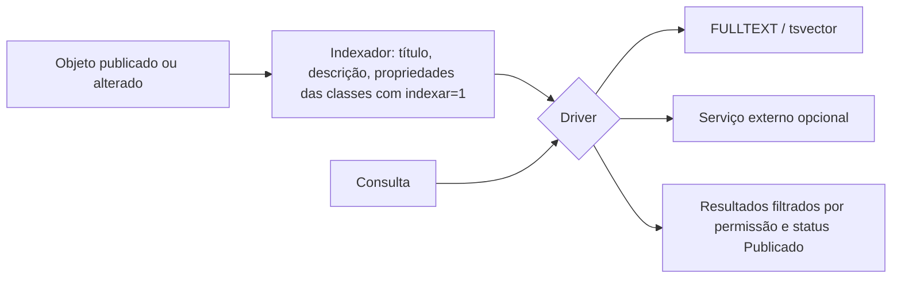

# Fluxo 8 — Busca e indexação

## Hoje

- Classes têm flag `indexar`. A busca textual dependia do **indexador Lucene** (repo `publicare/indexador-lucene`, Java, privado) criando índices a partir do banco; o portal consultava esse índice (`manage/indexportal.php`, `html/objects/search_result.php`).
- Exige Java e processo externo: inviável para o público do instalador (fluxo 3).
- Postgres no schema usa a extensão `unaccent`, o que indica buscas sem acento.

## PBL4 (a decidir; não bloqueia as Fases 0–4)

Meta: busca que funcione **sem serviço externo** na instalação padrão.

| Opção | Prós | Contras |
|---|---|---|
| A. Tabela de índice invertido própria (`indice_busca`) populada ao publicar | portátil (MySQL e Postgres), sem dependência | qualidade de ranking limitada |
| B. FULLTEXT do MySQL / `tsvector` do Postgres atrás de uma interface | ranking e performance melhores | dois dialetos para manter |
| C. Lucene/Meilisearch opcional | melhor para portais grandes (100k+ objetos) | exige serviço externo |

Recomendação inicial: interface `BuscaInterface` com **B como padrão** (um driver por banco) e C como driver opcional para portais grandes.

Pontos a cuidar:
- Resultado só mostra objetos que o usuário pode ver (publicado, não vencido, não apagado, não protegido).
- Reindexação completa disponível no admin; indexação incremental ao publicar/despublicar/apagar.
- Normalização de acentos e português (stemming simples).
