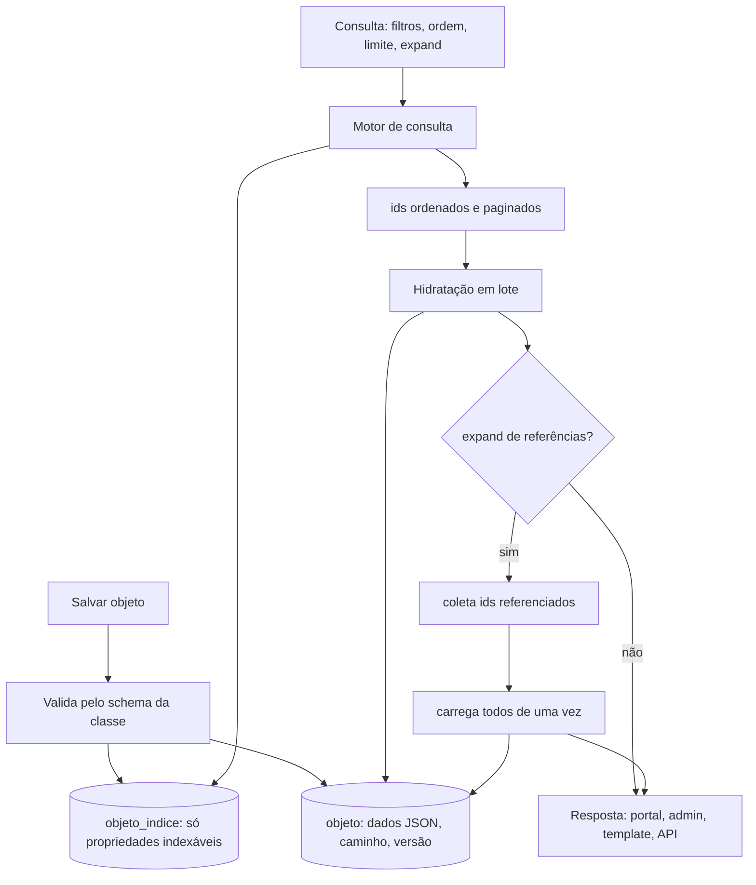

# Fluxo 9 — Armazenamento, referências e consulta

## Hoje (PBL3)

EAV: um objeto é espalhado por `tbl_string/text/integer/float/date/boolean/blob/objref`, uma linha por valor. Para montar o array de resposta de um objeto, o sistema lê as propriedades da classe e busca cada valor; para cada `Ref. Objeto`, busca o objeto apontado e carrega **as propriedades dele**. Em buscas complexas com referência, resultados intermediários iam para **tabelas temporárias** (busca do portal, filtros do admin e relatórios de template).

As tabelas temporárias eram uma solução engenhosa para um problema real do EAV (hidratar referências em buscas complexas); a ideia de hidratar referências continua, muda a execução.

Problemas: joins por campo, N+1 em referências, tabelas temporárias exigem privilégio de DDL.

## PBL4

Regras:
1. **Escrita**: ao salvar, valida e grava o JSON em `objeto` e reescreve as linhas de `objeto_indice` dos campos indexáveis (tipados). Tudo em transação.
2. **Consulta**: o motor monta o SQL só sobre `objeto_indice` (+ `objeto` para status, site, caminho, permissão) e devolve ids paginados.
3. **Hidratação em lote**: carrega os objetos desses ids com **uma** consulta; para referências, junta os ids referenciados de toda a página e faz **uma** segunda consulta (profundidade máxima configurável). Substitui o N+1 e as tabelas temporárias.
4. **Filtro por objeto referenciado**: em duas etapas (ids do referenciado, depois `WHERE ref IN (...)`) ou `WITH`.
5. **Snapshot opcional** de campos de exibição na própria referência (p.ex. título) para listas baratas; atualizado por evento quando o referenciado muda.
6. **Cache** de listas caras (ids) invalidado por mudança nas classes envolvidas.
7. **Sem DDL em runtime**; tabela física por classe é opção avançada com credencial de migração separada ou SQL exportado para DBA (ver ADR 0003).

## Os três usos, um motor

| Contexto | Quem | Como consulta |
|---|---|---|
| Busca do portal | visitante | texto + filtros simples; só publicados, não vencidos, não protegidos |
| Filtros do admin | editor | filtros por campo e por referência, respeitando permissão da subárvore |
| Template/relatório | autor da pele | comando de lista do PBL com a mesma definição de consulta; exporta CSV/PDF/RSS |
