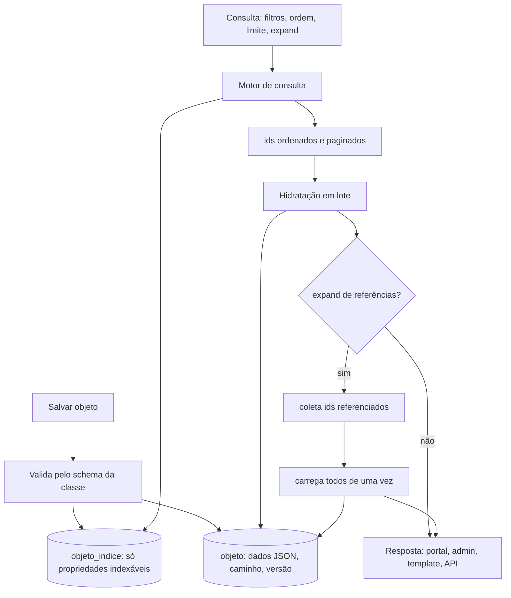
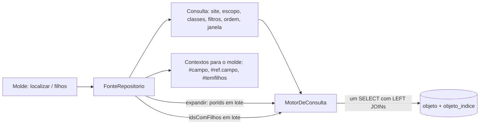

# Fluxo 9 — Armazenamento, referências e consulta

## Hoje (PBL3)

EAV: um objeto é espalhado por `tbl_string/text/integer/float/date/boolean/blob/objref`, uma linha por valor. Para montar o array de resposta de um objeto, o sistema lê as propriedades da classe e busca cada valor; para cada `Ref. Objeto`, busca o objeto apontado e carrega **as propriedades dele**. Em buscas complexas com referência, resultados intermediários iam para **tabelas temporárias** (busca do portal, filtros do admin e relatórios de template).

As tabelas temporárias eram uma solução engenhosa para um problema real do EAV (hidratar referências em buscas complexas); a ideia de hidratar referências continua, muda a execução.

Problemas: joins por campo, N+1 em referências, tabelas temporárias exigem privilégio de DDL.

## PBL4

Regras:
1. **Escrita**: ao salvar, valida e grava o JSON em `objeto` e reescreve as linhas de `objeto_indice` dos campos indexáveis (tipados). Tudo em transação.
2. **Consulta**: o motor monta o SQL só sobre `objeto_indice` (+ `objeto` para status, site, caminho, permissão) e devolve ids paginados.
3. **Hidratação em lote**: carrega os objetos desses ids com **uma** consulta; para referências, junta os ids referenciados de toda a página e faz **uma** segunda consulta (profundidade máxima configurável). Substitui o N+1 e as tabelas temporárias.
4. **Filtro por objeto referenciado**: em duas etapas (ids do referenciado, depois `WHERE ref IN (...)`) ou `WITH`.
5. **Snapshot opcional** de campos de exibição na própria referência (p.ex. título) para listas baratas; atualizado por evento quando o referenciado muda.
6. **Cache** de listas caras (ids) invalidado por mudança nas classes envolvidas.
7. **Sem DDL em runtime**; tabela física por classe é opção avançada com credencial de migração separada ou SQL exportado para DBA (ver ADR 0003).
8. **Mudar a classe não reescreve dados** (fase 5c): como os valores vivem no JSON do objeto, remover um campo ou trocar o tipo exigiria converter ou apagar valores. A regra é não fazer nenhum dos dois: campo com valor (no objeto ou em versão antiga) só pode ser **arquivado** (continua na definição, então a validação, o índice e os moldes seguem iguais) e campo sem valor pode ser removido ou mudar de tipo livremente ([ADR 0012](../adr/0012-administracao-web.md) §6).

## Os três usos, um motor

| Contexto | Quem | Como consulta |
|---|---|---|
| Busca do portal | visitante | texto + filtros simples; só publicados, não vencidos, não protegidos |
| Filtros do admin | editor | filtros por campo e por referência, respeitando permissão da subárvore |
| Template/relatório | autor da pele | comando de lista do PBL com a mesma definição de consulta; exporta CSV/PDF/RSS |

## Caminho materializado e escopo de busca

`objeto.caminho` guarda a trilha completa (`/1/45/230/`), com índice por prefixo. Ele substitui `parentesco` e cumpre os dois papéis dele:

1. **Exibição da árvore** a partir da raiz do site: breadcrumb, menu e `ROOT` do PBL cortam o caminho na raiz resolvida pelo domínio (fluxo 1).
2. **Redução da população nas buscas**: toda consulta leva implicitamente `caminho LIKE '<caminho da raiz>%'` (site ou seção), de modo que listas, busca e relatórios só enxergam a subárvore pedida. É o filtro mais seletivo e entra sempre no plano de execução.

Mover um objeto reescreve o caminho da subárvore (uma atualização por prefixo, em transação). `objeto_indice` repete o caminho (ou o id do site) para que o filtro de escopo seja resolvido na própria tabela de índice.

Objeto servido por mais de um domínio: o domínio é só uma raiz de entrada; o objeto continua tendo um caminho único e uma URL canônica (a do site dono).

## Ordenar e filtrar pelo campo de um objeto referenciado

No PBL3, ordenar (ou filtrar) pelo campo de um objeto apontado por uma propriedade `obj_ref` (por exemplo, notícias ordenadas pelo nome do autor) era um dos motivos das **tabelas temporárias**: o resultado era achatado para a ordem ser aplicada. No PBL4 isso é uma consulta só, sem DDL:

- a propriedade do tipo `ref` guarda o id do referenciado em `objeto_indice` (`numero`);
- `LEFT JOIN objeto r ON r.id = <índice>.numero` traz as colunas do referenciado (`titulo`, `peso`…); para um campo **indexável** do referenciado entra um segundo `LEFT JOIN objeto_indice`;
- sintaxe de molde prevista: `ordem="autor.titulo"`, `ordem="-autor.cargo"` e `campo="autor.cargo" valor="…"`;
- alternativa barata para listas grandes: *snapshot* do campo de exibição na própria referência (ADR 0003 §3), atualizado por evento.

**Implementado** (fase 1a): o tipo `ref`, `ordem="autor.titulo"`, `campo="autor.cargo"`, `#autor.titulo` e `expandir="autor"` (carga em lote) já funcionam, com os testes `MotorDeConsultaTest` e `ReferenciasNoMoldeTest`. Detalhes de implementação: um `LEFT JOIN` no índice da referência e outro no objeto apontado, **sempre do mesmo site**, no máximo 8 junções por consulta e nulos por último em qualquer banco. A forma de *snapshot* continua como otimização futura para listas muito grandes.

