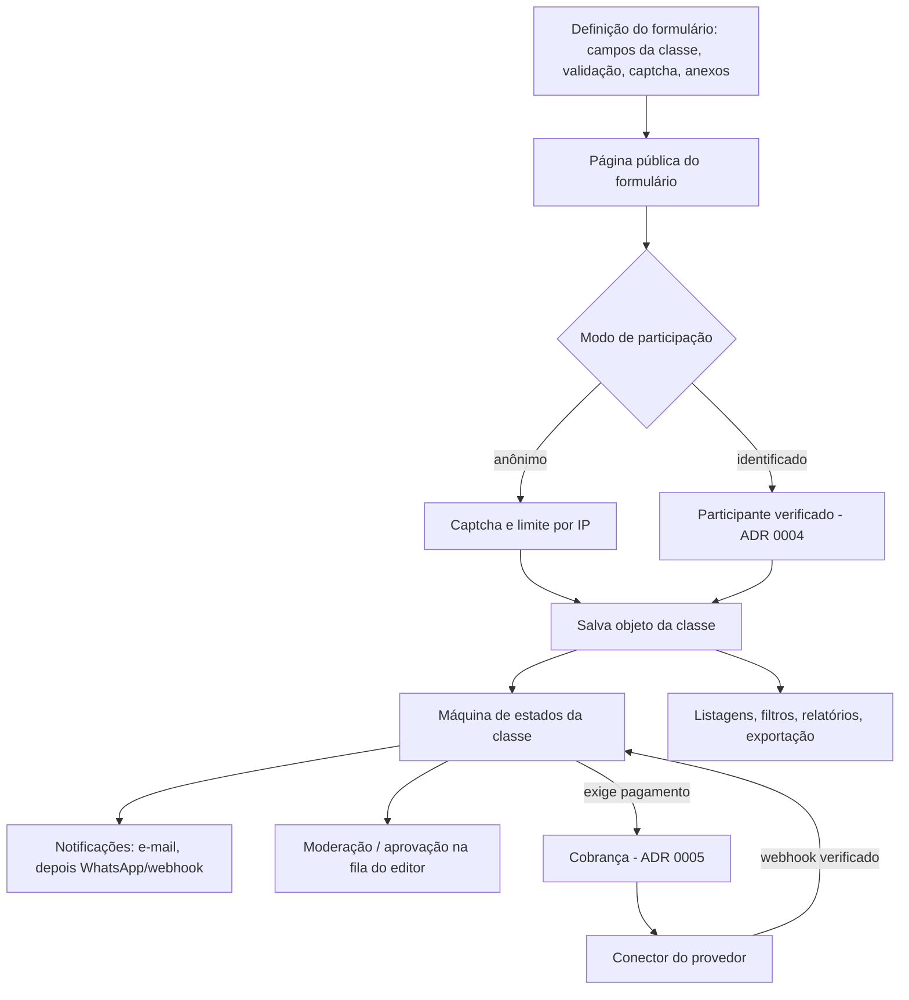
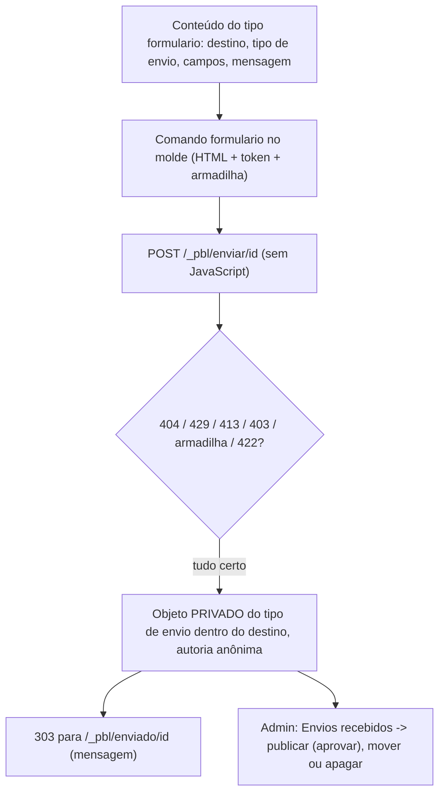

# Fluxo 10 — Formulários, fluxos de estado, participação e pagamento

## Hoje (PBL3)

Cada sistema pequeno (consulta pública, inscrição, cadastro interno, enquete) era uma classe de dados mais um **script PHP avulso** em `html/objects/`, repetindo validação, e-mail de token, moderação e telas de listagem. Pagamento, quando existia, era integrado à mão.

## PBL4

Peças, todas **dados/configuração**:

| Peça | O que define |
|---|---|
| Formulário | campos expostos, rótulos, validação, anexos, consentimento, captcha, página de agradecimento |
| Estados e transições | estados da classe, quem pode mover, prazos, ação ao entrar (notificar, criar cobrança, publicar) |
| Notificações | modelos com variáveis do objeto; destinatário = participante, autor, perfil da subárvore |
| Agregações | contagem por opção (enquetes), média de notas (avaliações), vagas restantes |
| Listagens e relatórios | consulta do fluxo 9 + coluna/ordem + exportação CSV/PDF/RSS |

### O que existe hoje (fatia 6a)

Só o pedaço **Formulário → anônimo → captcha/limite → salva objeto → fila do editor** do diagrama acima, sem captcha de terceiros, sem máquina de estados e sem notificações. Decisões e segurança no [ADR 0013](../adr/0013-formularios-publicos.md).

Ainda **não** existe: estados e transições, notificações, captcha, anexos, prazos, agregações, participante identificado, editor de formulário, exportação. São os próximos passos da fase 6.

### Exemplos que o modelo precisa cobrir
- **Consulta pública/enquete**: formulário anônimo ou identificado, prazo de abertura e fechamento, agregação de resultados, moderação de comentários.
- **Biblioteca virtual**: classe com anexo, facetas por campo (tema, autor, ano), busca (fluxo 8), download protegido (fluxo 7).
- **Evento com inscrição paga**: classes `evento`, `sala/mesa`, `palestrante`, `atividade` ligadas por referência; inscrição com estados `pendente → pago → confirmado`, limite de vagas, categorias de valor, avaliação pós-evento.
- **Cadastro com aprovação**: autor cria, editor aprova (workflow do fluxo 5).

### Limite
Regras que cruzam várias tabelas, cálculos próprios ou integrações específicas viram **módulo** (ponto de extensão), não script solto. Ganchos disponíveis: antes/depois de salvar, ao mudar de estado, ao receber notificação de cobrança, comando PBL novo, tipo de campo novo.

### Segurança
CSRF em todo formulário (hoje: token fixo por formulário + conferência de origem, ADR 0013); captcha plugável (hoje: campo-armadilha); limite por IP e por participante; upload pela política do fluxo 7; dados pessoais conforme ADR 0004; auditoria das transições.
