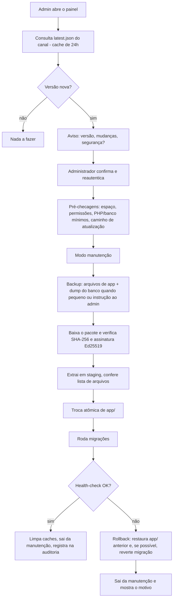

# Fluxo 11 — Atualização automática

## Hoje (PBL3)

Sem mecanismo: copiar os arquivos novos por cima do site (FTP), aplicar SQL à mão, torcer para nada ter sido sobrescrito (config, peles). Não há aviso de versão nova nem como voltar atrás.

## PBL4 (ADR 0006)



### Layout de pastas

```
raiz/
  app/           código e assets do produto (substituível)
  vendor/        dependências (substituível)
  dados/         config, uploads, peles do site, cache, SQLite (nunca tocado)
  releases/      versões anteriores guardadas para rollback (as 2 últimas)
  public/        index.php (front controller)
```

### Troca atômica
- **Com symlink** (VPS, hospedagens que permitem): `app` é um link para `releases/<versão>`; a troca é um único `rename` do link.
- **Sem symlink** (compartilhada): `rename` de diretório (`app` → `app.old`, `app.new` → `app`), operação rápida e quase atômica; o modo manutenção cobre a janela. Se o `rename` não for permitido, o atualizador cai para o modo manual com instruções.

### Segurança das atualizações
| Ameaça | Defesa |
|---|---|
| CDN ou bucket comprometido | assinatura Ed25519 com chave fora do CDN; chave pública embutida |
| Pacote adulterado em trânsito | SHA-256 no manifesto assinado; HTTPS |
| Downgrade malicioso | versão só avança; manifesto traz versão mínima |
| Zip-slip | extração em staging, caminhos normalizados, lista de arquivos esperada |
| Escrita indevida de código | janela de escrita só durante a atualização, token de uso único e reautenticação; CLI recomendado quando houver terminal |
| Atualização que quebra o site | modo manutenção, backup, health-check, rollback automático |

### Publicação de uma release (lado do mantenedor)
1. Tag da versão no repositório; CI roda testes e empacota (`app/` + `vendor/` sem dev).
2. Assinatura do pacote e do manifesto (chave de release).
3. Envio ao bucket; `latest.json` do canal por último (publicação só vira visível quando tudo está no ar).
4. Changelog e flag `seguranca` quando for o caso.

### Pontos a decidir
- Tamanho típico do pacote e se vale oferecer pacote diferencial (patch) além do completo.
- Política de rollback de migrações (reversíveis vs. só compatíveis).
- Frequência e modo de checagem para sites sem cron (checagem no acesso do admin).
- Canal para atualizar módulos e peles de galeria.
