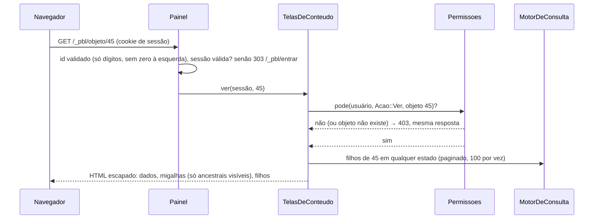
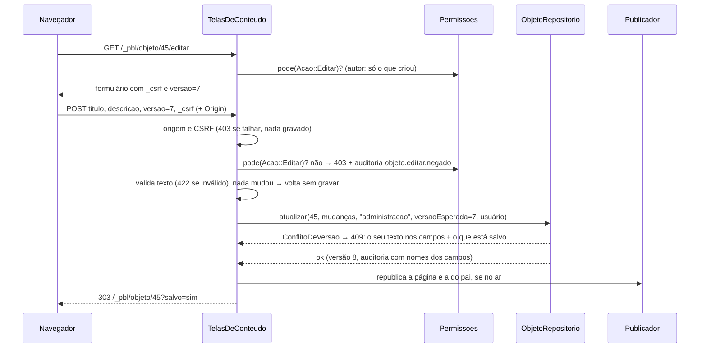

# Fluxo 12 — Administração pelo navegador

## Hoje (p3)

- Telas em `manage/*.php`, cada uma decidindo sozinha o que mostrar; a permissão era conferida por uma regex sem âncora sobre o texto da ação (fluxo 6), e esconder o link fazia as vezes de controle de acesso.
- Formulários sem token CSRF; saídas com escape irregular.
- Edição simultânea: quem salvava por último apagava o trabalho do outro, sem aviso.

## PBL4

> **Decisões:** [ADR 0012](../adr/0012-administracao-web.md). **Implementado (fase 5a):** painel com os sites e seções que a pessoa pode ver, navegação na árvore (só leitura, com conteúdo fora do ar) e edição de título e descrição com proteção contra edição simultânea e republicação. **Falta:** criar, mover, mudar estado, apagar, editar propriedades, histórico na tela, contas, domínios, redirecionamentos e peles.

### Ver um conteúdo

### Editar título e descrição

1. **A rota decide a ação** (`Acao::Ver`, `Acao::Editar`), nunca o texto do pedido; a decisão é sempre de `Permissoes::pode`.
2. **Mesma resposta** para "não existe" e "sem permissão" (403): ninguém descobre ids alheios.
3. **Edição simultânea** é recusada com as duas versões à vista; salvar de novo é uma decisão consciente.
4. **Republicação** imediata da página editada e da página-mãe; outras páginas que citam o título (menus em outras seções) mudam na próxima publicação do site.
5. **Visual**: Bootstrap 5 local (só CSS), sem JavaScript, servido direto pelo servidor web a partir de `public/_pbl/assets/`.
