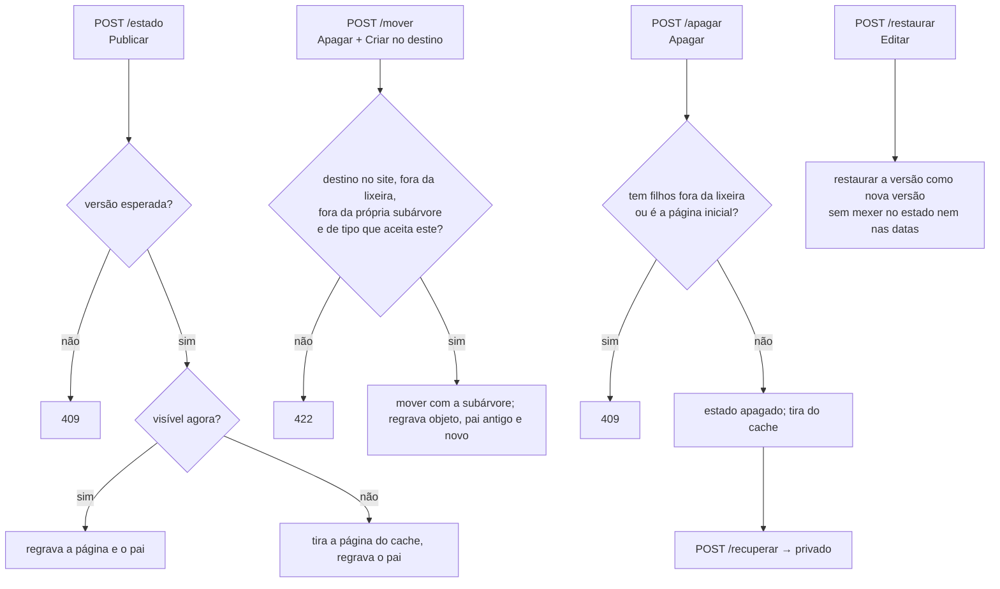

# Fluxo 12 — Administração pelo navegador

## Hoje (p3)

- Telas em `manage/*.php`, cada uma decidindo sozinha o que mostrar; a permissão era conferida por uma regex sem âncora sobre o texto da ação (fluxo 6), e esconder o link fazia as vezes de controle de acesso.
- Formulários sem token CSRF; saídas com escape irregular.
- Edição simultânea: quem salvava por último apagava o trabalho do outro, sem aviso.

## PBL4

> **Decisões:** [ADR 0012](../adr/0012-administracao-web.md). **Implementado (fase 5a):** painel com os sites e seções que a pessoa pode ver, navegação na árvore (com conteúdo fora do ar) e edição de título e descrição com proteção contra edição simultânea e republicação. **(fase 5c):** tipos de conteúdo (classes): listar, criar, editar campos e apagar, sem nunca apagar valor guardado. **(fase 5b):** lista de filhos com ordem e filtros por classe e estado, criar filho (só dos tipos que o pai aceita) com as propriedades da classe, editar todas as propriedades (obrigatórias exigidas, arquivadas preservadas), estado e datas, mover com a subárvore, lixeira (mandar e tirar) e histórico com restaurar. **Falta:** contas, domínios, redirecionamentos e peles.

### Ver um conteúdo

```mermaid
sequenceDiagram
    participant V as Navegador
    participant P as Painel
    participant T as TelasDeObjetos
    participant A as Permissoes
    participant M as MotorDeConsulta
    V->>P: GET /_pbl/objeto/45 (cookie de sessão)
    P->>P: id validado (só dígitos, sem zero à esquerda), sessão válida? senão 303 /_pbl/entrar
    P->>T: ver(sessão, 45)
    T->>A: pode(usuário, Acao::Ver, objeto 45)?
    A-->>T: não (ou objeto não existe) → 403, mesma resposta
    A-->>T: sim
    T->>M: filhos de 45 (ordem e filtros de listas fixas; sem filtro, fora a lixeira; 100 por vez)
    T-->>V: HTML escapado: dados, migalhas (só ancestrais visíveis), filhos
```

### Editar

```mermaid
sequenceDiagram
    participant V as Navegador
    participant T as TelasDeObjetos
    participant A as Permissoes
    participant R as ObjetoRepositorio
    participant U as Publicador
    V->>T: GET /_pbl/objeto/45/editar
    T->>A: pode(Acao::Editar)? (autor: só o que criou)
    T-->>V: formulário (título, descrição, endereço, peso, campos não arquivados da classe) com _csrf e versao=7
    V->>T: POST campos, versao=7, _csrf (+ Origin)
    T->>T: origem e CSRF (403 se falhar, nada gravado)
    T->>A: pode(Acao::Editar)? não → 403 + auditoria objeto.editar.negado
    T->>T: valida cada campo pelo tipo e os obrigatórios (422 com a mensagem ao lado do campo), nada mudou → volta sem gravar
    T->>R: atualizar(45, mudanças, "administracao", versaoEsperada=7, usuário)
    R-->>T: ConflitoDeVersao → 409: o seu texto nos campos + o que está salvo
    R-->>T: ok (versão 8, auditoria com nomes dos campos)
    T->>U: endereço mudou? tira o antigo do cache; republica a página e a do pai, se no ar
    T-->>V: 303 /_pbl/objeto/45?salvo=sim
```

### Criar um conteúdo (fase 5b)

```mermaid
sequenceDiagram
    participant V as Navegador
    participant T as TelasDeObjetos
    participant A as Permissoes
    participant R as ObjetoRepositorio
    V->>T: GET /_pbl/objeto/45/novo
    T->>A: podeCriarSob(pai 45)? senão 403
    T-->>V: escolha entre os tipos que o tipo do pai aceita
    V->>T: GET /_pbl/objeto/45/novo?classe=3
    T-->>V: formulário com os campos (não arquivados) da classe 3
    V->>T: POST classe=3, campos, _csrf (+ Origin)
    T->>T: origem e CSRF; podeCriarSob (senão 403 + objeto.criar.negado); tipo aceito pelo pai? (senão 422)
    T->>T: valida; endereço vazio → gerado do título (-2, -3… se usado)
    T->>R: criar(..., estado privado, criado_por = pessoa)
    T-->>V: 303 /_pbl/objeto/novo?salvo=criado
```

### Estado, mover, lixeira e histórico (fase 5b)



1. **A rota decide a ação** (`Acao::Ver`, `Acao::Criar`, `Acao::Editar`, `Acao::Publicar`, `Acao::Apagar`), nunca o texto do pedido; a decisão é sempre de `Permissoes::pode`.
2. **Mesma resposta** para "não existe" e "sem permissão" (403): ninguém descobre ids alheios.
3. **Edição simultânea** é recusada (409) em toda gravação; na edição, com as duas versões à vista, e salvar de novo é uma decisão consciente.
4. **Republicação** imediata da página e da página-mãe (e, ao mover, da antiga mãe); o que sai do ar sai do cache na hora; outras páginas que citam o título (menus em outras seções) mudam na próxima publicação do site.
5. **Visual**: Bootstrap 5 local (só CSS), sem JavaScript, servido direto pelo servidor web a partir de `public/_pbl/assets/`.

### Editar um tipo de conteúdo (fase 5c)

```mermaid
sequenceDiagram
    participant V as Navegador
    participant T as TelasDeClasses
    participant A as Permissoes
    participant C as ClasseRepositorio
    V->>T: GET /_pbl/classe/3/editar
    T->>A: podeModelarClasses(usuário)? não → 403
    T->>C: usoDasPropriedades (objetos e versões com valor em cada campo)
    T-->>V: formulário com versao=4; campo em uso: tipo fixo, sem "remover"
    V->>T: POST campos, versao=4, _csrf (+ Origin)
    T->>T: origem e CSRF (403), permissão (403 + classe.negado)
    T->>T: valida (422): tipo trocado ou remoção de campo com valor → recusado com a contagem
    T-->>V: arquivando campo com valores? tela de confirmação com a contagem (nada gravado)
    V->>T: POST confirmar=1
    T->>C: atualizar(3, versaoEsperada=4, campos, descrição, filhas)
    C->>C: repete a regra "nada some"; UPDATE ... WHERE versao = 4
    C-->>T: ConflitoDeVersao → 409, nada gravado
    C-->>T: ok (versão 5); auditoria classe.atualizar com os nomes do que mudou
    T-->>V: 303 /_pbl/classe/3/editar?ok=salva
```

6. **Classes são da instalação**, não de um site; só o administrador global as altera. Os demais veem a lista.
7. **Arquivar, não apagar**: campo com valores sai dos formulários e mantém os dados; remover ou trocar o tipo só vale para campo que nunca teve valor.
8. **Apagar tipo** só sem conteúdo e sem outro tipo que dependa dele.
9. **Nada se apaga de vez** pela tela de conteúdo: a lixeira é o estado `apagado`, e tirar dela devolve o conteúdo fora do ar.
10. **Conteúdo novo nasce fora do ar**; ir ao ar é outra permissão (editor).
