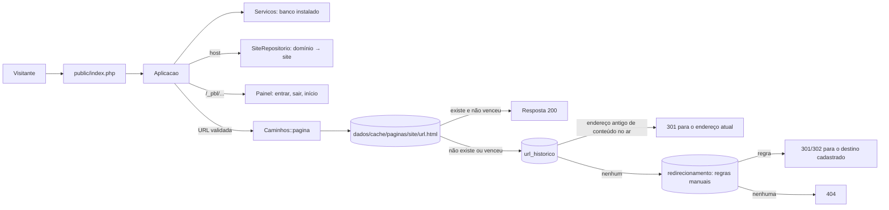
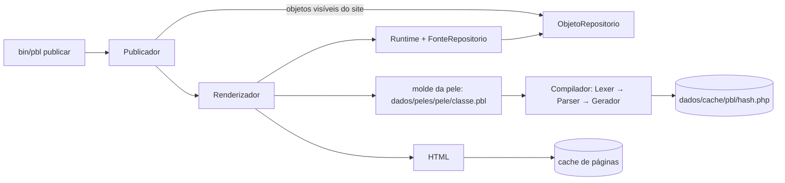

# Arquitetura

Visão geral do que existe hoje. Decisões e desenho completo: [ADRs](../adr/) e [fluxos](../fluxos/).

## Do pedido à página



A requisição pública **só lê um arquivo pronto**: ela não monta página nem consulta conteúdo. O banco é consultado apenas para descobrir o site pelo domínio.

## Da publicação ao cache



O molde é compilado **uma vez** para PHP; o hash cobre o molde, a cadeia de layouts e a versão do formato do compilador. O PHP gerado só chama o `Runtime`; nada escrito no molde vira código.

## Modelo de dados

| Tabela | Papel |
|---|---|
| `site`, `dominio` | sites e os domínios que levam a eles (vários domínios para um site) |
| `classe` | tipos de conteúdo e suas propriedades (JSON) |
| `objeto` | os conteúdos: dados em JSON, `caminho` materializado (`/1/45/230/`), metadados (`peso`, `descricao`, vigência), `titulo_norm` |
| `objeto_indice` | valores tipados só das propriedades marcadas como **indexáveis** (as `ref` sempre); é o que permite filtrar e ordenar, inclusive pelo campo de um objeto apontado, com `JOIN`s e sem tabela temporária |
| `objeto_versao` | histórico: uma linha por estado salvo de cada objeto (a atual inclusive), com o motivo |
| `url_historico` | endereço antigo → objeto; a `Aplicacao` responde 301 para o endereço atual |
| `redirecionamento` | regras manuais por site (exatas ou por prefixo, 301/302) |
| `dominio` | host → site, com `modo` (`principal`, `servir`, `redirecionar`) |
| `usuario`, `acesso`, `auditoria` | equipe, perfil de um usuário numa subárvore e o registro de ações (só acrescenta) |
| `sessao`, `tentativa_login` | sessões da administração (só o hash do token) e falhas de login (só hashes) |
| `schema_versao` | migrações já aplicadas |

Sem DDL em produção: só o migrador cria ou altera tabelas; o usuário do banco em uso normal só precisa de `SELECT/INSERT/UPDATE/DELETE` ([ADR 0003](../adr/0003-plataforma-low-code.md)). A subárvore de um objeto sai do prefixo do `caminho`, o que também limita cada consulta ao seu site.

## Camadas

| Camada | Namespace | Responsabilidade |
|---|---|---|
| Entrada | `Pbl\Aplicacao`, `public/index.php` | resolver host e URL, devolver arquivo do cache |
| Conteúdo | `Pbl\Conteudo` | classes, objetos, sites; validação dos dados por tipo (`texto`, `numero`, `html`, `data`, `booleano`, `ref`); índice |
| Administração | `Pbl\Admin` | `Painel`: rotas sob `/_pbl/` (entrar, sair, início) com sessão, CSRF, limite de tentativas e cabeçalhos de segurança |
| Acesso | `Pbl\Acesso` | contas, senhas (argon2id), perfis por subárvore, `Permissoes::pode` (único ponto de decisão) e auditoria |
| Busca | `Pbl\Busca` | normalização de texto (minúsculas e sem acento) usada na gravação e na consulta; relevância e grafias parecidas no [ADR 0010](../adr/0010-busca.md) |
| Consulta | `Pbl\Consulta` | `Consulta` (o pedido) e `MotorDeConsulta` (a execução): filtros, ordem, referências, contagem, carga em lote. Único caminho para ler conteúdo em lista |
| Linguagem | `Pbl\Linguagem` | compilar e executar moldes (PBL4) em ambiente restrito |
| Publicação | `Pbl\Publicacao` | renderizar, gravar e limpar o cache; ligar o runtime ao banco |
| Conversão | `Pbl\Conversao` | migrar moldes do PBL3 |
| Infraestrutura | `Pbl\Banco`, `Pbl\Instalacao`, `Pbl\Console` | conexão e migrações, instalador, comandos |

O `Runtime` não conhece o banco: usa a interface `FonteDeDados`, implementada por `FonteRepositorio`, que monta `Consulta`s para o `MotorDeConsulta`. Isso mantém a linguagem testável e permite outras fontes (por exemplo, a API de conteúdo prevista no [ADR 0009](../adr/0009-peles-de-saida-headless.md)).

## Pastas do site (`dados/`)

```
dados/
  config/     configuração e a trava de instalação
  cache/      paginas/ (HTML pronto) e pbl/ (PHP compilado)
  peles/      moldes de cada pele (a pele básica é copiada na instalação)
  uploads/    arquivos enviados (previsto)
  pbl4.sqlite banco SQLite padrão
```

## O que ainda não existe

Telas da administração, instalador web, atualizador, upload de arquivos, tela para gerir domínios e regras (hoje por linha de comando). Estão no [plano](../plano.md).
