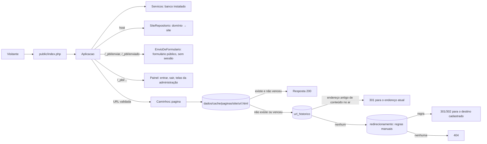
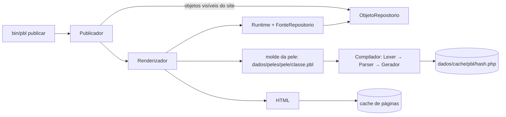
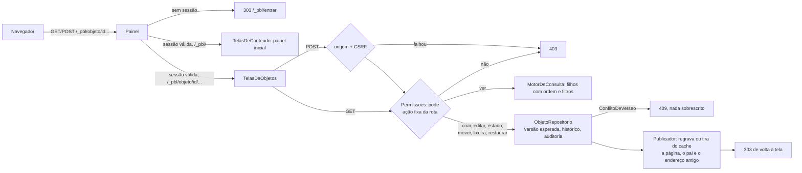

# Arquitetura

Visão geral do que existe hoje. Decisões e desenho completo: [ADRs](../adr/) e [fluxos](../fluxos/).

## Do pedido à página



A requisição pública **só lê um arquivo pronto**: ela não monta página nem consulta conteúdo. O banco é consultado apenas para descobrir o site pelo domínio.

## Da publicação ao cache



`bin/pbl agendados` (cron) usa o mesmo `Publicador`: `pendentes` compara o banco com o cache (visível sem página, ou fora do ar com página) e `aplicarAgendados` republica o site só se houver diferença, o que põe no ar o que a `data_publicacao` liberou e tira o que a `data_validade` venceu.

O molde é compilado **uma vez** para PHP; o hash cobre o molde, a cadeia de layouts e a versão do formato do compilador. O PHP gerado só chama o `Runtime`; nada escrito no molde vira código.

## Administração pelo navegador



As regras de integridade não moram nas telas: `ObjetoRepositorio` recusa (com `ViolacaoDeRegra`) tipo não aceito pelo pai e campo obrigatório vazio, normaliza as datas de vigência para UTC e limpa propriedades `html` com `HtmlSeguro`; as telas só traduzem o erro em mensagem. A tela de mover navega pela árvore com links (`?em=`) e botões de `POST`.

Os tipos de conteúdo (`/_pbl/classes`, `/_pbl/classe/{id}/...`) seguem a mesma receita em `TelasDeClasses`, com `Permissoes::podeModelarClasses` no lugar de `pode` e `ClasseRepositorio` (versão esperada, regra de não apagar valores) no lugar de `ObjetoRepositorio`; veja o [fluxo 12](../fluxos/12-administracao-web.md).

Contas (`/_pbl/contas`, `/_pbl/conta/{id}/...`) ficam em `TelasDeContas` e domínios (`/_pbl/site/{id}/dominios/...`) em `TelasDeDominios`, com a mesma receita: `Permissoes::podeAdministrarContas` e `Permissoes::podeAdministrarSite` (ação `Administrar` na raiz do site) no lugar de `pode`, e os repositórios que a linha de comando já usa (`UsuarioRepositorio`, `DominioRepositorio`). As peças comuns (origem e CSRF, barra, leitura de texto) estão no trait `AuxiliaresDeTela`.

Redirecionamentos e peles de um site (`/_pbl/site/{id}/...`) ficam em `TelasDeSite`, com `Permissoes::pode(Acao::Administrar)` na seção raiz; os moldes são lidos e gravados só por `GerenciadorDePeles` (nomes validados, sem links simbólicos, gravação atômica, validação pelo parser antes de salvar) e o site é republicado pelo `Publicador` depois.

As telas são HTML montado no servidor, sem JavaScript, com o CSS do Bootstrap servido do próprio site (`public/_pbl/assets/`). Arquivo existente em `public/` é entregue direto pelo servidor web; o resto de `/_pbl/` vai para o `Painel`. Detalhes no [ADR 0012](../adr/0012-administracao-web.md) e no [fluxo 12](../fluxos/12-administracao-web.md).

## Modelo de dados

| Tabela | Papel |
|---|---|
| `site`, `dominio` | sites e os domínios que levam a eles (vários domínios para um site) |
| `classe` | tipos de conteúdo (valem para a instalação toda): propriedades em JSON (com rótulo, obrigatório e arquivada opcionais), descrição, filhos aceitos e versão |
| `objeto` | os conteúdos: dados em JSON, `caminho` materializado (`/1/45/230/`), metadados (`peso`, `descricao`, vigência), `titulo_norm` |
| `objeto_indice` | valores tipados só das propriedades marcadas como **indexáveis** (as `ref` sempre); é o que permite filtrar e ordenar, inclusive pelo campo de um objeto apontado, com `JOIN`s e sem tabela temporária |
| `objeto_versao` | histórico: uma linha por estado salvo de cada objeto (a atual inclusive), com o motivo |
| `url_historico` | endereço antigo → objeto; a `Aplicacao` responde 301 para o endereço atual |
| `redirecionamento` | regras manuais por site (exatas ou por prefixo, 301/302) |
| `dominio` | host → site, com `modo` (`principal`, `servir`, `redirecionar`) |
| `usuario`, `acesso`, `auditoria` | equipe, perfil de um usuário numa subárvore e o registro de ações (só acrescenta) |
| `sessao`, `tentativa_login` | sessões da administração (só o hash do token) e falhas de login (só hashes) |
| `schema_versao` | migrações já aplicadas |

Sem DDL em produção: só o migrador cria ou altera tabelas; o usuário do banco em uso normal só precisa de `SELECT/INSERT/UPDATE/DELETE` ([ADR 0003](../adr/0003-plataforma-low-code.md)). A subárvore de um objeto sai do prefixo do `caminho`, o que também limita cada consulta ao seu site.

## Camadas

| Camada | Namespace | Responsabilidade |
|---|---|---|
| Entrada | `Pbl\Aplicacao`, `public/index.php` | resolver host e URL, devolver arquivo do cache |
| Conteúdo | `Pbl\Conteudo` | classes, objetos, sites; validação dos dados por tipo (`texto`, `numero`, `html`, `data`, `booleano`, `ref`); índice |
| Instalação | `Pbl\Instalacao` | `Instalador` (atômico), `InstaladorWeb` (assistente em `/_pbl/instalar`, só antes de instalar), `Requisitos` |
| Formulários públicos | `Pbl\Formularios` | `FormularioRepositorio` (lê a definição e falha fechada), `FormularioHtml` (HTML escapado), `FormularioParaMolde` (ponte do comando `formulario`), `EnvioDeFormulario` (rotas `/_pbl/enviar/{id}` e `/_pbl/enviado/{id}`: limite, tamanho, origem, token, armadilha, validação e criação do objeto privado); `Acesso\LimiteDeEnvios` e `Csrf::paraFormulario` ([ADR 0013](../adr/0013-formularios-publicos.md)) |
| Administração | `Pbl\Admin` | `Painel`: rotas sob `/_pbl/` (entrar, sair) com sessão, CSRF, limite de tentativas e cabeçalhos de segurança; `TelasDeConteudo`: painel inicial com os sites; `TelasDeObjetos`: um conteúdo e seus filhos (ordem e filtros), criar, editar todas as propriedades, estado e datas, mover, lixeira e histórico ([ADR 0012](../adr/0012-administracao-web.md)); `TelasDeClasses`: tipos de conteúdo (só administrador; campo com valores é arquivado, nunca apagado); `TelasDeContas`: contas, senhas e papéis por seção (só administrador; última conta de administrador protegida); `TelasDeDominios`: domínios do site (alias, redirecionador, principal); `Pagina`: HTML com Bootstrap local, escape e cabeçalhos |
| Acesso | `Pbl\Acesso` | contas, senhas (argon2id), perfis por subárvore, `Permissoes::pode` (único ponto de decisão) e auditoria |
| Busca | `Pbl\Busca` | normalização de texto (minúsculas e sem acento) na gravação e na consulta (`Texto`); busca por palavras: `Termos` (palavras, plural), `BuscaInterface` e o driver padrão `BuscaSql` sobre a tabela `objeto_termo`, alimentada por `IndexadorDeObjeto` a cada criação/alteração; o `MotorDeConsulta` encaixa a condição e a relevância na consulta única ([ADR 0010](../adr/0010-busca.md), nível C ainda não feito) |
| Consulta | `Pbl\Consulta` | `Consulta` (o pedido) e `MotorDeConsulta` (a execução): filtros, ordem, referências, contagem, carga em lote. Único caminho para ler conteúdo em lista |
| Linguagem | `Pbl\Linguagem` | compilar e executar moldes (PBL4) em ambiente restrito |
| Publicação | `Pbl\Publicacao` | renderizar, gravar e limpar o cache; ligar o runtime ao banco |
| Conversão | `Pbl\Conversao` | migrar moldes do PBL3 |
| Infraestrutura | `Pbl\Banco`, `Pbl\Instalacao`, `Pbl\Console` | conexão e migrações, instalador, comandos |

O `Runtime` não conhece o banco: usa a interface `FonteDeDados`, implementada por `FonteRepositorio`, que monta `Consulta`s para o `MotorDeConsulta`. Isso mantém a linguagem testável e permite outras fontes (por exemplo, a API de conteúdo prevista no [ADR 0009](../adr/0009-peles-de-saida-headless.md)).

## Pastas do site (`dados/`)

```
dados/
  config/     configuração e a trava de instalação
  cache/      paginas/ (HTML pronto) e pbl/ (PHP compilado)
  peles/      moldes de cada pele (a pele básica é copiada na instalação)
  uploads/    arquivos enviados (previsto)
  pbl4.sqlite banco SQLite padrão
```

## O que ainda não existe

Parte das telas da administração (regras de redirecionamento e peles: hoje por linha de comando), o botão do atualizador e upload de arquivos. Estão no [plano](../plano.md).
