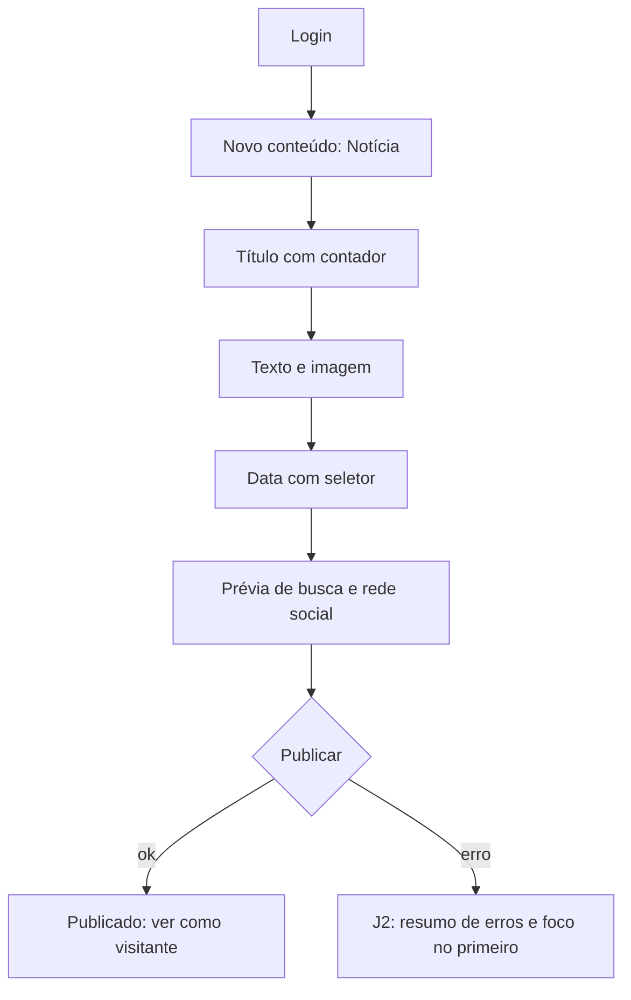
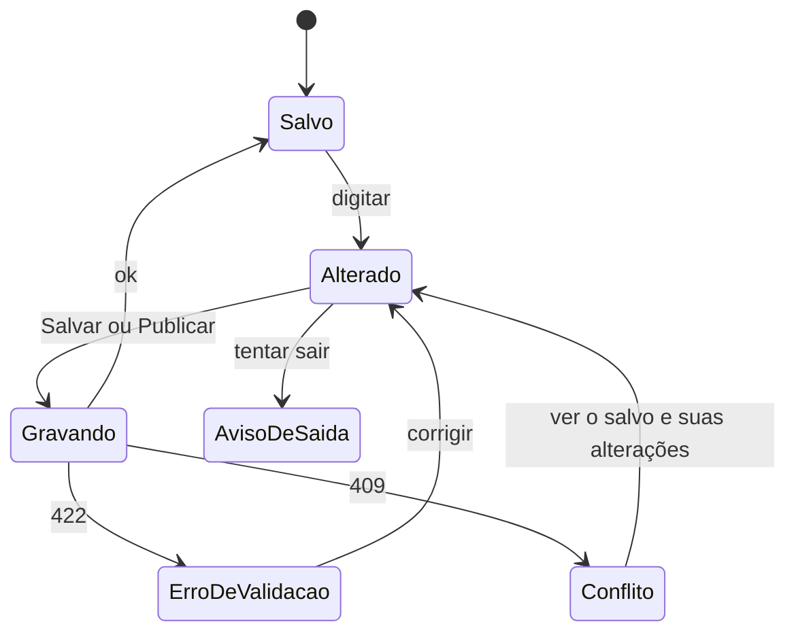
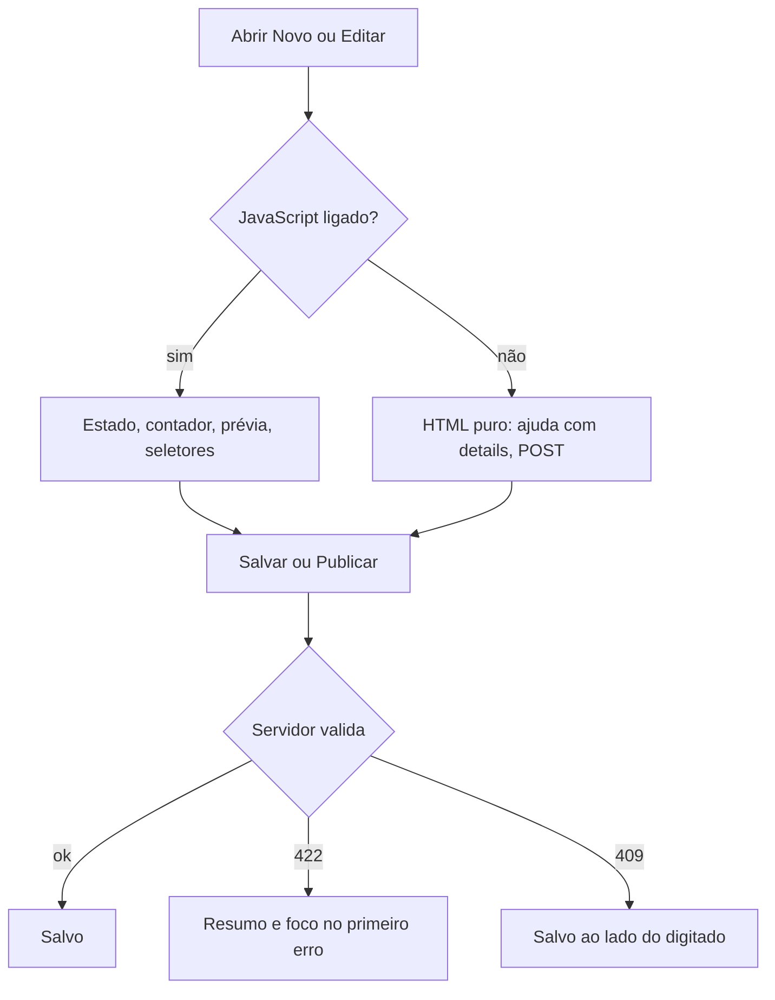

A proposta está pronta. Não gravei em `docs/ux/formularios-proposta.md` porque nesta etapa `origem/` é somente leitura; a versão completa está em `notas/formularios-proposta.md` para a equipe mover ao repositório. Nenhum código foi alterado.

Principais achados: sem JavaScript, a ajuda "?" e o "Menu do site" ficam ocultos (a confirmar); referência a conteúdo exige digitar número; erros não levam o foco ao primeiro campo; e não há aviso de alterações não salvas.

## PERSONAS

Personas ilustrativas, montadas a partir do BA e do código. Nomes e contextos são hipóteses a validar com o dono.

**P1. Editora de conteúdo (usuária principal)**
- **Quem:** pessoa de comunicação de uma organização pequena (escola, associação, coletivo). Não é técnica.
- **Objetivo:** publicar uma notícia com foto e data em poucos minutos, sem pedir ajuda.
- **Dor:** não entende "Texto formatado (HTML)", "Referência a outro conteúdo" nem o formato "aaaa-mm-dd"; tem medo de perder o texto; não sabe se salvou; o erro aparece longe do campo; alvos pequenos em formulários longos.
- **Contexto:** usa principalmente o celular, em pausas, com conexão variável. Prefere botões claros e exemplos.
- **Sucesso:** publica sem chamado de suporte e entende o estado ("salvo", "publicado").
- **Evidência:** referência pede número digitado (`TelasDeObjetos.php:1262`); data é texto livre (`:1260`).

**P2. Administrador do site**
- **Quem:** responsável pela organização no painel; gerencia contas, domínios, peles, cópias e atualização; às vezes cria tipos de conteúdo.
- **Objetivo:** mudar configurações e fazer ações sensíveis com segurança e sem surpresas.
- **Dor:** modo elevado (senha confirmada, 10 min) pouco explicado; restauração de cópia com palavra digitada; ao criar campo, precisa digitar um nome técnico.
- **Contexto:** mais desktop, mas abre o painel no celular para conferir.
- **Sucesso:** entende o efeito de cada ação antes de confirmar.

**P3. Pessoa que usa teclado ou leitor de tela (transversal)**
- **Objetivo:** preencher e corrigir o formulário sem ver o layout.
- **Dor:** erro que não é anunciado nem levado ao foco; ajuda escondida atrás de "?"; cor como único indicador.
- **Sucesso:** ao enviar com erro, ouve o resumo, vai ao primeiro erro e entende a causa.
- **Papel:** critério de aceite em todas as fatias.

**P4. Operador técnico (instalador e login)**
- **Objetivo:** instalar, entrar e atualizar sem tropeço. Uso raro.
- **Escopo:** entra só como restrição visual, não como foco.

## USER_JOURNEYS

**Problema do BA:** formulários pouco interativos, atraentes e organizados; erros difíceis de localizar; rótulos e ajuda insuficientes; estados pouco claros; alvos pequenos no celular; risco de perda de texto. Objetivos O1–O8 do EPIC.

Legenda: **[atrito]** = dor encontrada no código (arquivo:linha). **[proposta]** = intervenção, com a fatia.

**J1. Publicar notícia com imagem e data (P1; tarefa-chave; O1)**
1. Entra no painel (o foco já vai ao campo de login, `Painel.php:156`).
2. Cria um conteúdo do tipo Notícia.
3. Preenche o título. **[atrito]** sem contador; `maxlength` corta letras em silêncio. **[proposta]** F3: contador com aviso antes do limite.
4. Escreve o texto. **[atrito]** rótulo técnico "Texto formatado (HTML)". **[proposta]** F2: "Texto da notícia".
5. Escolhe a imagem. **[atrito]** input de arquivo puro; fica pendente até salvar (ADR 0014). **[proposta]** F7: miniatura imediata e arrastar-e-soltar.
6. Define a data. **[atrito]** dois modelos: texto livre (`:1260`) e `datetime-local` (`:1224`). **[proposta]** F3: seletor nativo.
7. Confere a prévia. **[atrito]** não há prévia de busca nem de rede social. **[proposta]** F6.
8. Publica. **[atrito]** barra fixa só no celular (`pbl.css:174-177`). **[proposta]** F5: barra fixa em todas as larguras.
9. Vê a confirmação com estado claro. **[proposta]** F5.

Se o passo 3 ou 6 der erro, segue para J2.



**J2. Corrigir erro de validação (P1 e P3; O2)**
1. Publica com data "31/12/2026" (formato errado).
2. O servidor recusa e devolve a página com os valores digitados (`TelasDeObjetos.php:1137-1149`).
3. **[atrito]** o erro aparece só no campo (`:1369`). Não há resumo no topo nem foco no primeiro erro. No celular, o campo pode ficar fora da tela.
4. **[proposta]** F2: resumo no topo (`role="alert"`, `tabindex="-1"`) com link para cada campo. Sem JavaScript, o link de âncora leva ao campo; com JavaScript, o foco vai ao resumo. A mensagem diz como corrigir.
5. O campo volta com o foco, e os valores são preservados.

**J3. Não perder o texto (P1 e P3; O6)**
- **(a) Sair com alterações.** **[atrito]** `pbl-admin.js` não tem `beforeunload`. **[proposta]** F5: aviso ao sair só quando houve mudança.
- **(b) Outra pessoa salvou antes (409).** **[atrito]** o ADR 0012 mostra o salvo e não reaproveita o digitado. **[proposta]** F5: painel "Suas alterações". Depende de Q3.
- **(c) Modo elevado expira ao gravar.** **[atrito]** a senha é pedida no meio do formulário (`AuxiliaresDeTela.php:131`). **[proposta]** campo de senha junto do Publicar, com o texto mantido. Depende de Q2.

**J4. Criar tipo de conteúdo "Evento" (P2)**
1. **[atrito]** o nome técnico é obrigatório logo no início.
2. **[atrito]** digita o nome técnico à mão; "Texto curto" vira textarea de 3 linhas (`TelasDeObjetos.php:1264`); "Sim ou não" vira select de três estados (`:1261`).
3. **[proposta]** F12: nome técnico derivado do rótulo ("Data do evento" vira `data_do_evento`), com descrição curta por tipo.

**J5. Configurar o site em abas (P2)**
1. As abas já existem (`Pagina::abas`). Sem JavaScript, os painéis ficam empilhados.
2. **[atrito]** a aba com erro não mostra o erro antes de abrir. **[proposta]** F9: "Menu •1" na aba.

**J6. Dar acesso a um conteúdo a uma conta (P2)**
1. **[atrito]** lista longa ou "Ou o número" (`TelasDeContas.php:326-327`).
2. **[proposta]** F4: seletor com busca por nome e caminho.

**J7. Criar e restaurar cópia de segurança (P2)**
1. **[atrito]** grade ad hoc (`TelasDeBackup.php:321-325`).
2. **[atrito]** restaurar exige digitar uma palavra (`:381`) sem explicar o que se perde.
3. **[proposta]** F11: resumo "o que será perdido" e checkbox explícito. Q9 decide a palavra.

**J8. Login e instalador (P4)**
Já tem foco no primeiro campo, indicador de força da senha e atalhos no instalador. Ajustes menores em F11.

## UI_SPEC

### 0. Princípios
- **Servidor é a autoridade.** Toda regra continua no PHP; o JavaScript só melhora.
- **Três camadas:** (1) HTML e POST normal, que funciona sem nada; (2) CSS com tokens; (3) `pbl-formularios.js` com `defer` e `?v=hash`. Sem script ou estilo inline (CSP `script-src 'self'`).
- **Bootstrap 5.3.8 local.** Sem CDN, sem framework novo.

### 1. Grade e espaçamento
- Celular (até 767 px): coluna única.
- 768–1199 px: duas colunas (`.pbl-grade`).
- Desktop (≥1200 px): área principal e coluna lateral "Publicação" com prévia.
- Campos curtos (data, número, hora): no máximo 20 rem.
- Escala de 4 px. Entre seções 24 px; entre campos 16 px; rótulo e ajuda 4 px.

### 2. Tipografia
- Rótulo: 600, 16 px no celular (evita zoom no iOS).
- Ajuda: 14 px, contraste ≥ 4,5:1.
- Título de seção: 18 px. Nada menor que 14 px.

### 3. Tokens CSS (`pbl-formulario.css`, novo)

```css
:root {
  --pbl-espaco-1: .25rem;  /* 4 px */
  --pbl-espaco-2: .5rem;   /* 8 */
  --pbl-espaco-3: .75rem;  /* 12 */
  --pbl-espaco-4: 1rem;    /* 16 */
  --pbl-espaco-6: 1.5rem;  /* 24 */
  --pbl-espaco-8: 2rem;    /* 32 */
  --pbl-toque-minimo: 44px;
  --pbl-campo-curto: 20rem;
  --pbl-fonte-rotulo: 600 1rem/1.3 var(--bs-body-font-family);
  --pbl-fonte-ajuda: 400 .875rem/1.45 var(--bs-body-font-family);
  --pbl-cor-texto: var(--bs-body-color);
  --pbl-cor-texto-suave: var(--bs-secondary-color);  /* validar ≥ 4,5:1 */
  --pbl-cor-superficie: var(--bs-body-bg);
  --pbl-cor-superficie-campo: var(--bs-body-bg);     /* hoje #f4f6f8 fixo */
  --pbl-cor-borda-campo: #6c757d;                    /* ≥ 3:1 (WCAG 1.4.11) */
  --pbl-cor-erro: var(--bs-danger-text-emphasis);
  --pbl-cor-erro-fundo: var(--bs-danger-bg-subtle);
  --pbl-cor-sucesso: var(--bs-success-text-emphasis);
  --pbl-cor-foco: #0a58ca;
  --pbl-anel-foco: 0 0 0 .25rem rgba(13, 110, 253, .45);
  --pbl-altura-barra-acoes: 4.5rem;
  --pbl-raio: var(--bs-border-radius);
}
```

**Tema escuro:** via `data-bs-theme`. Hoje só a barra é escura (`Pagina.php:282`); campos e cartões têm cores fixas (`pbl.css:94-97`, `:104`). Sem script inline, o tema não pode ser aplicado antes da pintura: ou por `prefers-color-scheme`, ou pelo servidor lendo uma preferência salva (Q7).

### 4. Componentes

**4.1 Campo (`Field`)**
- Anatomia: rótulo visível; ajuda curta visível; controle; contador (opcional); erro.
- Base:
```html
<div class="pbl-campo">
  <label for="campo-titulo">Título</label>
  <p id="campo-titulo-ajuda" class="pbl-ajuda">Aparece na lista e no Google.</p>
  <input id="campo-titulo" name="titulo" aria-describedby="campo-titulo-ajuda campo-titulo-erro" aria-invalid="true">
  <p id="campo-titulo-erro" class="pbl-erro">Escreva o título: até 120 caracteres.</p>
</div>
```
- Ajuda longa: `<details><summary>Saiba mais</summary>…</details>` (funciona sem JavaScript).
- Estados: padrão, hover, foco-visível, erro (texto, ícone e borda), desabilitado, somente leitura, preenchido, salvo.

**4.2 Grupo ou seção (`FieldGroup`)**
- `<fieldset><legend>…</legend><p>Uma linha.</p>…</fieldset>`.
- Substitui o cartão por campo (`:1267`).
- Seções: "O essencial", "Quando aparece", "Outros campos do tipo", "Endereço e menu" (accordion fechado). Agrupar exige um atributo novo no tipo (Q6).

**4.3 Aba e painel recolhível (`Disclosure`)**
- Abas: já funcionam; aba com erro mostra "Menu •1" em texto.
- Recolhível: migrar `Pagina::recolhivel` e `Pagina::ajuda` de `.collapse` para `<details><summary>`. Abre sem JavaScript e não depende do `bootstrap.bundle.js` (D1).
- Painel com erro abre no servidor (`details[open]`).

**4.4 Alerta e resumo de erros**
- `role="alert"`, título "Corrija 2 campos antes de publicar", links `#campo`, `tabindex="-1"`.
- Aviso informativo (`role="status"`): "Rascunho salvo às 14:32".

**4.5 Barra de ações (`ActionBar`)**
- Fixa no rodapé em todas as larguras, com `env(safe-area-inset-bottom)`.
- À esquerda, o estado ("Alterações não salvas" ou "Salvo"). À direita: Cancelar (link), Salvar rascunho, Publicar.
- Ação destrutiva separada, no fim.
- `scroll-padding-bottom` para o campo focado não ficar atrás da barra (2.4.11).

**4.6 Contador**
- Sem JavaScript: "até 120 caracteres". Com JavaScript: "38 de 120"; a partir de 90%, muda a cor e diz "Faltam 10".
- Sem `aria-live` a cada tecla; anuncia só ao ultrapassar o limite.
- Remover `maxlength` de textos públicos; o servidor valida.

**4.7 Data e hora**
- `type="date"` e `type="time"`. O navegador mostra `dd/mm/aaaa`; o valor enviado segue `aaaa-mm-dd`, que o servidor já aceita.

**4.8 Booleano**
- `switch` ou checkbox. Se "não informado" precisar existir, é opção explícita (Q5).

**4.9 Seletor de conteúdo (`ContentPicker`)**
- Base: `<select>` com caminho ("Notícias › Eventos") e busca GET.
- Com JavaScript: combobox ARIA 1.2, busca a partir de 2 letras, atraso de 300 ms. Endpoint novo que respeita `Acao::Ver`.
- O valor enviado é o id, em campo oculto; o servidor valida como hoje (`:1139`).
- Some o `type="number"` (`:1262`) e o "Ou o número" (`TelasDeContas.php:327`).

**4.10 Seletor de imagem (`FilePicker`)**
- Base: input de arquivo, nome do atual e "Tirar esta imagem".
- Com JavaScript: zona para soltar (o botão continua existindo); miniatura via `FileReader` (`data:`, já permitido pela CSP, sem usar `blob:`); valida tipo e tamanho com a mensagem do servidor.
- Miniatura guardada: `/_pbl/arquivo/{id}/miniatura/{tamanho}` (ADR 0014).

**4.11 Tags (`TagInput`)**
- Base: texto separado por vírgula.
- Com JavaScript: chips com "remover", sugestões, até 10 tags. O campo oculto recebe "a, b, c".

**4.12 Prévia (`SnippetPreview`)**
- Prévia de busca (título até ~60, descrição até ~160) e de rede social (imagem, título, descrição). Mostra "pode ser cortado".
- O endereço final é do servidor; a prévia só replica.

**4.13 Estado de salvamento (`SaveState`)**


- `beforeunload` só em `Alterado` e só com JavaScript; sem JavaScript, não há aviso (limitação documentada).

**4.14 Atalhos**
- Ctrl/Cmd+S: salvar rascunho, dentro do formulário.
- Sem atalho para publicar (risco de publicação por engano).
- A dica aparece no texto do botão.

**4.15 Confirmação de senha (modo elevado)**
- Campo junto do botão, com "Você tem 10 minutos depois disso". Permite colar a senha.

### 5. Estados de tela

| Tela | Carregando | Vazio | Erro | Sucesso | Conflito | Sem permissão |
|---|---|---|---|---|---|---|
| Edição de conteúdo | página do servidor | tipo sem campos: "Adicione campos em Tipos de conteúdo." | resumo de erros (422) | "Salvo às 14:32" | 409: salvo ao lado do digitado | "Você pode ver, mas não editar." |
| Busca de conteúdo (F4) | "Buscando…" com `aria-busy` | "Nenhum conteúdo com 'x'." | "Não consegui buscar agora." | n resultados (`role="status"`) | n/a | só o que a pessoa pode ver |
| Envio de imagem (F7) | progresso (`aria-valuenow`) | "Escolha uma imagem." | tipo ou tamanho | miniatura | n/a | n/a |
| Tipos de conteúdo | n/a | "Crie o primeiro." | nome repetido no campo | "Tipo salvo" | n/a | "Só administradores criam tipos." |
| Configurações | página do servidor | "Nada para configurar aqui." | "Menu •1" | "Configurações salvas" | 409 | só leitura com aviso |

### 6. Wireframes

**Celular (375 px), edição de conteúdo:**
```
┌───────────────────────────┐
│ ☰ PBL4            Sair    │
├───────────────────────────┤
│ Notícia · Editar          │
│ ✓ Rascunho salvo 14:32    │
│ ⚠ Corrija 1 campo         │
│   • Data: use 2026-12-31  │
│ O essencial               │
│  Título             38/120│
│  [__________________]     │
│  Texto da notícia         │
│  Imagem [miniatura] Trocar│
│ ▸ Quando aparece          │
│ ▸ Endereço e menu         │
├───────────────────────────┤  barra fixa
│ Alterações não salvas     │
│ [Salvar rascunho][Publicar]│
└───────────────────────────┘
```

**Desktop (≥1200 px):**
```
┌───────────────────────────────────────────┬──────────────────┐
│ Notícia · Editar     [Cancelar][Salvar]   │ Publicação       │
│ O essencial                               │ Estado: Rascunho │
│  Título ...                               │ Publicar a partir│
│  Texto ...  Imagem ...                    │ [dd/mm/aaaa]     │
│ Outros campos do tipo                     │ Prévia no Google │
└───────────────────────────────────────────┴──────────────────┘
```

**Configurações (abas):**
```
[Identidade] [Menu •1] [Endereço] [Aparência]
 Nome do site  [__________]  ajuda visível
 Logo          [miniatura] [Trocar]
 ───────────────────────────────────────────
 Alterações não salvas        [Cancelar][Salvar]
```



### 7. Acessibilidade (WCAG 2.2 AA)
- Rótulo visível em todo campo; placeholder nunca substitui rótulo.
- Erro com texto, ícone e borda; `aria-invalid`; `aria-describedby` inclui o erro.
- Foco visível com contraste ≥ 3:1; foco não coberto pela barra fixa (2.4.11).
- Alvos de 44 px no celular (já em `pbl.css:35-39`); 24 px no mínimo (2.5.8).
- Ordem de tabulação igual à visual; colar senha permitido (3.3.8).
- Testes: axe, teclado, leitor de tela (NVDA ou VoiceOver) e JavaScript desligado.

### 8. Testes (TDD)
- PHPUnit: `for`, `id`, `aria-describedby`, `aria-invalid`; nenhum `style=` nem `on*=`; POST com JavaScript desligado.
- `tests/AssetsAdminTest.php`: hash `?v=` e procedência dos arquivos novos.
- Infraestrutura de teste de JavaScript: não encontrada; confirmar antes da F5.

## DIAGNOSTICO_E_PLANO (docs/ux/formularios-proposta.md)

### a) Diagnóstico priorizado
P0 bloqueia a tarefa-chave ou um objetivo do BA; P1 atrapalha com contorno; P2 é polimento.

| # | Problema | Evidência | Impacto | Obj. | Pri. |
|---|---|---|---|---|---|
| D1 | Ajuda "?", "Menu do site" e recolhíveis dependem de JS; sem ele, ficam fechados | `Pagina.php:296-302`, `:365-368` (classe `collapse`); `TelasDeObjetos.php:1235-1237`. **A confirmar com JS desligado** | P1 e P3 não leem a ajuda | O5 | P0 |
| D2 | Referência pede número; contas têm "Ou o número" | `TelasDeObjetos.php:1262`; `TelasDeContas.php:326-327` | P1 não sabe o número | O3 | P0 |
| D3 | Erros sem resumo, sem foco no primeiro, sem link ao campo | sem foco ou `autofocus` em `TelasDeObjetos`; `:1369-1389` só marca o campo | P1 e P3 não localizam o erro | O2 | P0 |
| D4 | Sem aviso de alterações não salvas | `pbl-admin.js` sem `beforeunload` | perda de texto | O6 | P0 |
| D5 | Rótulo e controle divergem | `TelasDeObjetos.php:1264`, `:1261`; `TelasDeClasses.php:45-49` | confusão | O1 | P0 |
| D6 | Dois modelos de data | `:1260` e `:1224` | erro de formato | O1 | P1 |
| D7 | `maxlength` corta em silêncio; sem contador | `:1200`, `:1201` | texto perdido | O2 | P1 |
| D8 | Um cartão por campo; formulário longo | `:1210-1212`, `:1267` | pouca organização | — | P1 |
| D9 | Cores fixas; tema escuro impossível | `pbl.css:94-97`, `:104`; `Pagina.php:282` | tema não atendido | — | P1 |
| D10 | Tags sem sugestão | `:1206` | duplicação | — | P1 |
| D11 | Imagem sem miniatura imediata | `:1289-1291`; ADR 0014. **Miniatura depois de salvo: a confirmar** | sem confirmação visual | O1 | P1 |
| D12 | Sem prévia de busca nem de rede social | ausência | SEO ruim | — | P1 |
| D13 | Conflito (409) não reaproveita o digitado | ADR 0012, "Edição simultânea" | perda de trabalho | O6 | P1 |
| D14 | Nome técnico obrigatório; termos técnicos na tela | `TelasDeClasses.php`; `TelasDeObjetos.php:1324-1326` | barreira para P2 | — | P1 |
| D15 | Barra fixa só no celular | `pbl.css:174-177` vs `TelasDeObjetos.php:716, 857, 1552` | desktop sem ação visível | — | P2 |
| D16 | Restauração com palavra sem explicar o que se perde | `TelasDeBackup.php:319-325`, `:381` | P2 com medo | — | P2 |
| D17 | Abas sem indicação de erro | `Pagina.php:312-324` | P2 procura o erro | — | P2 |

**Pontos fortes (manter):** rótulos com `for`/`id`; `aria-describedby` e `aria-invalid`; mensagens específicas; alvos de 44 px no celular; tabelas viram cartões; abas com fallback; CSRF e modo elevado; validação no servidor; TinyMCE sem inline.

**Heurísticas de Nielsen:** visibilidade do estado (D4, D17); linguagem (D5, D14); controle (D4, D13); prevenção de erro (D2, D7); reconhecimento (D1, D2); minimalismo (D8); recuperação (D3).

### b) Especificação
Ver UI_SPEC: tokens (seção 3), componentes (4), estados (5), wireframes (6).

### c) Plano em fatias (um PR por fatia)

| Fatia | Conteúdo | Resolve | Depende de | Tam. |
|---|---|---|---|---|
| **F1** | Componentes base: `pbl-formulario.css`, `FieldGroup`, campo com ajuda visível, alerta de resumo | base | — | M |
| **F2** | Edição de conteúdo: resumo de erros com âncoras e foco; ajuda com `details`; rótulos do dia a dia; texto curto como `input`; booleano como `switch` | D1 (parte), D3, D5 | F1 | M |
| **F3** | Edição de conteúdo: datas nativas; contador; sem `maxlength` silencioso | D6, D7 | F1 | M |
| **F4** | Seletor de conteúdo com busca (endpoint novo); sai "Ou o número" (pode ser F4b) | D2 | — (ARCH: endpoint) | G |
| **F5** | Barra fixa em todas as larguras; "Alterações não salvas"; aviso ao sair; Ctrl+S; painel "Suas alterações" no conflito | D4, D13, D15 | F1 | M |
| **F6** | Prévia de busca e de rede social; endereço gerado | D12 | F3 | M |
| **F7** | Imagem: miniatura imediata, zona para soltar, progresso | D11 | F1 | G |
| **F8** | Tags com chips e sugestão | D10 | F1 | M |
| **F9** | Recolhíveis e abas em todas as telas com `details`; "Menu •1" | D1 (completo), D17 | F2 | M |
| **F10** | Tema escuro: cores fixas para tokens | D9 | F1 | G |
| **F11** | Contas, domínios, peles, cópias (o que se perde), atualização, login e instalador (várias fatias pequenas) | D16 e demais | F1, F9 | G |
| **F12** | Tipos de conteúdo: nome técnico derivado do rótulo; descrição por tipo | D14 | F1 | M |

Antes da F1: **linha de base** (tempo e taxa de erro da J1 com 5 pessoas). Não é PR; é condição para provar O1 e O8 (Q4).

Decisões para a equipe de front e arquitetura (a triagem dispensou o ARCH, mas estes pontos são dele): atributo de seção (ADR 0002, aditivo); endpoint de busca (F4); preferência de tema (F10); módulo `pbl-formularios.js` (a partir da F2).

### d) Perguntas de produto para o dono
Nenhuma bloqueia a F1.

1. **Q1.** Quais tarefas a editora faz mais e acha mais difíceis? Define se a primeira fatia de conteúdo é notícia com imagem (J1) e fixa a meta O1.
2. **Q2.** Quando a senha do modo elevado expira no meio da edição, podemos manter o texto digitado no navegador, ou ele deve ser perdido por segurança? (F5)
3. **Q3.** No conflito de edição, mostrar o que a pessoa digitou ao lado do salvo, mesmo que não caiba mais no tipo? O ADR 0012 decidiu que não. (D13)
4. **Q4.** Há medição atual (tempo, erros, chamados)? Se não, aceita um teste com 5 pessoas antes da F2 como linha de base?
5. **Q5.** Booleano: é preciso distinguir "não informado" de "não"? (4.8)
6. **Q6.** Pode existir um atributo "seção" em cada campo do tipo (mudança aditiva)? Sem ele, não há grupos nomeados. (4.2)
7. **Q7.** Tema escuro: agora ou depois? Quem escolhe: a pessoa ou o sistema?
8. **Q8.** O pedido estava cortado em "config". O que mais entra nas configurações? O editor de código de moldes fica de fora?
9. **Q9.** Restaurar cópia: a palavra de confirmação vale para tudo, ou só para o que não tem cópia de volta?
10. **Q10.** O pedido cita "listas", mas o produto não tem tipo de lista (`ClasseRepositorio.php:22`). Precisa de lista (vários conteúdos ou vários valores)?

**Premissas adicionais:** personas ilustrativas, a validar; backlog do PO inexistente; JavaScript permitido na administração (ADR 0012, adendo de 2026-11).

## Como validar

1. Abrir `notas/formularios-proposta.md` (ou esta resposta). O caminho `docs/ux/formularios-proposta.md` ainda não existe no repositório: quem tiver acesso de escrita deve movê-lo.
2. Conferir as personas. A editora é quem publica? O administrador é outra pessoa? O site é usado no celular?
3. Conferir a J1 com quem já publicou no painel: pedir que conte os passos e comparar com os 9 passos.
4. Conferir D1–D4 no próprio painel, no celular e no desktop, em Novo conteúdo de um tipo Notícia:
   - (a) Publicar com data errada: o erro aparece junto do campo, sem resumo no topo? **Esperado: sim.**
   - (b) Desligar o JavaScript do navegador e abrir a ajuda "?" e "Menu do site": abrem? **Esperado: não (D1, a confirmar).**
   - (c) Digitar algo e sair da página: aparece aviso? **Esperado: não (D4).**
   - (d) Referenciar outro conteúdo: é preciso digitar um número? **Esperado: sim (D2).**
   Se algum resultado for diferente, o item do diagnóstico está errado; registrar qual.
5. Ordenar as fatias F1–F12 com o PO, conferindo se F1 e F2 cobrem a edição de conteúdo.
6. Responder Q1–Q10 (Q1 e Q4 são as mais úteis para o próximo passo).

**Critérios de aceite da descoberta:**
- PERSONAS, USER_JOURNEYS e UI_SPEC existem e citam o problema do BA e os objetivos O1–O8.
- Cada item P0 e P1 do diagnóstico tem evidência em arquivo:linha.
- Cada componente tem estados padrão, foco, erro, desabilitado, carregando, salvo e vazio.
- Nenhuma proposta exige script ou estilo inline; a CSP é mantida.
- O plano tem 12 fatias, cada uma com dependências e tamanho; F1 e F2 cobrem a edição de conteúdo.
- As perguntas estão ordenadas e nenhuma bloqueia a F1.
- Nenhum arquivo de `origem/` ou de `.vsf/` foi alterado.

**O que falta para validar por completo:** teste com pessoas sem formação técnica (Q4); backlog do PO; confirmação de D1 com JavaScript desligado; confirmação de D11 (miniatura depois de salvo); e a proposta paralela `docs/ux/painel-proposta.md`, que ainda não existe.
