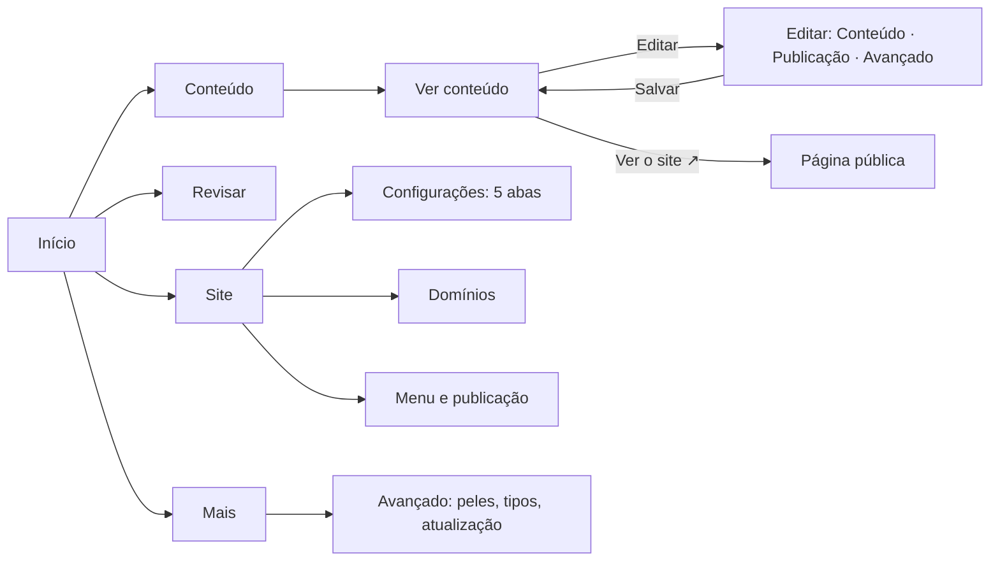

# PBL4: UX do painel (diagnóstico, navegação e divulgação progressiva)

Tipo: DISCOVERY. Status: proposta para decisão do dono. Nada foi implementado nem alterado em `origem/`.

## Premissas e limites

- **Fonte da verdade**: código em `/work/origem` (publicare4 @ b573b19), ADR 0012, 0017, 0020, 0022, `docs/usuario/glossario.md`, `docs/fluxos/12-administracao-web.md` e os JSONs de `.vsf/context/` (triagem e BA).
- **`contexto/` não existe neste ambiente.** Não li o dossiê do projeto e não usei nada dele. Se houver material que contradiga esta proposta, ele deve prevalecer.
- **Não rodei o painel no navegador.** Os achados de celular e de "sem JavaScript" vêm do HTML e do CSS gerados pelo código (`collapse:not(.show){display:none}` do Bootstrap local e `navbar-expand-xl`). Eles são marcados para confirmação no passo de validação.
- **As contagens de campos são estáticas.** Contam os controles que o código gera por padrão, para uma instalação com as classes padrão. Não são tempos de uso. O baseline real é a fatia F0.
- **Não gravei `docs/ux/painel-proposta.md`.** Nesta etapa a escrita é limitada a `./notas/`. Esta resposta é o artefato oficial.
- **O backlog do PO não está no contexto.** Refiro-me às fatias propostas (F0–F12) e aos objetivos do BA (O1–O6).

---

## Diagnóstico: inventário por tela (O1)

Classificação: **E** = essencial (uso diário ou semanal), **R** = raro (ocasional), **A** = avançado/técnico.

| Tela (rota) | Objetivo do usuário | O que aparece hoje | Classe | Problema principal |
|---|---|---|---|---|
| Início `/_pbl/` | Ver os sites e achar a seção certa | Avisos (revisão, devolvidos, cron, atualização). Por site: 5 botões de mesmo peso (Domínios, Configurações, Redirecionamentos, Peles e moldes, Menu e publicação) e a lista de seções com o papel | E (seções) / R (botões) | Nenhuma ação principal. Só "Navegar no conteúdo". Site sem conteúdo tem só o texto "Este site ainda não tem conteúdo inicial." |
| Conteúdo (árvore) `/conteudo/{id}` | Achar e abrir um item da seção | Filtros recolhidos (busca, estado, tipo, ordem, por página). Tabela de 8 colunas com seleção em lote. Topo com 5 ações. Faixa da pilha. Ajuda de 6 frases no topo | E | Lixeira e Vencidos aparecem também como itens de menu. A tabela vira cartões no celular, sem resumo do que mudou |
| Ver conteúdo `/objeto/{id}` | Entender o estado e decidir o próximo passo | Título com selos, metadados, um cartão por campo, barra com 10 ícones (Editar, Criar, Publicar, Histórico, Registro, QR, Mover, Copiar, Recortar, Lixeira) e a lista dos filhos | E (Editar, Publicar) / R (QR, Registro) | Ícones sem rótulo visível. O item ativo do menu é "Sites e conteúdo", não "Conteúdo" (ver D7) |
| **Editar conteúdo** `/objeto/{id}/editar` | Trocar texto ou foto e publicar | Identificação (título, descrição, endereço, tags), campos do tipo, Publicação (estado, 2 datas, peso), Aparência (pele, molde) e "Menu do site" fechado | E (título, texto, estado) / R (SEO, tags, peso) / A (pele, molde) | **16 controles visíveis numa Página** (17 numa Notícia, 14 numa Pasta). SEO e pele/molde sempre visíveis. Publicar também existe em outra tela |
| Criar conteúdo `/objeto/{id}/novo` | Criar uma página ou notícia | Escolha do tipo antes do formulário. Depois, Identificação, campos do tipo e Peso | E | 11 controles visíveis numa Página. O tipo é escolhido antes, sem explicação de por quê |
| Publicar ou tirar do ar `/objeto/{id}/estado` | Colocar no ar ou retirar | Estado e datas de vigência | E | **Segundo caminho** para a mesma ação. Estado e datas também estão na edição |
| Mover, Histórico, Registro, QR, Lixeira (`/mover`, `/versoes`, `/log`, `/qr`, `/apagar`) | Operações pontuais | Uma tela por operação, com migalhas | R / A | Os ícones ocupam a barra do conteúdo, ao lado das ações do dia |
| Tipos de conteúdo `/classes`, `/classe/{id}/editar` | Modelar campos e tipos | Lista e editor com um item recolhível por campo | A | No menu principal para todos. Vocabulário técnico ("classe", "propriedade") |
| Peles e moldes `/site/{id}/peles` | Trocar a aparência ou editar molde | Lista de arquivos; editor com realce, histórico, diferença e pré-visualização | A | Botão de mesmo peso na home. Risco alto: um erro no molde quebra o site |
| **Configurações do site** `/site/{id}/configuracoes` | Nome, logo, contato, SEO do site | 5 abas (Identidade, Busca e compartilhamento, Contato, Rodapé e métricas, Comportamento). "Opções avançadas" recolhido (imagem de abertura). 22 chaves | R | **É a tela mais próxima do alvo.** Falta um resumo do que está ligado. O ADR 0012 diz que é formulário único, o que está defasado (ver D16) |
| Domínios, Redirecionamentos, Menu e publicação `/site/{id}/…` | Ligar domínio, redirecionar endereço, publicar o menu | Telas próprias, acessíveis só pelos botões da home | R / A | Fora do menu principal. "Publicar o menu" e "Publicar conteúdo" usam o mesmo verbo |
| Contas `/contas`, `/conta/{id}` | Criar ou alterar acesso | Lista compacta. Conta em 4 abas (Dados, Senha, Situação, Papéis) | R (admin) | **Bom padrão já existente**; usar como referência |
| Atualização, Cópias de segurança, Tarefas agendadas | Manter o sistema | Telas técnicas. Ações sensíveis pedem a senha de novo (modo elevado) | A / R | Ficam no menu principal de admin, no mesmo nível das tarefas do dia |
| Vencidos, Lixeira `/vencidos`, `/lixeira` | Achar ou recuperar conteúdo | Listas próprias | R | São estados do conteúdo e já existem como filtro na árvore |
| Entrar / Sair | Acessar a conta | Formulário simples | E | Sem problema relevante |

### Problemas priorizados (impacto × esforço)

Escala de 1 a 5. Ordem = prioridade (impacto alto e esforço baixo primeiro).

| ID | Problema e evidência | Impacto | Esforço | Fatia |
|---|---|---|---|---|
| D1 | **Sem JavaScript, o menu principal some abaixo de 1200 px.** A barra usa `navbar-collapse` com a classe `collapse`, que o CSS do Bootstrap esconde. Itens como Contas, Cópias e Tarefas ficam sem acesso pelo menu (`Pagina::barra`, `pbl.css`) | 4 | 1 | F1 |
| D2 | **Edição com 16 controles visíveis.** SEO (4 campos), pele e molde ficam sempre à vista (`TelasDeObjetos::camposDoFormulario` e `campoDeAparencia`) | 5 | 2 | F3 |
| D3 | **Painéis recolhíveis e ajudas dependem de JavaScript.** `recolhivel` e `ajudaPainel` usam `collapse`. O próprio ADR 0012 admite: "sem JavaScript os painéis não abrem" | 4 | 2 | F2 |
| D4 | **Barra do conteúdo com 10 ícones só com ícone** (`TelasDeObjetos::botoes`). Pouco legível no celular | 4 | 2 | F5 |
| D5 | **Início sem ação principal.** Cinco botões de mesmo peso por site. Falta "Editar esta página" e "Ver o site" | 4 | 2 | F6 |
| D6 | **Menu organizado por tabela e estado, não por tarefa.** Nove itens para admin. Configurações do site não têm lugar no menu | 4 | 3 | F7 |
| D7 | **Item ativo errado.** `Pagina::barra` cai no padrão `inicio` para `/_pbl/objeto/…` e `/_pbl/classe/…`. Quem edita uma página vê "Sites e conteúdo" marcado | 3 | 1 | F1 |
| D8 | **Publicar em dois caminhos**: a aba de edição e `/objeto/{id}/estado` | 3 | 2 | F4 |
| D9 | **Toda gravação redireciona para a prévia** (`/objeto/{id}/previa?salvo=…`). É mais um clique por salvamento. Pode ser útil ou pode ser ruído (ver pergunta 5) | 3 | 2 | decisão |
| D10 | **Sem busca global.** Achar um conteúdo exige descer a árvore seção por seção | 4 | 3 | F8 |
| D11 | **Vencidos e Lixeira como itens de menu**, repetindo o filtro de estado da árvore | 2 | 2 | F7 |
| D12 | **Vocabulário técnico na interface**: "Objeto" ("Editar este objeto", "Criar filho"), "Classe", "Propriedade", "Molde", "Publicar menu". O glossário já define os termos | 3 | 1 | F1, F9 |
| D13 | **Peles, moldes e tipos com a mesma prominência das tarefas do dia** | 3 | 2 | F10 |
| D14 | **Estado vazio sem próximo passo.** "Este site ainda não tem conteúdo inicial." não tem botão de criar | 2 | 1 | F6 |
| D15 | **Ajuda de tela longa no topo** (a da árvore tem cerca de 6 frases numa faixa fixa) | 2 | 1 | F2 |
| D16 | **Documentação defasada.** O adendo do ADR 0012 diz que as configurações são "formulário único" e que a navegação usa `navbar-expand-md`. O código tem 5 abas (ADR 0017) e `navbar-expand-xl` | 2 | 1 | F12 |

**Pontos fortes a preservar:** rotas sob `/_pbl/`; POST→303→GET; CSP sem inline; abas e cartões já usados em Contas e Configurações; "Mais ações" no celular na tela de conteúdo; ações sensíveis com reautenticação; migalhas; "Pular para o conteúdo"; alvos de 44 px no toque.

---

## PERSONAS

Personas compostas a partir dos papéis do ADR 0011 e do glossário (leitor, autor, editor, administrador). **Não foram entrevistadas**: são hipóteses a validar com o dono (ver "Como validar").

**P1. Ana, dona da negócio (administradora)**
- **Papel:** administradora global do site.
- **Contexto de uso:** celular entre atendimentos, às vezes computador na recepção. Pouco tempo, pouca paciência com telas longas.
- **Objetivo:** trocar preço, foto ou texto de um quarto e publicar. Conferir que o site está certo.
- **Dores:** "tripão" (muitas coisas numa tela só); não sabe o que é molde, classe ou peso; não sabe se salvou ou se publicou; perde o caminho de volta; medo de quebrar o site.
- **Critério de sucesso:** completa a troca em menos de 3 minutos, sem ajuda, e confirma no site.
- **Relação com o BA e as fatias:** O1, O2, O3. Principalmente D2, D5, D7 e F3, F5, F6.

**P2. Bruno, recepção e eventos (editor de uma seção)**
- **Papel:** editor da seção "Eventos".
- **Contexto de uso:** computador ou celular, esporadicamente.
- **Objetivo:** criar um evento com data e publicar. Tirar do ar quando passar.
- **Dores:** as datas de vigência ficam longe do título; vê pele, molde e tipos sem usar; confunde "Salvar" com "Publicar".
- **Relação:** O2, O3. D8, D9 e F4.

**P3. Carla, colaboradora externa (autora)**
- **Papel:** autora (cria e edita o que criou; envia para revisão).
- **Contexto de uso:** celular, de casa, ocasional.
- **Objetivo:** escrever uma notícia e enviar para revisão. Ver se foi aprovada ou devolvida com ajuste.
- **Dores:** não sabe que "enviar" não publica; "Meus envios" não aparece com clareza; o motivo da devolução não fica em destaque.
- **Relação:** O2. D6 e F7.

**P4. Dário, técnico ou web designer de apoio (administrador)**
- **Papel:** administrador, com acesso a peles, domínios e tipos.
- **Contexto de uso:** computador, por tarefa, mensal ou menos. Aceita densidade, mas não quer ser exposto a ela no dia a dia.
- **Objetivo:** trocar a aparência, ligar um domínio, editar um tipo de conteúdo, fazer cópia de segurança e atualizar.
- **Dores:** precisa ir à mesma tela de Ana para achar o que é avançado; a confirmação com senha é correta, mas aparece sem contexto.
- **Relação:** O2. D13 e F10.

---

## USER_JOURNEYS

Passos e telas são lidos do código. Os números de passos são **estimativas do caminho** no código, não medição. Medi-los é a fatia F0.

### J1. Ana troca o texto de um quarto e publica (celular). P1

| # | Tela | Ação | O que vê hoje | Dor | Proposta (fatia) |
|---|---|---|---|---|---|
| 1 | Entrar | Login | Formulário | — | Igual |
| 2 | Início | Escolher "Navegar no conteúdo" | Botões e avisos | Não há atalho para o que ela faz | Card "Continuar: Quarto Master" + "Ver o site" (F6) |
| 3 | Conteúdo | Escolher a seção | Lista de seções | Mais um nível | Some com o atalho (F6) |
| 4 | Árvore | Abrir o quarto | Tabela ou cartões, 5 ações no topo | Tem de achar o item | Some com o atalho |
| 5 | Ver conteúdo | Tocar "Editar" | 10 ícones | Ícones sem nome | Ação "Editar" com rótulo (F5) |
| 6 | Editar | Achar o texto | 16 controles, SEO e pele/molde à vista | "Tripão" | Aba **Conteúdo** primeiro (F3) |
| 7 | Editar | Alterar o texto e salvar | Botão "Salvar" | Não sabe se publicou | "Salvar e publicar" ou aviso explícito (pergunta 3) |
| 8 | Prévia | Ler o aviso de gravação | Tela extra | Clique a mais | Aviso na mesma tela; "Ver como ficou" opcional (D9) |
| 9 | Editar > Publicação | Mudar para Publicado, se preciso | Tela separada `/estado` | Caminho duplicado | Aba Publicação (F4) |
| 10 | Site | Conferir | Sai do painel | — | "Ver o site ↗" em nova aba (pergunta 10) |

**Hoje:** cerca de 12 passos em 6 telas. **Proposta:** cerca de 5 passos em 3 telas. Medir com cronômetro na F0.

### J2. Bruno cria um evento com data de validade. P2

1. Início → Conteúdo → seção "Eventos" (`/conteudo/{id}`).
2. "Criar conteúdo aqui dentro" (`/objeto/{id}/novo`). **Hoje:** escolhe o tipo "Evento" antes do formulário.
3. Formulário: Identificação (4 campos), campos do tipo "Evento", Peso. **Estado e datas não aparecem** nesta tela de criação (são exibidos só na edição).
4. Salvar (fica privado). Depois ir a `/estado` para publicar e escolher datas. **Proposta:** na mesma aba **Publicação**, a opção "Agendar" mostra as datas só quando ligada (F3).
5. Conferir na árvore. **Proposta:** mensagem "Publicado, sai do ar em 31/12" no topo da página.

### J3. Carla envia uma notícia para revisão e recebe devolução. P3

1. Início → "Meus envios" (item só aparece para quem pode enviar) ou Conteúdo → seção → "Criar".
2. Salvar. O conteúdo fica privado. **Hoje:** o botão "Enviar para revisão" fica na linha da árvore, não no próprio conteúdo.
3. Aguardar. Início mostra o aviso "conteúdo devolvido".
4. Abrir o motivo, corrigir e reenviar. **Proposta:** a barra do conteúdo mostra "Enviar para revisão" como ação principal para o autor e um bloco "Devolvido: motivo…" no topo (F5 e F6).

### J4. Ana ou Bruno acha e recupera um conteúdo apagado. P1, P2

1. **Hoje:** item "Lixeira" no menu (`/lixeira`) → lista → recuperar.
2. **Proposta:** busca global (F8) → filtro "Estado: Lixeira" → "Recuperar". A lixeira continua existindo, agora como filtro, e o menu fica com menos itens (F7).

### J5. Dário troca a pele ou o molde de uma seção. P4

1. **Hoje:** Início → botão "Peles e moldes" do site → lista de peles → pele → molde → editor → histórico → confirmação com senha.
2. **Proposta:** Mais → Avançado → Peles e moldes, com aviso antes de entrar ("Muda a aparência de todo o site") (F10). A reautenticação do modo elevado continua.

### J6. Dário ou Ana configura domínio e contato do site. P4, P1

1. **Hoje:** Início → "Domínios" → adicionar → definir principal. Depois, Início → "Configurações" → aba Contato.
2. **Proposta:** menu **Site** → Domínios; menu **Site** → Identidade e contato. O resumo "O que está ligado" fica no topo das configurações (F9).

---

## UI_SPEC

Este documento é o contrato para quem implementa. Ele reaproveita os componentes que já existem em `Pagina.php`. Não cria uma biblioteca nova.

### 1. Arquitetura de informação e navegação

**Princípios.** Em toda tela, a pessoa precisa saber três coisas: onde está (migalhas e item ativo), como volta (Subir um nível ou migalha) e o que faz agora (uma ação principal).

**Menu principal (no máximo 5 itens, por tarefa):**

| Item | Quem vê | Conteúdo |
|---|---|---|
| **Início** | todos | Sites, avisos, "Continuar" e "Ver o site" |
| **Conteúdo** | quem tem seção | Árvore. Filtros de estado: Todos, Privados, Publicados, Agendados, Vencidos, Lixeira |
| **Revisar** (com contador) | revisor; autor vê "Meus envios" | Pendências e envios |
| **Site** | quem administra um site | Identidade e contato · Menu e publicação · Domínios · Redirecionamentos · Busca |
| **Mais** | administrador | Contas · Tipos de conteúdo · Peles e moldes · Atualização · Cópias de segurança · Tarefas agendadas |

Se houver mais de um site, "Site" vira um seletor no topo da tela. Não sobe o número de itens do menu.



**Migalhas.** Padrão: `Início › Site › Seção › Conteúdo › Ação`. O último item é o título da tela e não tem link. A migalha não some nem no celular.

**Ação principal.** Uma por tela, sempre no mesmo lugar (ver wireframes). Ver conteúdo: **Editar**. Editar: **Salvar**, com "Salvar e publicar" quando o estado é publicado. Árvore: **Criar conteúdo**. Início: **Continuar**. Revisão: **Enviar**.

**Atalhos do dia a dia** (aparecem no Início e na barra do conteúdo): Editar esta página · Publicar ou tirar do ar · Ver no site ↗ · Criar dentro.

**Busca global.** Campo no cabeçalho com `GET /_pbl/buscar?q=`. Funciona sem JavaScript. Com JavaScript, a tecla `/` leva o foco ao campo. Resultado mostra título, tipo, estado e caminho.

**Onde fica o avançado.** Três lugares, nenhum some: (a) bloco "Opções avançadas" recolhido na própria tela; (b) grupo "Mais" no menu (admin); (c) menu "⋯ Mais ações" na barra do conteúdo.

**Migração de endereços.** Toda rota antiga responde com 303 para a nova. Nenhum endereço público muda.

### 2. Divulgação progressiva (padrões)

| Padrão | Quando usar | Quando não usar | Sem JavaScript | Regras |
|---|---|---|---|---|
| **Abas como links** (`?aba=`) | 2 a 5 grupos que a pessoa visita um por vez (Edição: Conteúdo, Publicação, Avançado) | Campos que precisam ficar juntos para comparar | Funciona: cada aba é um GET. Usar `aria-current="page"` | Não usar `role="tablist"` sem JS. Erro de POST volta para a aba do erro |
| **Seção recolhível** (`<details>`/`<summary>`) | Conteúdo opcional e pouco lido: SEO, tags, menu do site, ajuda, opções avançadas | Campo obrigatório ou erro | Funciona: abre e fecha nativamente | Abre sozinha se tiver valor ou erro. Substitui `accordion`/`collapse` (D3) |
| **Toggle de opção** | Ligar um grupo de campos: "Agendar publicação", "Preencher para buscadores" | Escolhas com mais de 2 valores | Ao salvar, a tela volta com o grupo aberto | Usar `aria-expanded` nativo do `details`. O grupo nasce aberto se houver valor |
| **Campo condicional por tipo** | Formulário, arquivo e imagem só para tipos que os usam | Campo sempre usado pelo tipo | Sem JS, o campo aparece depois de salvar (regra atual, mantida) | Reaproveitar `data-pbl-visivel-se`. Nunca esconder erro |
| **Campo opcional escondido até ligar** | SEO (4), tags, datas de vigência, pele e molde, peso, menu | Texto alternativo de imagem (é acessibilidade) | Aparece se tiver valor | Regra: aparece se tem valor, se houve erro ou se a pessoa abriu. Nunca esconde obrigatório |
| **Valores padrão sensatos** | Padrões já existentes: estado novo = privado; URL = título; peso = 0; pele = Herdar; molde = Automático; no menu = Não; indexar = Sim | — | Igual | Padrões novos: "Publicar a partir de" vazio = imediato; "Tirar do ar" vazio = nunca (a confirmar, pergunta 3) |
| **Lembrar aberto/fechado** | Seções recolhíveis em telas que a pessoa repete | Estado que deve valer para todos | Padrão do servidor | Progressivo: `localStorage` por tela e seção. Sem migração de banco (ADR 0002) |

**Regras de acessibilidade (todos os padrões):**
- **Teclado:** ordem de Tab lógica. Enter e Espaço funcionam no `summary`. Foco visível de 3 px (`--pbl-foco`). Foco não some ao abrir ou fechar.
- **Leitor de tela:** hierarquia de títulos h1 > h2 > h3. Todo campo tem `label`. Ajuda ligada por `aria-describedby`. Mensagens de estado com `role="status"`, erros com `role="alert"`.
- **Erro:** após POST com 422, o foco vai para o resumo de erros no topo, com links para cada campo. Campo inválido tem `aria-invalid="true"`.
- **Sem JavaScript:** todo fluxo termina. JavaScript só melhora (padrão do ADR 0022). Fallback: `<html class="js">` marca que o script rodou. Sem a marca, o conteúdo fica aberto.
- **CSP:** sem `style=` nem `<script>` inline. `details`, abas-link e busca não precisam de script. A exceção do editor de texto (`style-src 'unsafe-inline'`) continua restrita à tela de edição.
- **Toque:** alvos de 44 px. Nada que dependa só de passar o mouse.
- **Reflow:** sem rolagem horizontal em 320 px. Tabelas viram cartões abaixo de 768 px (`pbl-cartoes`).
- **Cor:** estado nunca só por cor. Selo tem texto (Publicado, Privado, Agendado).
- **Movimento:** `prefers-reduced-motion` desliga transições.

### 3. Wireframes das 4 telas críticas

**(a) Início**
```
[PBL4] Início  Conteúdo  Revisar(2)  Site  Mais ▾        Ana · Sair
Início
Olá, Ana. Você é administradora deste site.
(aviso: 2 envios aguardam sua revisão)

  [ Continuar: "Quarto Master" (editado há 2 dias) ]   [ Ver o site ↗ ]
  [ Buscar conteúdo ............................ ]   <- busca global

Site Exemplo Sol
  Ações do site:  [ Configurações ]  [ Domínios ]  Mais ▾ (Redirecionamentos,
                                                          Peles e moldes, Menu e publicação)
  Seções que você pode abrir:
   • Quartos ............ administradora
   • Eventos ............ editor
   [ + Criar página ]     <- aparece se o site ainda não tem conteúdo
```

**(b) Edição de conteúdo** (desktop; no celular as abas viram linha de rolagem e Salvar fica fixo no rodapé)
```
Início › Site Exemplo Sol › Quartos › Suíte Master
Suíte Master                       ● Publicado   [ Ver página ↗ ]
Versão 7 · alterado há 2 dias por Ana

Mais ações ▾ : Criar dentro · Mover · Copiar · Recortar · Histórico · Mandar p/ lixeira

[ Conteúdo ]  [ Publicação ]  [ Avançado ]          <- abas como links

 Conteúdo
   Título*        [ Suíte Master                         ]
   Resumo         [ ....................................  ]
   Texto          [ editor de texto ....................... ]
   Imagem         [ escolher arquivo ]
   ▸ Busca e compartilhamento (SEO)    não preenchido
   ▸ Endereço (URL)                    /quartos/suite-master

 [ Salvar ]   [ Salvar e publicar ]   Cancelar       <- rodapé fixo no celular
```

**(c) Navegação da árvore**
```
Início › Site Exemplo Sol › Quartos            [ Subir um nível ]  [ + Criar conteúdo ]
Quartos (3 itens)                          [ Editar ]  [ Ver página ↗ ]

Buscar por título [.........]   ▸ Filtros e ordem (abre se houver filtro ativo)
  Estado: Todos (menos lixeira) ▾   Ordem ▾   Mostrar 10 ▾

  Título            Estado          Alterado        Filhos   Ações
  Suíte Master      ● Publicado     há 2 dias       0        [Editar] [Abrir] [⋯]
  Chalé Lagoa       ○ Privado       hoje            0        [Editar] [Abrir] [⋯]
  Sala de café      ● Publicado     há 1 mês        0        [Editar] [Abrir] [⋯]
  (Lixeira e Vencidos: aparecem como estados do filtro, não no menu)

  ◂ Anterior   Página 1 de 2   Próxima ▸
```

**(d) Configurações do site**
```
Início › Site Exemplo Sol › Configurações
Configurações de Site Exemplo Sol
Resumo: Busca ligada · Feeds RSS ligados · Analytics: não definido

[ Identidade ] [ Busca e compartilhamento ] [ Contato ] [ Rodapé e métricas ] [ Comportamento ]

 Identidade
   Nome do site    [ Site Exemplo Sol               ]
   Slogan          [ ...                       ]
   Logo            [ preview ]  [ trocar ]
   Ícone (favicon) [ preview ]  [ trocar ]
   ▸ Opções avançadas (pouco usadas): Imagem de abertura

 [ Salvar esta aba ]        <- cada aba grava só o seu grupo (ADR 0017)
```

### 4. Estados por tela (vazio, carregando, erro, sucesso)

| Tela | Vazio | Carregando | Erro | Sucesso |
|---|---|---|---|---|
| Início | Sem seção: "Você ainda não recebeu acesso. Peça a um administrador." Site sem conteúdo: botão "Criar página" (se pode) | Sem JS: nada a mostrar, a página já vem pronta | Sem sessão: vai para Entrar | — |
| Árvore | Seção vazia: "Esta seção ainda não tem conteúdo." + "Criar conteúdo" (se pode). Filtro sem resultado: "Nenhum resultado para…" + "Limpar filtros" | Com JS, lista com `aria-busy` na troca de filtro | 403 e 404 com a mesma mensagem: "Você não tem acesso a este conteúdo, ou ele não existe." | — |
| Editar | Campo obrigatório vazio: resumo de erros no topo, foco nele | Com JS: botão "Salvando…" desabilitado | 422: formulário de volta com valores digitados. 409: "Alterado por outra pessoa", com as duas versões | 303 com "Salvo (versão 8)" em `role="status"` |
| Configurações | Campo sem valor: mostra o padrão, não "vazio" | Com JS: "Salvando…" na aba | Imagem recusada: mensagem junto ao campo | "Salvo" por aba |

### 5. Componentes (reuso e novos)

| Componente | Base existente | Estados | Observação |
|---|---|---|---|
| Menu principal | `Pagina::barra` | padrão, atual (`aria-current`), foco, contador, recolhido (com JS abaixo de 1200 px) | Sem JS, aberto (D1) |
| Migalhas | `Pagina::migalhas` | padrão, atual | Aparece em todas as telas |
| Barra do conteúdo | `TelasDeObjetos::botoes` | 3 primárias com rótulo, "⋯ Mais ações" | Mantém as permissões por rota |
| Seção recolhível | `Pagina::recolhivel` (vira `details`) | fechada, aberta, aberta por valor ou erro, foco | |
| Abas-link | `Pagina::abas` (nova variante) | ativa, inativa, foco | Padrão de Contas e Configurações, sem `tablist` |
| Campo | `Pagina::campo`, `checkbox` | normal, foco, erro, obrigatório | Erro com `aria-invalid` |
| Toggle de opção | `Pagina::checkbox` | desligado, ligado (abre o grupo) | |
| Resumo de erros | `resumoDeErros` | oculto, com links | Recebe foco em 422 |
| Estado vazio | `Pagina::alerta` (novo texto) | sem permissão, sem conteúdo, sem resultado | Com um próximo passo |
| Alerta de resultado | `Pagina::alerta` | sucesso (`status`), aviso, erro (`alert`) | |
| Cartão (celular) | `pbl-cartoes` | — | Sem mudança |

**Tokens** (em `pbl.css`, como propriedades CSS, sem estilo inline): `--pbl-foco` (`#0a58ca`, contorno 3 px); `--pbl-alvo` (44 px no toque); `--pbl-raio` (`.375rem`); escala de espaçamento do Bootstrap; quebras 768 px e 1200 px. Cores de estado reutilizam as variantes `text-bg-*` do Bootstrap, sempre com texto junto.

### 6. Checklist WCAG 2.2 AA (critérios aplicáveis)

| Critério | Exigência | Como cumprir |
|---|---|---|
| 1.3.1 Informação e relações | Títulos, listas, rótulos associados | `h1`–`h3`, `label for`, `details` com `summary` |
| 1.4.3 Contraste | 4,5:1 texto, 3:1 componentes | Bootstrap padrão; revisar selos e ajuda cinza |
| 1.4.10 Reflow | 320 px sem rolagem horizontal | Cartões abaixo de 768 px |
| 2.1.1 Teclado | Tudo por teclado | `details`, abas-link, busca |
| 2.4.1 Pular blocos | Link "Pular para o conteúdo" | Já existe |
| 2.4.6 Títulos | Título descreve a tela | Última migalha = título |
| 2.4.7 Foco visível | Foco visível | `--pbl-foco` |
| 2.5.8 Alvo | 24 px mínimo, 44 px no toque | Já existe |
| 3.2.3 Navegação consistente | Mesmo menu em todas as telas | Menu único, item ativo |
| 3.3.1 Identificação de erro | Erro descrito em texto | Resumo de erros, `aria-invalid` |
| 3.3.2 Rótulos e instruções | Instrução antes do campo | Ajuda ligada por `aria-describedby` |
| 4.1.2 Nome, função, valor | Controles com nome e estado | `details`, `aria-current`, `aria-expanded` nativo |

---

## Plano de implementação em fatias

Cada fatia é um PR pequeno e independente, com commit convencional. Ordem por ganho e risco. **Critérios de pronto comuns a todas:** testes PHPUnit passando (escritos antes, em TDD); PHPStan (`phpstan.neon`) sem erro; sem `style=` nem `<script>` inline; fluxo completo com JavaScript desligado; conferido em 360 px e 1280 px; ADR ou doc alterado quando o comportamento mudar.

| Fatia | Objetivo | Arquivos prováveis | Dependência | Critérios de pronto específicos |
|---|---|---|---|---|
| **F0** Baseline | Medir antes de mudar | `tests/` (contagem de controles visíveis e de ícones na barra); roteiro de cronômetro | — | Números de J1 e da edição registrados em `notas/` ou `docs/ux/` |
| **F1** Menu sem JS e item ativo | D1, D7, D12 (copy da barra) | `Pagina::barra`, `pbl.css`, `pbl-admin.js`, `<html class="js">` | F0 | Sem JS, menu visível em 360 px. Item ativo certo em `/objeto/…` e `/classe/…` (teste em `MenuEPaginasTest`) |
| **F2** `details` no lugar de `collapse` | D3, D15 | `Pagina::recolhivel`, `ajudaPainel`, `ajudaBotao`, `AdminClassesTest` (linhas 630–641) | F1 | Ajuda e painéis abrem sem JS. Abrem sozinhos com erro ou valor. Ajuda de tela recolhida |
| **F3** Edição em abas | D2 | `TelasDeObjetos::camposDoFormulario`, `campoDeAparencia`, `telaDeEdicao` | F2 | Aba padrão com 6 controles ou menos. Erro de POST volta para a aba do erro. Um único "Salvar" |
| **F4** Publicação em um lugar | D8 | `TelasDeObjetos::formularioEstado`, rota `/estado` (vira 303) | F3 | Permissão `Acao::Publicar` igual. Auditoria igual (`AdminObjetosTest`). URL antiga funciona |
| **F5** Barra do conteúdo | D4 | `TelasDeObjetos::botoes`, `Pagina::acoes` | F2 | 3 primárias com rótulo. "⋯ Mais ações" com as mesmas permissões. Alvo de 44 px no toque |
| **F6** Início com ação principal | D5, D14 | `TelasDeConteudo::inicio` | F5 | "Continuar" usa o último conteúdo editado pela pessoa. "Ver o site" em nova aba. Site vazio com "Criar página" |
| **F7** Navegação por tarefa | D6, D11 | `Pagina::barra`, `TelasDeConteudo`, rotas de vencidos e lixeira | F1, F4 | Menu com 5 itens. URLs antigas 303. Nenhum link quebrado |
| **F8** Busca global | D10 | nova rota `/_pbl/buscar`, reaproveita o filtro `q` | F7 | Funciona sem JS. Tecla `/` com JS. Resultado com estado e caminho |
| **F9** Configurações | D12, parte de D16 | `TelasDeConfiguracoes` (abas e "Opções avançadas") | F2 | Resumo "ligado/desligado" no topo. "Comportamento" e imagem de abertura em Avançado. Nenhum campo perdido |
| **F10** Avançado | D13 | `Pagina::barra`, `TelasDeSite::peles`, `TelasDeClasses` | F7 | Peles, moldes, tipos e técnicas em "Mais › Avançado" com aviso. Reautenticação mantida |
| **F11** Lembrar aberto | padrão "lembrar" | `pbl-admin.js` | F2 | Opcional. Sem JS, igual ao padrão. Testes de comportamento sem JS |
| **F12** Documentação | D16 | ADR 0012 (adendo, sem decisão nova), `docs/usuario`, `docs/fluxos/12` | em paralelo | ADR reflete `navbar-expand-xl` e as 5 abas. Texto de usuário com os novos nomes |

---

## Perguntas de produto para o dono (decidir antes de codar)

Uma pergunta por decisão. Responder com uma frase basta.

1. **Quem usa o painel no dia a dia?** Só você, você com um funcionário, ou mais pessoas? Isso define a tela inicial padrão.
2. **Qual tarefa acontece mais?** Trocar texto ou foto, publicar um evento, responder formulário, outra? Ela vira o atalho principal do Início.
3. **Ao salvar, o padrão deve ser publicar ou manter rascunho?** Hoje é rascunho. Você quer "Salvar e publicar" como ação principal?
4. **SEO pode ficar recolhido por padrão** e abrir só quando você ligar, mesmo com risco de a página ficar com descrição vazia para buscadores?
5. **A página de prévia depois de cada salvamento (D9) é útil ou é ruído?** Se for ruído, o aviso fica na própria tela de edição.
6. **Vencidos e Lixeira podem virar filtros dentro de Conteúdo** (saem do menu)?
7. **Pele, molde e tipos de conteúdo devem sair da frente para quem não é administrador?**
8. **Quais painéis de outros sistemas você considera fluidos?** Isso ajuda a escolher o padrão de abas e de busca. (É a segunda pergunta já aberta no triagem.)
9. **Qual o celular típico de quem edita?** Tamanho de tela e se é Android ou iPhone mudam o teste de 360 px.
10. **"Ver o site" deve abrir em nova aba?** Isso mantém o painel aberto.
11. **Você prefere começar pelo menu (F1, F7) ou pela edição (F3, F5)?** Menu é menos risco; edição é mais ganho para quem edita.

---

## Como validar

Para você conferir sozinho, em cerca de 30 minutos:

1. **Acessar o painel.** Entre em `/_pbl/` com a sua conta de administração, no computador e no celular.
2. **Conferir o inventário.** Compare a lista de telas da seção "Diagnóstico" com o que você usa. Confirme quais são as suas tarefas do dia a dia.
3. **Contar os campos de uma página.** Abra um conteúdo do tipo Página, clique em "Editar" e conte os campos visíveis sem rolar a tela para baixo de "Publicação" (esperado: cerca de 16 controles, mais o bloco "Menu do site" fechado). Anote o número.
4. **Verificar o item ativo do menu.** Abra um conteúdo (`/_pbl/objeto/…`) e veja qual item do menu está marcado. Esperado (D7): "Sites e conteúdo", e não "Conteúdo".
5. **Testar sem JavaScript.** No navegador, desligue o JavaScript (ou use uma janela sem script) e abra `/_pbl/` em uma largura de celular. Esperado (D1): o menu principal não aparece. Confirme também que "Ajuda" e os painéis recolhidos do tipo de conteúdo não abrem (D3).
6. **Cronometrar a tarefa J1.** Troque o texto de uma página e publique, do início ao "Ver o site". Anote o tempo e o número de telas. Compare com "cerca de 12 passos em 6 telas".
7. **Responder as 11 perguntas de produto.** As respostas definem a ordem final das fatias.
8. **Conferir personas e jornadas.** Leia P1–P4 e J1–J6. Diga o que não bate com a sua realidade (nomes, papéis, frequência). Com isso validamos ou trocamos as personas.
9. **Confirmar a ordem das fatias.** Veja a tabela do plano e diga se a ordem faz sentido.

**Critérios de aceite desta descoberta:**
- Inventário cobre as telas de `/_pbl/*` listadas na demanda, com objetivo, o que aparece, classificação E/R/A e problema.
- Diagnóstico com 16 problemas priorizados por impacto e esforço, cada um com evidência no código.
- Arquitetura de informação com menu de até 5 itens por tarefa, migalhas, ação principal, atalhos, busca, estados vazios e lugar do avançado.
- Padrões de divulgação progressiva com quando usar, quando não usar, comportamento sem JavaScript e regras de acessibilidade e CSP.
- Quatro wireframes (início, edição, árvore, configurações) e os estados de cada tela.
- Plano em 13 fatias pequenas (F0–F12), cada uma com critérios de pronto.
- Onze perguntas objetivas para o dono.
- Nenhuma alteração em `origem/`, em `.vsf/` ou em código.

**O que não consegui validar nesta etapa:** o comportamento real no navegador, em celular e sem JavaScript (passos 4 a 6 acima); os tempos de uso (F0); e o conteúdo de `contexto/`, que não existe neste ambiente.
